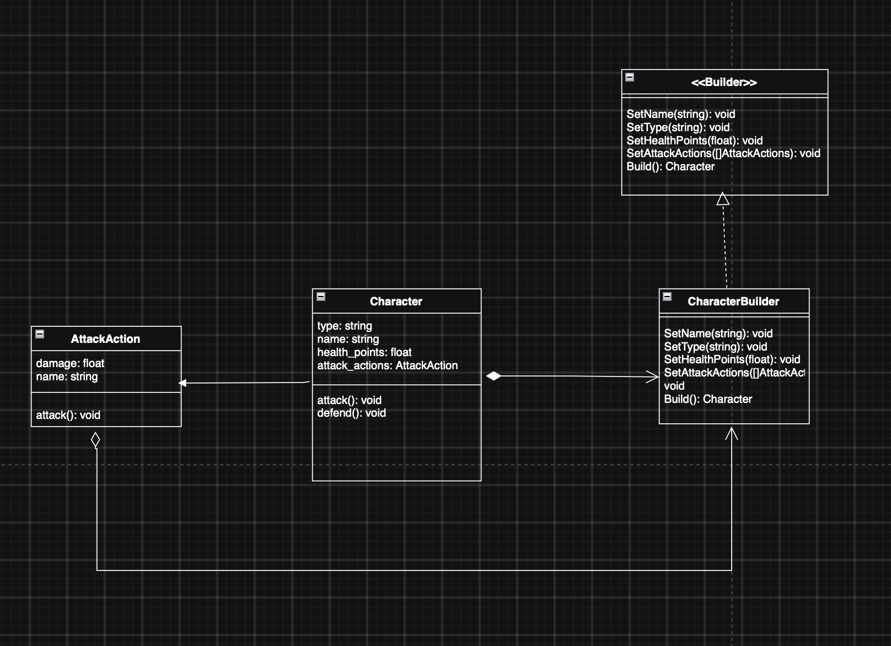

# SubEquipe_01 — GoF Criacional

## Descrição

Artefato do **FOCO_01: GoFs Criacionais & IA Generativa**, sob responsabilidade da SubEquipe_01. Documenta a aplicação de um padrão de projeto GoF Criacional ao **G4_ProjetoJogo**, com o contexto do problema, a modelagem na notação UML, o código e o vídeo com o padrão em execução.

Os padrões criacionais abstraem o processo de criação de objetos, tornando o sistema independente de como seus objetos são criados, compostos e representados (GAMMA et al., 2000). Pertencem a essa categoria os padrões Abstract Factory, Builder, Factory Method, Prototype e Singleton.

> **Página em elaboração.** A estrutura segue o [Artefato Padrão](/Guias/ArtefatoPadrao.md) e as seções exigidas pelo modelo da disciplina. Substitua cada trecho marcado com *A preencher* e remova esta nota quando o artefato estiver concluído.

## Objetivo

Atender à entrega mínima do foco: **um GoF Criacional, com modelo, código e vídeo com o padrão em execução**. Além disso, justificar a escolha do padrão com base na literatura e manter os elos com os artefatos das entregas anteriores.

## Metodologia

*A preencher: como ocorreu o trabalho em equipe neste foco.* Registre as reuniões realizadas, com link para as [atas do Subgrupo 01](/Atas/SubEquipe_01.md), os critérios usados para escolher o padrão, as ferramentas de modelagem e de desenvolvimento, a divisão de tarefas e a forma de revisão. Vídeos das reuniões ajudam a evidenciar o processo.

## Conteúdo

### Padrão Escolhido

| Item | Descrição |
|------|-----------|
| Padrão | Builder |
| Categoria | GoF Criacional |
| Intenção do padrão | Separar a construção de um objeto complexo da sua representação, de modo que o mesmo processo de construção possa criar diferentes representações (GAMMA et al., 2000). |
| Justificativa da escolha | Um personagem do jogo tem vários atributos opcionais (nome, tipo, pontos de vida e ações de ataque), e cada personagem usa uma combinação diferente deles. O Builder monta o objeto passo a passo e evita construtores com muitos parâmetros ou uma variação para cada combinação. O Factory Method e o Abstract Factory decidem qual classe instanciar, mas não montam o objeto por partes; o Prototype depende de um objeto pronto para clonar; e o Singleton garante uma única instância, o que não serve para criar vários personagens. |

<p align="center">Tabela 1: Padrão escolhido pela SubEquipe_01. Fonte: Autores, 2026.</p>

### Contexto (Problema)

O padrão de projeto Builder permite criar instâncias de uma classe por partes: os atributos são definidos um a um no builder e o objeto só é criado quando o método `Build()` é chamado. No **G4_ProjetoJogo**, o objetivo é usar esse padrão para mostrar como os personagens do jogo são criados.

Um personagem (`Character`) pode ter nome, tipo, pontos de vida e uma lista de ações de ataque (`AttackAction`), e nenhum desses atributos é obrigatório. Sem o padrão, a classe precisaria de um construtor com todos os parâmetros, exigindo valores "vazios" para o que não se quer incluir, ou de vários construtores, um para cada combinação. Com o Builder, quem cria o personagem chama apenas os métodos `Set...` dos atributos que deseja e, ao final, recebe o objeto pronto pelo `Build()`.

### Modelagem (Notação UML)

A Figura 1 apresenta o diagrama de classes do padrão aplicado à criação de personagens.



<p align="center">Figura 1: Diagrama de classes do padrão Builder na criação de personagens. Fonte: MAGIOLI, Gabriel, 2026.</p>

| Classe do modelo | Papel no padrão | Responsabilidade |
|------------------|-----------------|------------------|
| `<<Builder>>` | Builder | Interface que declara os passos de construção (`SetName`, `SetType`, `SetHealthPoints`, `SetAttackActions`) e o `Build()`. |
| `CharacterBuilder` | ConcreteBuilder | Implementa a interface, guarda as partes recebidas e entrega o `Character` montado no `Build()`. |
| `Character` | Product | O personagem criado, com `attack()` e `defend()`. |
| `AttackAction` | Parte do produto | Ação de ataque com nome e dano, usada pelo `Character` e repassada ao builder. |

<p align="center">Tabela 2: Participantes do padrão Builder no modelo. Fonte: Autores, 2026.</p>

### Implementação (Código & Vídeo com Padrão em Execução)

O código deste foco fica em `src/criacional/`, conforme a organização descrita no [README de `src/`](https://github.com/UnBArqDsw2026-2-Turma01/2026.2-T01-G4_ProjetoJogo_Entrega_03/blob/main/src/README.md).

#### Código

O código está em [`src/criacional/builder/`](https://github.com/UnBArqDsw2026-2-Turma01/2026.2-T01-G4_ProjetoJogo_Entrega_03/tree/main/src/criacional/builder). É um programa de terminal em C++17, sem dependências externas. Ao executá-lo, o programa mostra cada atributo do personagem e o usuário digita **1** para incluí-lo ou **0** para deixá-lo de fora. Para cada atributo incluído, o programa pede o valor e o repassa ao builder. No final, o `Build()` entrega o personagem, que é exibido e executa `attack()` e `defend()`.

**Builder** ([`builder.h`](https://github.com/UnBArqDsw2026-2-Turma01/2026.2-T01-G4_ProjetoJogo_Entrega_03/blob/main/src/criacional/builder/src/builder.h)): classe abstrata com os métodos virtuais puros do modelo. O cliente depende só dessa interface, então outro builder concreto poderia ser trocado sem mudar o menu.

```cpp
class Builder {
public:
    virtual ~Builder() = default;

    virtual void SetName(const string& name) = 0;
    virtual void SetType(const string& type) = 0;
    virtual void SetHealthPoints(float health_points) = 0;
    virtual void SetAttackActions(const vector<AttackAction>& attack_actions) = 0;
    virtual Character Build() = 0;
};
```

**CharacterBuilder** ([`character_builder.h`](https://github.com/UnBArqDsw2026-2-Turma01/2026.2-T01-G4_ProjetoJogo_Entrega_03/blob/main/src/criacional/builder/src/character_builder.h) e [`.cpp`](https://github.com/UnBArqDsw2026-2-Turma01/2026.2-T01-G4_ProjetoJogo_Entrega_03/blob/main/src/criacional/builder/src/character_builder.cpp)): guarda cada parte em um `optional`, de forma que um atributo não informado fique explicitamente vazio. O `SetHealthPoints` rejeita valores menores ou iguais a zero. O `Build()` cria o `Character` e reinicia o builder, que pode ser reaproveitado para o próximo personagem.

```cpp
Character CharacterBuilder::Build() {
    Character character(type, name, health_points, attack_actions);
    Reset();
    return character;
}
```

**Character** ([`character.h`](https://github.com/UnBArqDsw2026-2-Turma01/2026.2-T01-G4_ProjetoJogo_Entrega_03/blob/main/src/criacional/builder/src/character.h) e [`.cpp`](https://github.com/UnBArqDsw2026-2-Turma01/2026.2-T01-G4_ProjetoJogo_Entrega_03/blob/main/src/criacional/builder/src/character.cpp)): o produto. O `attack()` executa cada `AttackAction` do personagem (ou avisa que ele não tem ações) e o `defend()` informa os pontos de vida, quando existem. O `Describe()` lista os atributos e marca como "(nao incluido)" os que ficaram de fora.

**AttackAction** ([`attack_action.h`](https://github.com/UnBArqDsw2026-2-Turma01/2026.2-T01-G4_ProjetoJogo_Entrega_03/blob/main/src/criacional/builder/src/attack_action.h) e [`.cpp`](https://github.com/UnBArqDsw2026-2-Turma01/2026.2-T01-G4_ProjetoJogo_Entrega_03/blob/main/src/criacional/builder/src/attack_action.cpp)): uma ação com `name` e `damage`, cujo `attack()` exibe o dano causado.

**TerminalMenu** ([`terminal_menu.h`](https://github.com/UnBArqDsw2026-2-Turma01/2026.2-T01-G4_ProjetoJogo_Entrega_03/blob/main/src/criacional/builder/src/terminal_menu.h) e [`.cpp`](https://github.com/UnBArqDsw2026-2-Turma01/2026.2-T01-G4_ProjetoJogo_Entrega_03/blob/main/src/criacional/builder/src/terminal_menu.cpp)): o cliente do padrão. Recebe um `Builder&` e só chama o passo de construção de cada atributo que o usuário marcou com 1. Entradas inválidas, como uma opção diferente de 0 e 1 ou pontos de vida não positivos, são pedidas novamente.

```cpp
if (AskInclude("nome")) {
    builder.SetName(AskText("  Nome: "));
}
if (AskInclude("tipo")) {
    builder.SetType(AskText("  Tipo: "));
}
```

Em relação ao modelo, o código acrescenta métodos de leitura (`Get...`) para os testes, o `Describe()` para exibir o personagem e o parâmetro de saída em `attack()` e `defend()`, que por padrão é o terminal. O `TerminalMenu` não aparece no diagrama, porque é o cliente que usa o padrão e não um participante dele.

#### Como rodar e testar

Pré-requisitos: um compilador com suporte a C++17 (`g++` ou `clang++`) e o `make`. No Windows, use o MSYS2/MinGW ou o WSL.

```bash
cd src/criacional/builder
make run
```

Todos os arquivos usam `#include <bits/stdc++.h>` e `using namespace std;`. Como esse cabeçalho só existe no GCC (o `g++` do macOS é o Apple clang, que não o tem), o projeto traz uma versão própria em [`include/bits/stdc++.h`](https://github.com/UnBArqDsw2026-2-Turma01/2026.2-T01-G4_ProjetoJogo_Entrega_03/blob/main/src/criacional/builder/include/bits/stdc++.h), que reúne os cabeçalhos padrão. Por isso a compilação usa `-Iinclude`, já configurado no `Makefile`.

Sem o `make`, compile direto:

```bash
cd src/criacional/builder
g++ -std=c++17 -Iinclude src/*.cpp -o builder
./builder
```

Exemplo de uma sessão, incluindo nome, pontos de vida e uma ação de ataque e deixando o tipo de fora:

```text
Atributos disponiveis: nome, tipo, pontos de vida, acoes de ataque
Incluir nome? (1 = sim, 0 = nao): 1
  Nome: Arthas
Incluir tipo? (1 = sim, 0 = nao): 0
Incluir pontos de vida? (1 = sim, 0 = nao): 1
  Pontos de vida: 120
Incluir acoes de ataque? (1 = sim, 0 = nao): 1
  Quantidade de acoes: 1
  Nome da acao 1: Golpe de espada
  Dano da acao 1: 25

--- Personagem criado ---
Nome: Arthas
Tipo: (nao incluido)
Pontos de vida: 120
Acoes de ataque:
  - Golpe de espada (25 de dano)
```

Os testes ficam em [`tests/tests.cpp`](https://github.com/UnBArqDsw2026-2-Turma01/2026.2-T01-G4_ProjetoJogo_Entrega_03/blob/main/src/criacional/builder/tests/tests.cpp) e rodam com:

```bash
cd src/criacional/builder
make test
```

São 27 verificações, que cobrem a montagem completa e parcial do personagem, o reinício do builder após o `Build()`, a validação dos pontos de vida, os comportamentos `attack()` e `defend()` e o menu interativo, alimentado por uma entrada simulada (incluindo entradas inválidas). A saída termina com `27/27 verificacoes passaram`.

#### Vídeo

O Vídeo 1 mostra o programa rodando com `make run`: o usuário inclui o nome, o tipo e os pontos de vida digitando 1, deixa as ações de ataque de fora digitando 0, e o `CharacterBuilder` entrega o personagem montado só com as partes escolhidas, que em seguida executa `attack()` e `defend()`.

<div style="max-width:960px;margin:0 auto;">
  <video controls preload="metadata" style="width:100%;border-radius:6px;background:#000;" src="Base/Relatórios/SubEquipe_01/assets/gravacao-builder.mp4"></video>
</div>

<p align="center">Vídeo 1: Padrão Builder na criação de personagens, em execução no terminal. Fonte: MAGIOLI, Gabriel, 2026. <a href="Base/Relatórios/SubEquipe_01/assets/gravacao-builder.mp4" target="_blank">Link direto para o vídeo</a>.</p>

### Rastreabilidade

| Artefato relacionado | Elo com este padrão |
|----------------------|---------------------|
| [Diagrama de Classes da Entrega 02](https://unbarqdsw2026-2-turma01.github.io/2026.2-T01-G4_ProjetoJogo_Entrega_02/#/Base/Relatórios/SubEquipe_01/DiagramaClasses) | *A preencher: classes, fluxos ou decisões reaproveitados.* |
| [Ata Geral 04](/Atas/AtaGeral04.md) | Decisão do grupo que atribuiu o padrão criacional ao Subgrupo 01. |
| [Atas do Subgrupo 01](/Atas/SubEquipe_01.md) | *A preencher: decisões que originaram o artefato.* |

<p align="center">Tabela 3: Elos com outros artefatos. Fonte: Autores, 2026.</p>

## Referências

> GAMMA, Erich; HELM, Richard; JOHNSON, Ralph; VLISSIDES, John. **Padrões de Projeto**: soluções reutilizáveis de software orientado a objetos. Porto Alegre: Bookman, 2000.

> LARMAN, Craig. **Utilizando UML e Padrões**: uma introdução à análise e ao projeto orientados a objetos e ao desenvolvimento iterativo. 3. ed. Porto Alegre: Bookman, 2007.

> REFACTORING.GURU. **Builder**. Disponível em: https://refactoring.guru/pt-br/design-patterns/builder. Acesso em: 17 out. 2026.

> SERRANO, Milene; SERRANO, Maurício. **Arquitetura e Desenho de Software**. Universidade de Brasília, 2026.

## Nível de Contribuição dos Integrantes

| Nome | % de Contribuição |
|------|-------------------|
| Cibelly Lourenço Ferreira | *A preencher* |
| Gabriel Andrade Magioli | 33% |
| Yogi Nam de Souza Barbosa | *A preencher* |

<p align="center">Tabela 4: Contribuição dos integrantes.</p>

## Histórico de Versão

| Versão | Data | Descrição | Autor(es) | Revisor |
|:------:|------|:----------|:----------|:--------|
| 1.0 | 17/10/2026 | Inclusão do padrão Builder: contexto, modelagem UML, código C++ interativo e instruções de execução e testes | Gabriel Andrade Magioli | |
| 1.1 | 17/10/2026 | Inclusão do vídeo do padrão Builder em execução | Gabriel Andrade Magioli | |

<p align="center">Tabela 5: Histórico de versão.</p>
