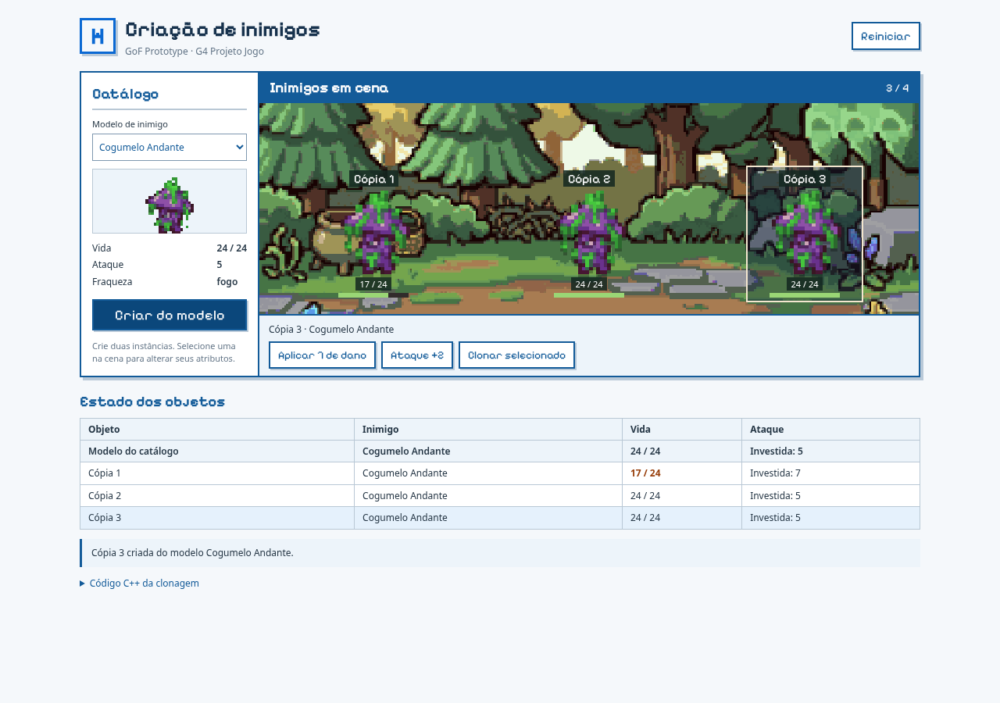
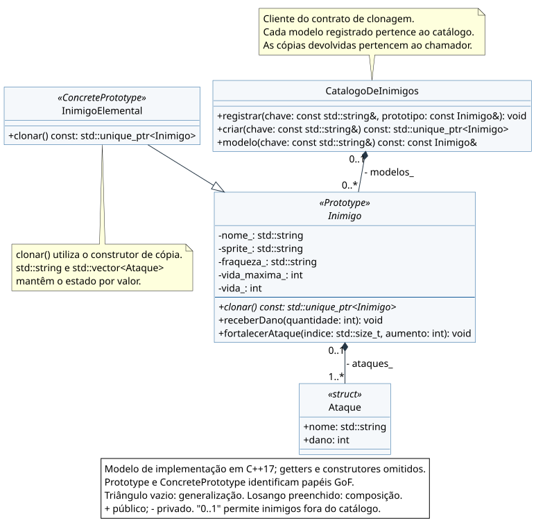
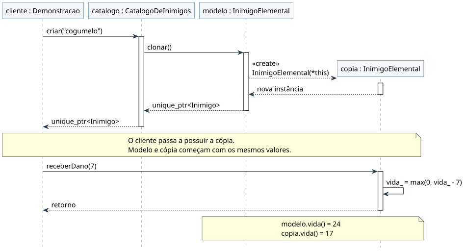

# Prototype na criação de inimigos

## Descrição

Um modelo de inimigo pode originar várias instâncias com os mesmos atributos. Depois da criação, cada uma precisa manter seu próprio estado: ferir um cogumelo ou fortalecer seu ataque deve afetar somente aquele inimigo.

Este artefato aplica o **GoF criacional Prototype** a esse problema do **G4_ProjetoJogo**. A contribuição de **Yogi Nam de Souza Barbosa**, no FOCO_01, reúne UML, código **C++17**, testes e execução visual do mesmo código compilado para WebAssembly.

<p><a href="Base/Relatórios/SubEquipe_01/prototype/index.html" target="_blank" rel="noopener"><strong>Abrir demonstração ↗</strong></a> · <a href="Base/Relatórios/SubEquipe_01/assets/prototype/gravacao-prototype.webm" target="_blank" rel="noopener">Assistir ao vídeo</a></p>



<p align="center">Figura 1: Comparação dos objetos durante a execução. Fonte: Yogi Nam de Souza Barbosa, 2026. Cenário e sprites reutilizados dos assets do projeto, com procedência registrada no README do código.</p>

## Objetivo

Criar inimigos por clonagem de objetos configurados e comprovar três propriedades: a cópia é outro objeto, preserva o estado do objeto escolhido e pode ser alterada independentemente dele. O catálogo permite reutilizar configurações; a clonagem de uma instância ferida mostra que o padrão preserva também o estado atual.

## Metodologia

O recorte partiu do Mapa Mental da Entrega 01, do Diagrama de Classes e da lista de requisitos adotada na Entrega 02. A escolha foi confrontada com a intenção dos padrões criacionais em Gamma et al. (2000) e com o exemplo de clonagem de monstros de Nystrom (2014).

O desenvolvimento individual seguiu a sequência: identificar o problema, definir o contrato de clonagem, implementar em C++17, representar classes e interação em UML e verificar a execução. O núcleo foi compilado tanto para o terminal quanto para WebAssembly. Os testes comparam os resultados dessas duas versões e exercitam a interface. A gravação reproduz o experimento descrito nesta página.

As decisões e correções decorrentes do apoio do Codex estão no [relato de IA Generativa](IAGenerativa.md?id=yogi-nam-de-souza-barbosa). A revisão também alinhou a apresentação às cores, à tipografia e aos assets já usados pela entrega.

## Conteúdo

### Padrão Escolhido

**Prototype, categoria criacional.** Novos objetos são criados pela cópia de um protótipo, preservando seu tipo concreto e seu estado (GAMMA et al., 2000). No exemplo de jogos de Nystrom, a criação é delegada a um monstro configurado, que sabe produzir uma cópia de si próprio. Esse é o papel de `clonar()` nesta aplicação.

| Alternativa | Avaliação para este problema |
|------------|------------------------------|
| **Prototype** | Reutiliza um inimigo configurado e permite copiar uma instância já alterada. |
| Builder | Monta o personagem por etapas. É a aplicação de Gabriel; poderia fornecer objetos para um catálogo de protótipos. |
| Factory Method | Delega a subclasses uma etapa de criação. As espécies deste exemplo diferem por dados, sem exigir uma hierarquia de criadores. |
| Abstract Factory | Cria famílias de produtos relacionados. O recorte trabalha com uma entidade: o inimigo. |
| Singleton | Controla uma única instância. Aqui são necessárias várias instâncias independentes. |

<p align="center">Tabela 1: Comparação dos criacionais no recorte escolhido. Fonte: Yogi Nam de Souza Barbosa, 2026, com base em Gamma et al. (2000).</p>

### Contexto (Problema)

O jogo possui inimigos com pontos de vida, ataques e fraquezas elementares. Espalhar sua configuração pelo cliente repete decisões de criação. Compartilhar o mesmo objeto entre posições de uma cena, por sua vez, faria o dano recebido em uma posição afetar as demais.

`CatalogoDeInimigos` guarda os modelos. Ao receber `criar("cogumelo")`, localiza o protótipo e chama sua operação virtual `clonar()`. O cliente recebe um objeto independente e passa a ser responsável por ele por meio de `std::unique_ptr`.

Cogumelo, gólem e morcego são configurações de `InimigoElemental`. A classe abstrata `Inimigo` permite que o catálogo trabalhe com outros tipos concretos sem alterar sua operação de criação; um teste exercita essa substituição. O [README][codigo] identifica a origem dos dados e os ajustes didáticos de ataques e fraquezas.

### Modelagem (Notação UML)



<p align="center">Figura 2: Classes do núcleo C++17. Fonte: Yogi Nam de Souza Barbosa, 2026. Notação baseada na UML 2.5.1 (OMG, 2017).</p>

[Ampliar classes](Base/Relatórios/SubEquipe_01/assets/prototype/classes.svg ':ignore') · [Fonte PlantUML](Base/Relatórios/SubEquipe_01/assets/prototype/classes.puml ':ignore')

A generalização usa linha contínua e triângulo vazio apontando para a classe abstrata. Os losangos preenchidos indicam composição: o catálogo possui seus modelos e o inimigo possui os valores dos ataques. A multiplicidade `0..1` no extremo do proprietário permite objetos fora daquela composição, como as cópias entregues ao cliente. Os marcadores `«Prototype»` e `«ConcretePrototype»` identificam os papéis GoF; não são tipos adicionais da implementação.

| Elemento | Papel e correspondência no código |
|----------|----------------------------------|
| `Inimigo` | **Prototype:** classe abstrata com `clonar()` virtual puro e destrutor virtual. |
| `InimigoElemental` | **ConcretePrototype:** implementa a clonagem usando seu construtor de cópia. |
| `CatalogoDeInimigos` | Registro de modelos e cliente do contrato `Inimigo::clonar()`. |
| `Ataque` | Objeto de valor com nome e dano, armazenado em `std::vector<Ataque>`. |
| `Demonstracao` | Cliente de aplicação: mantém as cópias, recebe comandos do terminal ou da interface web e permite consultar seu estado. |

<p align="center">Tabela 2: Correspondência entre os participantes e a implementação. Fonte: Yogi Nam de Souza Barbosa, 2026.</p>



<p align="center">Figura 3: Criação de uma cópia e alteração independente do seu estado. Fonte: Yogi Nam de Souza Barbosa, 2026.</p>

[Ampliar sequência](Base/Relatórios/SubEquipe_01/assets/prototype/sequencia.svg ':ignore') · [Fonte PlantUML](Base/Relatórios/SubEquipe_01/assets/prototype/sequencia.puml ':ignore')

Na sequência, a linha de vida da cópia começa na mensagem de criação. O retorno transfere a posse do objeto ao cliente; a operação seguinte modifica somente a instância criada. Os retornos são tracejados e as barras de ativação delimitam as chamadas.

### Implementação (Código & Vídeo com Padrão em Execução)

#### Código C++

O projeto está em [`src/criacional/prototype/`][codigo]. O contrato e a operação principal são:

```cpp
class Inimigo {
public:
    virtual ~Inimigo() = default;
    virtual std::unique_ptr<Inimigo> clonar() const = 0;
    // Atributos e operações de combate no arquivo completo.
};

std::unique_ptr<Inimigo> InimigoElemental::clonar() const {
    return std::make_unique<InimigoElemental>(*this);
}
```

O objeto criado possui o mesmo tipo concreto. O retorno pela interface base mantém o cliente independente da classe escolhida e evita copiar apenas a parte base do objeto (*object slicing*). Essa organização segue a recomendação **C.130** das C++ Core Guidelines: usar uma operação virtual de clonagem para cópia polimórfica.

Os atributos são números, `std::string` e `std::vector<Ataque>`. O construtor de cópia padrão já copia esses membros por valor. Cada vetor possui seus próprios ataques; fortalecer o ataque de uma cópia preserva as demais. Essa propriedade depende dos tipos dos membros: introduzir ponteiros para dados mutáveis compartilhados exigiria revisar a política de cópia.

O catálogo delega a criação ao protótipo:

```cpp
std::unique_ptr<Inimigo> CatalogoDeInimigos::criar(
    const std::string& chave) const {
    return modelo(chave).clonar();
}
```

O registro também clona o objeto recebido, protegendo o modelo de alterações posteriores feitas pelo chamador. A consulta retorna `const Inimigo&`, permitindo leitura sem expor operações de alteração. As instâncias são geridas por `unique_ptr`; a destruição pela interface base é virtual.

#### Demonstração interativa

<iframe src="Base/Relatórios/SubEquipe_01/prototype/index.html" title="Prototype em C++: criação e clonagem de inimigos" width="100%" height="960" style="border:1px solid #135b99;" loading="lazy"></iframe>

<p align="center">Demonstração 1: Núcleo C++ compilado para WebAssembly e apresentado com os assets do jogo. Fonte: Yogi Nam de Souza Barbosa, 2026. <a href="Base/Relatórios/SubEquipe_01/prototype/index.html" target="_blank" rel="noopener">Abrir em janela própria</a>.</p>

A versão visual usa **o mesmo código C++ do terminal**. O Emscripten compila o núcleo; `web.cpp` exporta as funções de comando e leitura. O JavaScript chama essas funções e atualiza a cena e a tabela. A clonagem, o catálogo, o dano e os ataques permanecem no C++ ([integração C++/JavaScript do Emscripten](https://emscripten.org/docs/porting/connecting_cpp_and_javascript/Interacting-with-code.html)).

Roteiro de apresentação:

1. Use **Criar do modelo** duas vezes: vida 24 e ataque 5 nas duas cópias.
2. Selecione a cópia 1 e aplique **7 de dano** e **Ataque +2**: ela passa a 17 e 7; modelo e cópia 2 mantêm 24 e 5.
3. Crie novamente pelo modelo: a cópia 3 começa com 24 e 5.
4. Selecione a cópia 1 e use **Clonar selecionado**: a cópia 4 herda 17 e 7.
5. Cause dano na cópia 4: ela passa a vida 10, enquanto a cópia 1 permanece com 17.

**Clonar preserva o estado atual; criar pelo catálogo copia o modelo preservado.** Os números das cópias identificam os objetos na cena. O limite de quatro instâncias mantém a comparação legível.

#### Vídeo

<video controls preload="metadata" poster="Base/Relatórios/SubEquipe_01/assets/prototype/demonstracao.png" style="width:100%;border:1px solid #135b99;" src="Base/Relatórios/SubEquipe_01/assets/prototype/gravacao-prototype.webm"></video>

<p align="center">Vídeo 1: Execução da demonstração C++/WebAssembly, seguindo o roteiro acima. Fonte: Yogi Nam de Souza Barbosa, 2026. Captura de navegador realizada pelo roteiro automatizado de interface. <a href="Base/Relatórios/SubEquipe_01/assets/prototype/gravacao-prototype.webm" target="_blank" rel="noopener">Abrir ou baixar WebM</a>.</p>

#### Execução e verificação

Com compilador C++17 e Make, na raiz do repositório:

```bash
make -C src/criacional/prototype run
make -C src/criacional/prototype test
```

Para recompilar a apresentação web, use o Emscripten **4.0.23** e Python 3. O navegador executa a versão já publicada inclusive offline. As instruções completas de compilação e gravação estão no [README][codigo].

```bash
make -C src/criacional/prototype publish
make -C src/criacional/prototype check
node src/criacional/prototype/tests/paridade.cjs
```

**Resultados: 13 casos nativos aprovados e oito estados idênticos entre C++ nativo e WebAssembly.** A [saída dos testes](Base/Relatórios/SubEquipe_01/assets/prototype/testes.txt ':ignore') acompanha o artefato.

| Verificação | Resultado exigido |
|-------------|-------------------|
| Identidade e tipo | Novo endereço, mesmo tipo concreto e valores preservados. |
| Independência | Dano e fortalecimento alteram apenas a instância escolhida; vetores e ataques possuem armazenamento próprio. |
| Estado atual | Uma cópia ferida ou derrotada mantém seu estado ao ser clonada. |
| Catálogo e polimorfismo | Alterar o objeto registrado preserva o modelo; outro protótipo funciona pelo mesmo contrato. |
| Entradas e limites | Valores inválidos e excesso de cópias são recusados preservando o estado. |
| Paridade | Oito comandos geram os mesmos dados no executável nativo e no módulo web. |
| Interface | Três modelos, seleção, quatro cópias, teclado, reinício, imagens e larguras de 360, 390, 768 e 1280 pixels. |
| Publicação | Arquivos da interface e módulo coincidem com a publicação; manifesto SHA-256 identifica os fontes C++ compilados. |

<p align="center">Tabela 3: Critérios de verificação, executados em 19/10/2026. Fonte: testes do artefato.</p>

### Análise Crítica

O benefício do Prototype é manter a criação junto do objeto que conhece seu próprio estado. O teste com uma instância ferida distingue a clonagem de uma simples criação com valores iniciais. A comparação dos ataques verifica uma condição que a aparência de duas figuras iguais não comprova.

O custo cresce com os dados copiados: cada inimigo possui seu próprio vetor de ataques. Para apenas três configurações fixas, uma função de criação também seria suficiente. O Prototype se justifica neste estudo pelo contrato polimórfico e pela possibilidade de copiar instâncias modificadas. A discussão de alternativas em Nystrom (2014) sustenta essa escolha sem tratar o padrão como solução obrigatória para todo jogo.

O catálogo é um apoio à aplicação; o mecanismo essencial continua sendo `clonar()`. Os controles de dano fixo e fortalecimento tornam observável a independência dos objetos. A interface e a compilação web permitem apresentar o C++ diretamente no GitPages, enquanto a versão de terminal mantém a reprodução simples com o compilador da linguagem.

### Rastreabilidade

| Origem | Elo concreto com o artefato |
|--------|----------------------------|
| [Mapa Mental da Entrega 01][mapa] | Inimigos, combate em turnos e elementos químicos situam o problema. |
| [Diagrama de Classes da Entrega 02][classes-e2] | `Inimigo`, atributos de combate e fraqueza elemental orientam os dados copiados. A hierarquia Prototype é uma decisão desta entrega. |
| [Requisitos do Subgrupo 03 adotados na Entrega 02][requisitos] | **RF13:** fraquezas elementares; **RF17:** estatísticas dos inimigos. A clonagem preserva esses dados. Os identificadores se referem à lista vinculada. |
| [Dados de inimigos da Entrega 03][dados-jogo] | Nomes, PV e ataques selecionados fundamentam os modelos. Origem e ajustes didáticos estão descritos no README. |
| [Ata Geral 04](/Atas/AtaGeral04.md) | Organização dos focos criacional, estrutural e comportamental. |
| [Builder](Builder.md) e [visão geral](GoFCriacional.md) | Relacionam montagem por etapas e criação por cópia dentro do FOCO_01. |
| [Código e testes][codigo] · [commit 735073c](https://github.com/UnBArqDsw2026-2-Turma01/2026.2-T01-G4_ProjetoJogo_Entrega_03/commit/735073c689a9ebfd0a236ebe292e1f599e286a8b) | Implementação C++ e evidências reproduzíveis de comportamento, vinculadas à revisão utilizada no artefato. |
| [Participações](/Base/1.2.ParticipacoesPadroesDeProjeto.md) e [IA Generativa](IAGenerativa.md?id=yogi-nam-de-souza-barbosa) | Responsabilidade pelo artefato, decisões e avaliação da assistência utilizada. |

<p align="center">Tabela 4: Rastreabilidade do Prototype. Fonte: artefatos vinculados, organizados por Yogi Nam de Souza Barbosa, 2026.</p>

## Referências

> GAMMA, Erich; HELM, Richard; JOHNSON, Ralph; VLISSIDES, John. **Padrões de Projeto**: soluções reutilizáveis de software orientado a objetos. Porto Alegre: Bookman, 2000. Padrões criacionais: Prototype.

> NYSTROM, Robert. **Game Programming Patterns**. 2014. Capítulo Prototype. Disponível em: https://gameprogrammingpatterns.com/prototype.html. Acesso em: 19 out. 2026.

> STROUSTRUP, Bjarne; SUTTER, Herb (ed.). **C++ Core Guidelines**. Regra C.130: clonagem de classes polimórficas. Disponível em: https://isocpp.github.io/CppCoreGuidelines/CppCoreGuidelines#c130-for-making-deep-copies-of-polymorphic-classes-prefer-a-virtual-clone-function-instead-of-public-copy-constructionassignment. Acesso em: 19 out. 2026.

> OBJECT MANAGEMENT GROUP. **Unified Modeling Language, version 2.5.1**. 2017. Disponível em: https://www.omg.org/spec/UML/2.5.1. Acesso em: 19 out. 2026.

> EMSCRIPTEN CONTRIBUTORS. **Interacting with code**. Disponível em: https://emscripten.org/docs/porting/connecting_cpp_and_javascript/Interacting-with-code.html. Acesso em: 19 out. 2026.

## Nível de Contribuição dos Integrantes

| Nome | Contribuição neste artefato |
|------|----------------------------|
| Yogi Nam de Souza Barbosa | Responsável pelo Prototype: código, UML, demonstração, testes, vídeo e documentação. Assistência de IA registrada no relato individual. |

<p align="center">Tabela 5: Participação no artefato Prototype.</p>

## Histórico de Versão

| Versão | Data | Descrição | Autor(es) | Revisor |
|:------:|------|-----------|-----------|---------|
| 1.0 | 19/10/2026 | Aplicação inicial do Prototype, UML, demonstração, testes, vídeo e rastreabilidade. | Yogi Nam de Souza Barbosa | — |
| 1.1 | 19/10/2026 | Implementação C++17 nativa e WebAssembly, revisão UML, sequência de clonagem, interface alinhada ao jogo, novo vídeo e testes de paridade. | Yogi Nam de Souza Barbosa | — |

<p align="center">Tabela 6: Histórico de versão.</p>

[codigo]: https://github.com/UnBArqDsw2026-2-Turma01/2026.2-T01-G4_ProjetoJogo_Entrega_03/tree/735073c689a9ebfd0a236ebe292e1f599e286a8b/src/criacional/prototype
[mapa]: https://unbarqdsw2026-2-turma01.github.io/2026.2-T01-G4_ProjetoJogo_Entrega_01/#/Base/Relatórios/SubEquipe_03/MapaMental.md
[classes-e2]: https://unbarqdsw2026-2-turma01.github.io/2026.2-T01-G4_ProjetoJogo_Entrega_02/#/Base/Relatórios/SubEquipe_01/DiagramaClasses.md
[requisitos]: https://github.com/UnBArqDsw2026-2-Turma01/2026.2-T01-G4_ProjetoJogo_Entrega_02/blob/3c2f767ea022f938663d67236e7256513e2c8012/docs/Base/Relatórios/SubEquipe_01/assets/referencias/requisitos-subgrupo03.txt
[dados-jogo]: https://github.com/UnBArqDsw2026-2-Turma01/2026.2-T01-G4_ProjetoJogo_Entrega_03/blob/9c4e632/src/estrutural/data/inimigos.json
