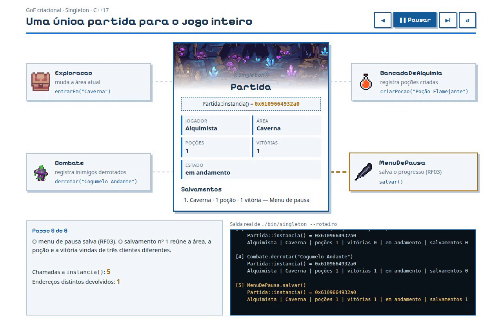
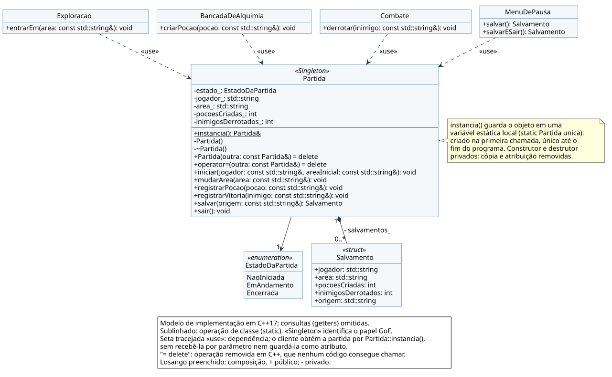
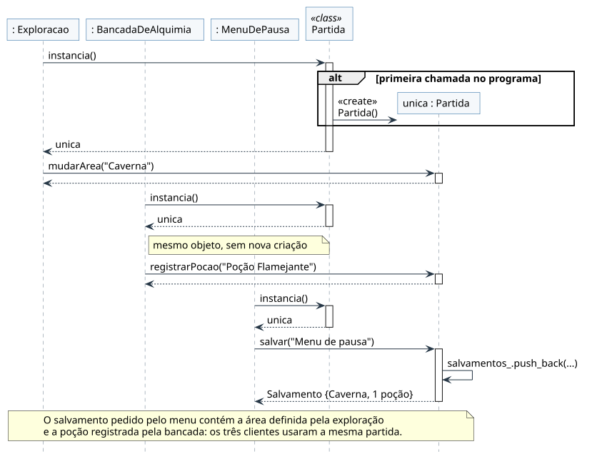

# Singleton na partida do jogo

## Descrição

Durante uma sessão do **G4_ProjetoJogo**, várias partes do jogo mexem no mesmo progresso: a exploração muda a área atual, a bancada de alquimia conta as poções criadas, o combate conta os inimigos derrotados e o menu de pausa salva tudo isso (RF03). Se cada parte tivesse a sua própria `Partida`, o salvamento guardaria apenas um pedaço do progresso.

Este artefato aplica o **GoF criacional Singleton** a esse problema. A contribuição de **Cibelly Lourenço Ferreira**, no FOCO_01, reúne UML de classes e de sequência, código **C++17**, testes, uma visualização da execução e vídeo.

<p><a href="Base/Relatórios/SubEquipe_01/singleton/index.html" target="_blank" rel="noopener"><strong>Abrir visualização ↗</strong></a> · <a href="Base/Relatórios/SubEquipe_01/assets/singleton/gravacao-singleton.webm" target="_blank" rel="noopener">Assistir ao vídeo</a></p>



<p align="center">Figura 1: Quatro clientes usando a mesma partida durante a execução. Fonte: Cibelly Lourenço Ferreira, 2026. Cenários e sprites reutilizados dos assets do projeto.</p>

## Objetivo

Garantir que exista **uma única `Partida`** durante a execução e que qualquer parte do jogo consiga alcançá-la sem recebê-la por parâmetro. A aplicação deve comprovar três coisas:

1. todas as chamadas a `Partida::instancia()` devolvem o mesmo objeto;
2. clientes que não se conhecem enxergam e alteram o mesmo progresso;
3. nenhum código fora da classe consegue criar, copiar ou destruir uma `Partida`, e isso é barrado pelo compilador, não por convenção.

## Metodologia

O trabalho foi individual, dentro da divisão do foco criacional registrada na [Ata Geral 04](/Atas/AtaGeral04.md): Gabriel ficou com o Builder, Yogi com o Prototype e eu com o Singleton. O Subgrupo 01 não fez reunião própria nesta entrega; a combinação foi feita por mensagens, e por isso não há ata de subgrupo.

As etapas foram:

1. **Escolher o objeto.** Revisei os artefatos anteriores procurando algo que precisasse ser único. A classe `Partida`, do [Diagrama de Classes da Entrega 02][classes-e2], que eu modelei, já era descrita como a "sessão de jogo que coordena o fluxo geral e o salvamento". O [Diagrama de Componentes][componentes-e2] coloca o Controle da Partida no centro, coordenando mundo, combate e progressão.
2. **Confrontar com a literatura.** Comparei a escolha com a intenção do padrão em Gamma et al. (2000) e com as críticas de Nystrom (2014) e da regra I.3 das C++ Core Guidelines, que recomendam evitar Singletons quando não há real necessidade de unicidade.
3. **Implementar em C++17**, na mesma linguagem do Builder e do Prototype, sem dependências externas.
4. **Modelar em UML** a estrutura (classes) e a interação (sequência), conferindo cada elemento com o código.
5. **Verificar**: testes automatizados, um arquivo que *não deve* compilar e execução com sanitizadores de memória e de threads.
6. **Mostrar em execução**: o programa gera um roteiro em JSON, e a visualização apenas exibe esse roteiro. O vídeo grava a visualização.

O uso de IA generativa nesse processo e as críticas que fiz às sugestões estão no [relato de IA Generativa](IAGenerativa.md?id=cibelly-lourenço-ferreira).

## Conteúdo

### Padrão Escolhido

**Singleton, categoria criacional.** Intenção: *garantir que uma classe tenha somente uma instância e fornecer um ponto global de acesso a ela* (GAMMA et al., 2000). Os autores citam exatamente o caso de objetos que representam algo único no sistema e que precisam ser acessados de vários lugares.

| Alternativa | Avaliação para este problema |
|------------|------------------------------|
| **Singleton** | Garante pelo compilador que existe uma só partida e dá acesso a ela de qualquer parte do jogo. |
| Builder | Monta um objeto por etapas (aplicação do Gabriel). A partida não tem montagem complexa: começa com nome e área. |
| Prototype | Cria objetos copiando um modelo (aplicação do Yogi). Aqui a cópia é justamente o que **não** pode acontecer. |
| Factory Method / Abstract Factory | Escolhem qual classe instanciar. Existe só um tipo de partida; o problema é quantas instâncias existem, e não qual classe criar. |
| Variável global comum | Também dá acesso global, mas não impede que alguém crie uma segunda `Partida`, e a ordem de inicialização entre arquivos não é garantida. |

<p align="center">Tabela 1: Comparação dos criacionais no recorte escolhido. Fonte: Cibelly Lourenço Ferreira, 2026, com base em Gamma et al. (2000).</p>

### Contexto (Problema)

O jogo é *single-player*: existe um jogador e uma sessão em andamento. A [lista de requisitos adotada na Entrega 02][requisitos] pede no **RF03** que seja possível "salvar e sair do jogo em todas as áreas". O [BPMN de exploração da Entrega 01][bpmn-e01] descreve o salvamento como "gravando os dados atuais e a localização". Isso cria duas exigências:

- **o progresso precisa ser um só**: área, poções e vitórias vêm de partes diferentes do jogo e precisam terminar no mesmo salvamento;
- **o acesso precisa estar em todo lugar**: qualquer área, tela ou mecânica pode pedir para salvar.

Sem o padrão, haveria duas saídas ruins: passar a partida por parâmetro por toda a cadeia de chamadas, inclusive por objetos que não a usam, ou deixar cada parte criar a sua, fragmentando o progresso. A visualização mostra esse segundo caso como ilustração: o menu de pausa salvaria "Floresta, 0 poções, 0 vitórias", perdendo tudo que a exploração, a bancada e o combate fizeram.

Os nomes usados no exemplo vêm do próprio jogo: as áreas Floresta e Caverna (cenários de combate), a Poção Flamejante e os inimigos Cogumelo Andante e Gólem de Enxofre ([`inimigos.json`][dados-inimigos] e [`alquimia.json`][dados-alquimia]).

### Modelagem (Notação UML)

#### Diagrama de classes



<p align="center">Figura 2: Classes do Singleton aplicado à partida. Fonte: Cibelly Lourenço Ferreira, 2026. Notação baseada na UML 2.5.1 (OMG, 2017).</p>

[Ampliar classes](Base/Relatórios/SubEquipe_01/assets/singleton/classes.svg ':ignore') · [Fonte PlantUML](Base/Relatórios/SubEquipe_01/assets/singleton/classes.puml ':ignore')

A operação `instancia()` aparece **sublinhada** por ser uma operação de classe (`static`). Construtor e destrutor têm visibilidade privada (`-`). Os clientes se ligam à `Partida` por **dependência** (seta tracejada com `«use»`) e não por associação: nenhum deles guarda a partida como atributo, apenas a obtém quando precisa. O losango preenchido indica que os salvamentos pertencem à partida.

No diagrama de Gamma et al. (2000), a instância única aparece como um atributo estático (`uniqueInstance`). Aqui ela é uma **variável estática local** dentro de `instancia()`, por isso não aparece como atributo; a nota do diagrama registra essa diferença para que o modelo continue fiel ao código.

| Elemento | Papel e correspondência no código |
|----------|----------------------------------|
| `Partida` | **Singleton.** Guarda o progresso da sessão e oferece `instancia()` como único ponto de acesso. |
| `Exploracao`, `BancadaDeAlquimia`, `Combate`, `MenuDePausa` | **Clientes.** Partes do jogo que não se conhecem e chamam `Partida::instancia()` diretamente. |
| `Salvamento` | Fotografia do progresso (jogador, área, poções, vitórias e origem), guardada por valor. |
| `EstadoDaPartida` | Enumeração `NaoIniciada`, `EmAndamento`, `Encerrada`. Substitui o `estado: String` do diagrama da Entrega 02. |

<p align="center">Tabela 2: Participantes e correspondência com a implementação. Fonte: Cibelly Lourenço Ferreira, 2026.</p>

#### Diagrama de sequência



<p align="center">Figura 3: Três clientes obtendo a mesma partida. Fonte: Cibelly Lourenço Ferreira, 2026.</p>

[Ampliar sequência](Base/Relatórios/SubEquipe_01/assets/singleton/sequencia.svg ':ignore') · [Fonte PlantUML](Base/Relatórios/SubEquipe_01/assets/singleton/sequencia.puml ':ignore')

O fragmento `alt` mostra que a criação só ocorre na **primeira** chamada: a linha de vida de `unica : Partida` começa ali. As chamadas seguintes devolvem o mesmo objeto, sem nova mensagem `«create»`. A nota final resume o efeito do padrão: o salvamento pedido pelo menu contém dados que ele nunca recebeu diretamente.

#### Mudanças em relação à Entrega 02

| Entrega 02 (`Partida`) | Entrega 03 | Motivo |
|------------------------|-----------|--------|
| `estado : String` | `estado_ : EstadoDaPartida` | Uma enumeração impede estados inválidos, como uma palavra digitada errada. |
| `iniciar()`, `salvar()`, `sair()` | Mantidas, com parâmetros | O salvamento agora devolve um `Salvamento` e registra de onde foi pedido. |
| `processarComando(cmd)` | Fora deste recorte | Tratar entradas do jogador é responsabilidade da camada de entrada, trabalhada no [Bridge da SubEquipe 02](/Base/Relatórios/SubEquipe_02/Bridge.md). |
| Construtor público implícito | `instancia()` + construtor privado | É a decisão do padrão: a unicidade passa a ser garantida pela própria classe. |

<p align="center">Tabela 3: Evolução da classe Partida desde a Entrega 02. Fonte: Cibelly Lourenço Ferreira, 2026, a partir do <a href="https://unbarqdsw2026-2-turma01.github.io/2026.2-T01-G4_ProjetoJogo_Entrega_02/#/Base/Relatórios/SubEquipe_01/DiagramaClasses.md" target="_blank" rel="noopener">Diagrama de Classes da Entrega 02</a>.</p>

### Implementação (Código & Vídeo com Padrão em Execução)

#### Código C++

O projeto está em [`src/criacional/singleton/`][codigo].

| Arquivo | Conteúdo |
|---------|----------|
| [`src/partida.hpp`][partida-hpp] e [`.cpp`][partida-cpp] | O Singleton: `Partida`, `Salvamento` e `EstadoDaPartida`. |
| [`src/clientes.hpp`][clientes-hpp] e [`.cpp`][clientes-cpp] | Os quatro clientes, cada um com poucas linhas. |
| [`src/main.cpp`][main] | Menu interativo no terminal e roteiro fixo (`--demo` e `--roteiro`). |
| [`tests/testes.cpp`][testes] | Oito testes e seis verificações em tempo de compilação. |
| [`tests/nao_compila.cpp`][nao-compila] | Arquivo que **precisa falhar** na compilação. |

<p align="center">Tabela 4: Organização do código. Fonte: Cibelly Lourenço Ferreira, 2026.</p>

**1. Só a classe cria a si mesma.** O construtor e o destrutor são privados; cópia e atribuição foram removidas com `= delete`. Como o construtor de cópia foi declarado, o C++ também deixa de gerar o construtor e a atribuição de movimento.

```cpp
class Partida {
public:
    static Partida& instancia();

    Partida(const Partida&) = delete;
    Partida& operator=(const Partida&) = delete;
    // ... operações da partida ...

private:
    Partida() = default;
    ~Partida() = default;
};
```

**2. O ponto de acesso.** A instância é uma variável estática local, conhecida como *Meyers Singleton* (MEYERS, 2005, item 4). Ela é criada na primeira chamada e destruída automaticamente ao fim do programa, sem `new` nem `delete`. Desde o C++11, o padrão da linguagem garante que, se duas threads chegarem ao mesmo tempo, apenas uma inicializa o objeto e a outra espera (ISO/IEC 14882, [stmt.dcl]).

```cpp
Partida& Partida::instancia() {
    static Partida unica;
    return unica;
}
```

O exemplo em C++ de Gamma et al. (2000) usa um ponteiro estático e `new` na primeira chamada. Preferi a variável estática local porque ela é mais curta, não tem vazamento de memória e já é segura entre threads, sem precisar de `mutex`.

**3. Os clientes não recebem a partida.** Cada um a obtém no momento em que precisa. Exemplo da bancada de alquimia e do menu de pausa:

```cpp
void BancadaDeAlquimia::criarPocao(const std::string& pocao) {
    Partida::instancia().registrarPocao(pocao);
}

Salvamento MenuDePausa::salvarESair() {
    Partida& partida = Partida::instancia();
    Salvamento salvamento = partida.salvar("Menu de pausa (salvar e sair)");
    partida.sair();
    return salvamento;
}
```

**4. O progresso tem regras.** As operações só funcionam com a partida em andamento; depois de "salvar e sair", novas ações são recusadas com `std::logic_error`. Nomes vazios são recusados com `std::invalid_argument`. `iniciar()` começa um novo jogo **na mesma instância**: o progresso volta a zero, mas o objeto continua o mesmo. Cada `Salvamento` é uma cópia por valor, então salvamentos antigos não mudam quando o jogo continua.

#### Visualização da execução

<iframe src="Base/Relatórios/SubEquipe_01/singleton/index.html" title="Singleton em C++: quatro clientes e uma partida" width="100%" height="1150" style="border:1px solid #135b99;" loading="lazy"></iframe>

<p align="center">Demonstração 1: Roteiro gerado pelo executável C++ e apresentado com os assets do jogo. Fonte: Cibelly Lourenço Ferreira, 2026. <a href="Base/Relatórios/SubEquipe_01/singleton/index.html" target="_blank" rel="noopener">Abrir em janela própria</a>.</p>

A visualização **não refaz a lógica em JavaScript**. O comando `make publicar` executa `./bin/singleton --roteiro` e salva a saída em [`roteiro.js`](Base/Relatórios/SubEquipe_01/singleton/roteiro.js ':ignore'). A página só desenha cada passo, inclusive o texto do terminal e o endereço de memória devolvido por `instancia()`.

Roteiro (8 passos):

1. O jogo inicia a partida na Floresta. É a primeira chamada a `instancia()`, que cria o objeto.
2. `Exploracao` muda a área para Caverna.
3. `BancadaDeAlquimia` registra a Poção Flamejante.
4. `Combate` registra a vitória sobre o Cogumelo Andante.
5. `MenuDePausa` salva: o **salvamento nº 1 reúne Caverna, 1 poção e 1 vitória**, dados vindos de três clientes diferentes.
6. `Combate` derrota o Gólem de Enxofre. O salvamento nº 1 continua com 1 vitória.
7. `MenuDePausa` salva e sai: salvamento nº 2 com 2 vitórias; a partida fica encerrada.
8. `Exploracao` tenta voltar à Floresta e é recusada.

Em todos os passos, **o endereço é o mesmo** e o contador de "endereços distintos devolvidos" termina em 1.

#### Vídeo

<video controls preload="metadata" poster="Base/Relatórios/SubEquipe_01/assets/singleton/demonstracao.png" style="width:100%;border:1px solid #135b99;" src="Base/Relatórios/SubEquipe_01/assets/singleton/gravacao-singleton.webm"></video>

<p align="center">Vídeo 1: Execução do roteiro, do início da partida à recusa após o encerramento, seguida do cenário hipotético sem Singleton. Fonte: Cibelly Lourenço Ferreira, 2026. <a href="Base/Relatórios/SubEquipe_01/assets/singleton/gravacao-singleton.webm" target="_blank" rel="noopener">Abrir ou baixar WebM</a>.</p>

#### Como rodar e testar

Pré-requisitos: compilador com C++17 (`g++` ou `clang++`) e `make`. Na raiz do repositório:

```bash
make -C src/criacional/singleton run       # menu interativo
make -C src/criacional/singleton demo      # roteiro fixo de 8 passos
make -C src/criacional/singleton test      # testes + garantia de compilação
```

No menu, cada opção chama um cliente diferente (`1 Caverna`, `2`, `3 Gólem de Enxofre`, `4`, `5`...). Depois de cada chamada, o programa mostra o endereço devolvido por `Partida::instancia()` e o progresso atual:

```text
[3] BancadaDeAlquimia.criarPocao("Poção Flamejante")
    Partida::instancia() = 0x5f03e0cf12a0
    Alquimista | Caverna | poções 1 | vitórias 0 | em andamento | salvamentos 0
```

**Resultado: 8/8 testes aprovados, garantia de compilação aprovada e nenhum diagnóstico com AddressSanitizer, UndefinedBehaviorSanitizer e ThreadSanitizer.** A [saída completa](Base/Relatórios/SubEquipe_01/assets/singleton/testes.txt ':ignore') acompanha o artefato.

| Verificação | O que comprova |
|-------------|----------------|
| `static_assert` (6) | Fora da classe, `Partida` não pode ser criada, copiada, movida, atribuída nem destruída. |
| `make garantia` | O compilador recusa `Partida outra;` e `Partida copia = Partida::instancia();`. |
| Mesmo objeto | 1000 chamadas a `instancia()` devolvem o mesmo endereço. |
| Clientes independentes | Exploração, bancada e combate alteram a mesma partida. |
| Salvamento | Reúne o progresso de todos os clientes e não muda depois. |
| Novo jogo | `iniciar()` zera o progresso, mas mantém o mesmo objeto. |
| Estado e entradas | Ações após "salvar e sair" e nomes vazios são recusados sem alterar nada. |
| Threads | Oito threads recebem o mesmo endereço; o ThreadSanitizer não aponta condição de corrida. |

<p align="center">Tabela 5: Verificações executadas em 19/10/2026. Fonte: testes do artefato.</p>

Mensagens do compilador para o arquivo que não deve compilar:

```text
tests/nao_compila.cpp:7:13: error: 'Partida::Partida()' is private within this context
tests/nao_compila.cpp:8:40: error: use of deleted function 'Partida::Partida(const Partida&)'
```

### Análise Crítica

**Por que o Singleton se justifica aqui.** O critério que usei foi: *existe, no domínio, uma razão para haver só um objeto?* Para a `Partida`, sim: o jogo tem um jogador e uma sessão, e o RF03 pede salvamento em qualquer área. O ganho mais concreto não é o acesso global em si, mas a **unicidade garantida pelo compilador**: um colega que futuramente escrever `Partida p;` recebe um erro, em vez de criar sem perceber um progresso paralelo.

**O custo é real, e a literatura avisa.** Nystrom (2014) dedica um capítulo a desaconselhar o uso indiscriminado de Singletons, e a regra I.3 das C++ Core Guidelines diz que eles são "objetos globais disfarçados". Percebi três desses problemas na prática:

1. **Dependência escondida.** A assinatura `Combate::derrotar(const std::string&)` não revela que o método altera a partida. Só lendo o código se descobre isso.
2. **Testes acoplados.** Como os testes compartilham a mesma instância, cada um precisa começar chamando `iniciar()`. Sem isso, o resultado de um teste dependeria da ordem de execução. Não criei um método especial "só para testes"; aproveitei o `iniciar()`, que já existe no domínio como "novo jogo".
3. **Rigidez para o futuro.** Se o jogo ganhar vários espaços de salvamento ou modo cooperativo local, a regra "só existe uma partida" deixará de ser verdadeira, e trocar o Singleton exigirá alterar todos os clientes.

**Alternativa considerada.** Passar `Partida&` por parâmetro para cada cliente (injeção de dependência) deixaria as dependências explícitas e facilitaria os testes. É o caminho que o [State da SubEquipe 03](/Base/Relatórios/SubEquipe_03/GoFComportamental.md) seguiu com o diário do jogador, acessado por `jogador.getDiario()`. Para quatro clientes funcionaria bem. Mantive o Singleton porque o problema estudado é justamente a unicidade de um objeto central do domínio. Na Entrega 04, com o jogo completo, uma alternativa intermediária seria o **Service Locator** sugerido por Nystrom: acesso global, mas com a possibilidade de trocar a implementação nos testes.

**Cuidado com responsabilidade demais.** O [Diagrama de Componentes da Entrega 02][componentes-e2] já alertava para o cuidado de que o Controle da Partida "não absorva regras de combate, compras ou inventário". Segui esse alerta: a `Partida` só **registra resultados** (área, contagem de poções e vitórias). Calcular dano ou validar receitas continua sendo trabalho do combate e da alquimia. Um Singleton que vira depósito de tudo é o abuso mais comum do padrão.

### Rastreabilidade

| Origem | Elo concreto com o artefato |
|--------|----------------------------|
| [Mapa Mental da Entrega 01][mapa] e [BPMN de exploração da Entrega 01][bpmn-e01] | "Savepoint" e salvamento que grava "os dados atuais e a localização": origem do `Salvamento` com área e progresso. |
| [Requisitos adotados na Entrega 02][requisitos] | **RF03:** salvar e sair em todas as áreas. Justifica o acesso a partir de qualquer cliente. |
| [Diagrama de Classes da Entrega 02][classes-e2] | Classe `Partida` (estado, `iniciar`, `salvar`, `sair`), modelada por mim e evoluída aqui (Tabela 3). |
| [Diagrama de Componentes da Entrega 02][componentes-e2] | Controle da Partida coordena mundo, combate e progressão; alerta sobre não absorver regras de outras mecânicas. |
| [Diagrama de Sequência da Entrega 02][sequencia-e2] | O turno de combate termina com "atualização do estado da partida", papel do cliente `Combate` neste código. |
| [Ata Geral 04](/Atas/AtaGeral04.md) | Atribuição do foco criacional ao Subgrupo 01. |
| [Builder](Builder.md), [Prototype](Prototype.md) e [visão geral](GoFCriacional.md) | Os três criacionais do foco: montar por etapas, copiar um modelo e garantir uma única instância. |
| [Facade da SubEquipe 02](/Base/Relatórios/SubEquipe_02/Facade.md) | A fachada de alquimia roda como *Autoload* do Godot, mecanismo que a própria documentação do Godot chama de Singleton. |
| [State da SubEquipe 03](/Base/Relatórios/SubEquipe_03/GoFComportamental.md) | Cada estado do combate tem uma única instância via `instancia()`, uso do Singleton citado por Gamma et al. (2000) para objetos State. |
| [Código e testes][codigo] | Implementação C++ e evidências reproduzíveis. |
| [Participações](/Base/1.2.ParticipacoesPadroesDeProjeto.md) e [IA Generativa](IAGenerativa.md?id=cibelly-lourenço-ferreira) | Responsabilidade pelo artefato e avaliação do uso de IA. |

<p align="center">Tabela 6: Rastreabilidade do Singleton. Fonte: artefatos vinculados, organizados por Cibelly Lourenço Ferreira, 2026.</p>

## Referências

> GAMMA, Erich; HELM, Richard; JOHNSON, Ralph; VLISSIDES, John. **Padrões de Projeto**: soluções reutilizáveis de software orientado a objetos. Porto Alegre: Bookman, 2000. Padrões criacionais: Singleton.

> GODOT ENGINE. **Singletons (Autoload)**. Godot Engine documentation. Disponível em: https://docs.godotengine.org/en/stable/tutorials/scripting/singletons_autoload.html. Acesso em: 19 out. 2026.

> ISO/IEC. **ISO/IEC 14882:2017**: Programming languages — C++. Genebra: ISO, 2017. Seção 9.7 [stmt.dcl], inicialização de variáveis estáticas locais.

> MEYERS, Scott. **Effective C++**: 55 specific ways to improve your programs and designs. 3. ed. Boston: Addison-Wesley, 2005. Item 4.

> NYSTROM, Robert. **Game Programming Patterns**. 2014. Capítulo Singleton. Disponível em: https://gameprogrammingpatterns.com/singleton.html. Acesso em: 19 out. 2026.

> OBJECT MANAGEMENT GROUP. **Unified Modeling Language, version 2.5.1**. 2017. Disponível em: https://www.omg.org/spec/UML/2.5.1. Acesso em: 19 out. 2026.

> REFACTORING.GURU. **Singleton**. Disponível em: https://refactoring.guru/pt-br/design-patterns/singleton. Acesso em: 19 out. 2026.

> STROUSTRUP, Bjarne; SUTTER, Herb (ed.). **C++ Core Guidelines**. Regra I.3: Avoid singletons. Disponível em: https://isocpp.github.io/CppCoreGuidelines/CppCoreGuidelines#Ri-singleton. Acesso em: 19 out. 2026.

## Nível de Contribuição dos Integrantes

| Nome | Contribuição neste artefato |
|------|----------------------------|
| Cibelly Lourenço Ferreira | Responsável pelo Singleton: escolha e justificativa, UML de classes e sequência, código C++17, testes, visualização, vídeo e documentação. Uso de IA registrado no relato individual. |

<p align="center">Tabela 7: Participação no artefato Singleton.</p>

## Histórico de Versão

| Versão | Data | Descrição | Autor(es) | Revisor |
|:------:|------|-----------|-----------|---------|
| 1.0 | 19/10/2026 | Aplicação do Singleton à `Partida`: UML de classes e sequência, código C++17, testes, visualização, vídeo, análise crítica e rastreabilidade. | Cibelly Lourenço Ferreira | — |

<p align="center">Tabela 8: Histórico de versão.</p>

[codigo]: https://github.com/UnBArqDsw2026-2-Turma01/2026.2-T01-G4_ProjetoJogo_Entrega_03/tree/main/src/criacional/singleton
[partida-hpp]: https://github.com/UnBArqDsw2026-2-Turma01/2026.2-T01-G4_ProjetoJogo_Entrega_03/blob/main/src/criacional/singleton/src/partida.hpp
[partida-cpp]: https://github.com/UnBArqDsw2026-2-Turma01/2026.2-T01-G4_ProjetoJogo_Entrega_03/blob/main/src/criacional/singleton/src/partida.cpp
[clientes-hpp]: https://github.com/UnBArqDsw2026-2-Turma01/2026.2-T01-G4_ProjetoJogo_Entrega_03/blob/main/src/criacional/singleton/src/clientes.hpp
[clientes-cpp]: https://github.com/UnBArqDsw2026-2-Turma01/2026.2-T01-G4_ProjetoJogo_Entrega_03/blob/main/src/criacional/singleton/src/clientes.cpp
[main]: https://github.com/UnBArqDsw2026-2-Turma01/2026.2-T01-G4_ProjetoJogo_Entrega_03/blob/main/src/criacional/singleton/src/main.cpp
[testes]: https://github.com/UnBArqDsw2026-2-Turma01/2026.2-T01-G4_ProjetoJogo_Entrega_03/blob/main/src/criacional/singleton/tests/testes.cpp
[nao-compila]: https://github.com/UnBArqDsw2026-2-Turma01/2026.2-T01-G4_ProjetoJogo_Entrega_03/blob/main/src/criacional/singleton/tests/nao_compila.cpp
[mapa]: https://unbarqdsw2026-2-turma01.github.io/2026.2-T01-G4_ProjetoJogo_Entrega_01/#/Base/Relatórios/SubEquipe_03/MapaMental.md
[bpmn-e01]: https://unbarqdsw2026-2-turma01.github.io/2026.2-T01-G4_ProjetoJogo_Entrega_01/#/Base/Relatórios/SubEquipe_03/BPMN.md
[classes-e2]: https://unbarqdsw2026-2-turma01.github.io/2026.2-T01-G4_ProjetoJogo_Entrega_02/#/Base/Relatórios/SubEquipe_01/DiagramaClasses.md
[componentes-e2]: https://unbarqdsw2026-2-turma01.github.io/2026.2-T01-G4_ProjetoJogo_Entrega_02/#/Base/Relatórios/SubEquipe_01/DiagramaComponentes.md
[sequencia-e2]: https://unbarqdsw2026-2-turma01.github.io/2026.2-T01-G4_ProjetoJogo_Entrega_02/#/Base/Relatórios/SubEquipe_01/DiagramaSequencia.md
[requisitos]: https://github.com/UnBArqDsw2026-2-Turma01/2026.2-T01-G4_ProjetoJogo_Entrega_02/blob/3c2f767ea022f938663d67236e7256513e2c8012/docs/Base/Relatórios/SubEquipe_01/assets/referencias/requisitos-subgrupo03.txt
[dados-inimigos]: https://github.com/UnBArqDsw2026-2-Turma01/2026.2-T01-G4_ProjetoJogo_Entrega_03/blob/main/src/estrutural/data/inimigos.json
[dados-alquimia]: https://github.com/UnBArqDsw2026-2-Turma01/2026.2-T01-G4_ProjetoJogo_Entrega_03/blob/main/src/estrutural/data/alquimia.json
