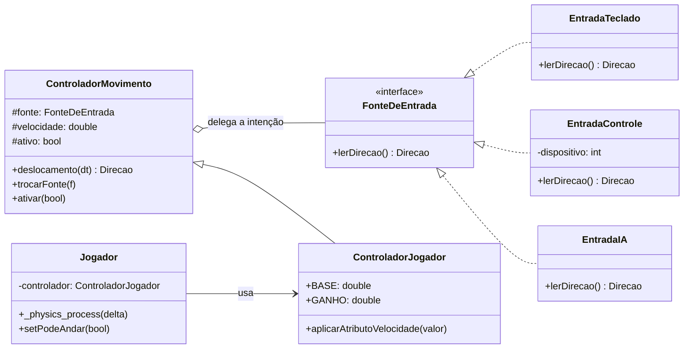

# SubEquipe 2: GoF Bridge

## Descrição

Artefato do padrão estrutural **Bridge** aplicado ao **G4_ProjetoJogo**. Documenta a separação entre o controle de movimento (quem se move: jogador, inimigos, NPCs) e a fonte da intenção de movimento (de onde vem a direção: teclado, controle, IA). O documento traz o contexto do problema, a modelagem UML, o código, o status de verificação e a rastreabilidade com os requisitos e com os demais padrões do projeto.

## Objetivo

Entregar um GoF Bridge com modelo, código e vínculo com os artefatos anteriores, justificando a escolha com base em Gamma et al. (2000) e no catálogo do Refactoring.Guru (2026).

## Metodologia

A definição do padrão ocorreu na primeira reunião da SubEquipe 02, documentada na [Ata 01 do Subgrupo 02](/Atas/AtaSub02_01.md). A subequipe adotou C++17 como linguagem base para todos os padrões estruturais, assegurando que as bibliotecas pudessem ser compiladas tanto como executáveis de console quanto integradas à Godot Engine.

A elaboração seguiu o guia de implementação do Bridge (REFACTORING.GURU, 2026):

1. **Identificação das dimensões ortogonais:** quem se move e de onde vem a intenção de movimento. Os dois eixos variam de forma independente.
2. **Definição da interface de implementação:** `FonteDeEntrada`, com o método `lerDirecao()`.
3. **Implementações concretas:** `EntradaTeclado` e `EntradaControle` (Godot) e `EntradaIA` (esqueleto para RF08).
4. **Abstração:** `ControladorMovimento`, que delega a intenção à fonte e aplica velocidade e tempo.
5. **Abstração refinada:** `ControladorJogador`, em que o atributo de velocidade (alterado pelos decoradores do padrão Decorator, como a Pena Leve) define a velocidade do personagem.
6. **Verificação:** testes do núcleo com fonte falsa, sem Godot, e teste manual no jogo.

## Conteúdo

### 1. Padrão escolhido

| Item | Descrição |
|------|-----------|
| **Padrão** | **Bridge** (Ponte) |
| **Categoria** | GoF Estrutural |
| **Também conhecido como** | Ponte (REFACTORING.GURU, 2026); Handle/Body (GAMMA et al., 2000) |
| **Autor responsável** | [João Igor](https://github.com/JoaoPC10) |
| **Intenção** | Desacoplar uma abstração de sua implementação, para que as duas hierarquias variem de forma independente (GAMMA et al., 2000; REFACTORING.GURU, 2026). |
| **Justificativa** | O movimento tem dois eixos independentes: quem se move e de onde vem a intenção. Sem o padrão, cada combinação exigiria uma classe própria (`JogadorTeclado`, `JogadorControle`, `InimigoIA` etc.), e cada novo dispositivo ou personagem multiplicaria as classes. Com o Bridge, cada eixo cresce com uma única classe nova. Esse é o problema de explosão de combinações que o padrão se propõe a resolver (REFACTORING.GURU, 2026). |

<p align="center">Tabela 1A: Identificação do padrão. Fonte: Elaborado pelo autor com base em Gamma et al. (2000) e Refactoring.Guru (2026).</p>

### 2. Contexto e problema

No estado atual do projeto, o `Jogador` lê diretamente as ações do `Input` do Godot para se mover. As ações são criadas em `Mundo::criarAcoes()` (`mover_esquerda`, `mover_direita`, `mover_cima`, `mover_baixo`), o que já separa a tecla física da ação. Mesmo assim, o personagem continua acoplado a uma única fonte de entrada. Isso gera três problemas:

- **Troca de dispositivo:** não há como passar a usar um controle em tempo de execução sem alterar o `Jogador`.
- **Reuso:** galinhas e inimigos (RF08) precisam de movimento, mas não de teclado. Sem uma abstração separada, o código de movimento teria de ser copiado ou condicionado por tipo.
- **Testabilidade:** o movimento só pode ser verificado com o jogo em execução.

Os requisitos envolvidos são RF01 (movimentação livre), RF02 (combate por turnos, em que o movimento é suspenso) e RF08 (inimigos).

### 3. Intenção e solução

O livro GoF introduz os termos *Abstração* e *Implementação* na definição do Bridge (GAMMA et al., 2000), e o Refactoring.Guru (2026) os explica da seguinte forma, o que vale para este projeto:

- **Abstração** (ou interface): a camada de controle de alto nível. Não faz o trabalho de baixo nível; delega à implementação. No projeto, é o `ControladorMovimento`.
- **Implementação** (ou plataforma): a camada que faz o trabalho concreto e que muda por dispositivo. No projeto, são as fontes de entrada.

Esses dois termos não se confundem com as *interfaces* ou *classes abstratas* da linguagem de programação (REFACTORING.GURU, 2026). Neste projeto, por exemplo, a "Implementação" é representada pela interface `FonteDeEntrada` e por suas classes concretas, mas o conceito diz respeito ao papel de cada camada, não ao recurso da linguagem.

A solução é trocar herança por composição (REFACTORING.GURU, 2026). Em vez de criar `JogadorTeclado` e `JogadorControle`, o `ControladorMovimento` guarda uma referência a uma `FonteDeEntrada`. A abstração calcula o deslocamento, e a fonte apenas informa a direção desejada.

Um ponto importante: o Bridge não é o mesmo que o Strategy. Os dois usam composição, mas o Bridge é projetado para duas hierarquias que evoluem de forma independente (personagens e dispositivos), enquanto o Strategy é uma única hierarquia de comportamentos intercambiáveis. A diferença aparece na intenção, não só na estrutura (REFACTORING.GURU, 2026; ver seção 10).

### 4. Modelagem (notação UML)



<p align="center">Figura 1: Diagrama de classes do padrão Bridge aplicado ao movimento. Fonte: João Igor , 2026.</p>

| Papel no padrão | Classe no projeto | Responsabilidade |
|-----------------|-------------------|------------------|
| Abstraction | `ControladorMovimento` | Calcula o deslocamento (direção × velocidade × tempo) e delega a direção à fonte. |
| RefinedAbstraction | `ControladorJogador` | Regra do jogador: a velocidade depende do atributo VELOCIDADE. |
| Implementor | `FonteDeEntrada` | Contrato comum: devolve a direção desejada, sem mover nada. |
| ConcreteImplementor | `EntradaTeclado`, `EntradaControle`, `EntradaIA` | Traduzem uma origem de intenção (teclado, analógico, IA) para o contrato. |
| Client | `Jogador` | Monta o controlador com uma fonte e usa o resultado no movimento. |

<p align="center">Tabela 1: Participantes do padrão Bridge. Fonte: (João Igor)[https://github.com/JoaoPC10] com base em Gamma et al. (2000) e Refactoring.Guru (2026). O papel Client é descrito pelo Refactoring.Guru (2026).</p>

### 5. Aplicabilidade

Segundo o Refactoring.Guru (2026), o Bridge é indicado quando:

- uma classe tem duas dimensões de variação independentes, ou seja, dimensões ortogonais (aqui, personagem e dispositivo);
- for preciso trocar a implementação em tempo de execução (controle conectado ou desconectado);
- a mesma lógica de movimento deve servir a personagens com fontes de intenção diferentes.

Não é recomendável usar o Bridge quando a classe é altamente coesa e tem uma única dimensão de variação. Nesse caso, uma abstração simples ou uma função bastam, e o padrão tornaria o código mais complicado sem ganho (REFACTORING.GURU, 2026).

### 6. Implementação (passo a passo)

Os passos abaixo seguem a orientação "Como implementar" do Refactoring.Guru (2026), aplicada ao projeto:

1. **Identificar as dimensões.** Quem se move (abstração) e de onde vem a intenção (implementação).
2. **Definir a operação de alto nível.** O `ControladorMovimento` precisa de `deslocamento(dt)`.
3. **Definir a interface de implementação.** `FonteDeEntrada::lerDirecao()` declara só a operação primitiva.
4. **Criar as implementações concretas.** Teclado, controle e IA, todas seguindo a mesma interface.
5. **Adicionar a referência na abstração.** `ControladorMovimento` guarda uma `FonteDeEntrada`.
6. **Criar abstrações refinadas.** `ControladorJogador` acrescenta a regra de velocidade do personagem.
7. **Ligar as peças no cliente.** O `Jogador` passa a fonte para o construtor do controlador e depois só trabalha com o controlador.

### 7. Código

A organização segue o padrão do projeto: o núcleo em C++17 puro, sem Godot, fica em `src/estrutural/bridge/`; as implementações que dependem do Godot ficam em `native/src/jogo/entrada/`.

```
src/estrutural/
├── bridge/                          núcleo C++17, sem Godot
│   ├── direcao.hpp
│   ├── fonte_de_entrada.hpp         Implementor
│   ├── controlador_movimento.hpp    Abstraction
│   ├── controlador_jogador.hpp      RefinedAbstraction
│   └── tests/test_bridge.cpp
└── native/src/jogo/
    ├── entrada/
    │   ├── entrada_godot.h          ConcreteImplementors (teclado, controle)
    │   └── entrada_ia.h             ConcreteImplementor (IA, esqueleto)
    └── jogador.cpp / jogador.h      Client (alterado)
```

#### 7.1 Núcleo (C++17, sem Godot)

**`src/estrutural/bridge/direcao.hpp`**

```cpp
#pragma once
#include <cmath>

namespace bridge {

struct Direcao {
    double x = 0.0;
    double y = 0.0;
};

// Evita que a diagonal seja mais rápida que a reta.
inline Direcao normalizar(Direcao d) {
    const double m = std::hypot(d.x, d.y);
    if (m > 1.0) return {d.x / m, d.y / m};
    return d;
}

} // namespace bridge
```

**`src/estrutural/bridge/fonte_de_entrada.hpp`** (Implementor)

```cpp
#pragma once
#include "direcao.hpp"

namespace bridge {

// Contrato comum a todos os dispositivos e IAs.
// Devolve apenas a intenção de direção; não move nada.
class FonteDeEntrada {
public:
    virtual ~FonteDeEntrada() = default;
    virtual Direcao lerDirecao() const = 0;
};

} // namespace bridge
```

**`src/estrutural/bridge/controlador_movimento.hpp`** (Abstraction)

```cpp
#pragma once
#include "direcao.hpp"
#include "fonte_de_entrada.hpp"
#include <memory>
#include <utility>

namespace bridge {

// Sabe COMO mover; delega DE ONDE vem a intenção à fonte (a "ponte").
class ControladorMovimento {
public:
    ControladorMovimento(std::shared_ptr<FonteDeEntrada> fonte, double velocidade)
        : fonte(std::move(fonte)), velocidade(velocidade) {}
    virtual ~ControladorMovimento() = default;

    // Troca de dispositivo em tempo de execução: basta trocar a referência.
    void trocarFonte(std::shared_ptr<FonteDeEntrada> nova) { fonte = std::move(nova); }
    void ativar(bool a) { ativo = a; }

    // Deslocamento deste quadro, em pixels.
    virtual Direcao deslocamento(double dt) const {
        if (!ativo || !fonte) return {0.0, 0.0};
        const Direcao d = normalizar(fonte->lerDirecao());
        return {d.x * velocidade * dt, d.y * velocidade * dt};
    }

protected:
    std::shared_ptr<FonteDeEntrada> fonte;
    double velocidade;
    bool ativo = true;
};

} // namespace bridge
```

**`src/estrutural/bridge/controlador_jogador.hpp`** (RefinedAbstraction)

```cpp
#pragma once
#include "controlador_movimento.hpp"

namespace bridge {

// Regra própria do jogador: a velocidade depende do atributo VELOCIDADE,
// que a cadeia de decoradores altera (ex.: Pena Leve, +2).
// BASE e GANHO são valores iniciais: calibre-os com o jogo.
class ControladorJogador : public ControladorMovimento {
public:
    using ControladorMovimento::ControladorMovimento;

    static constexpr double BASE = 120.0;  // px/s sem bônus
    static constexpr double GANHO = 4.0;   // px/s por ponto de atributo

    void aplicarAtributoVelocidade(int valorAtributo) {
        velocidade = BASE + valorAtributo * GANHO;
    }
};

} // namespace bridge
```

**`src/estrutural/bridge/tests/test_bridge.cpp`**

```cpp
#include "controlador_jogador.hpp"
#include <cmath>
#include <cstdio>
#include <memory>

using namespace bridge;

static int falhas = 0;
#define VERIFICAR(cond)                                              \
    do {                                                             \
        if (!(cond)) {                                               \
            std::printf("FALHOU: %s (linha %d)\n", #cond, __LINE__); \
            ++falhas;                                                \
        }                                                            \
    } while (0)

static bool aprox(double a, double b) { return std::fabs(a - b) < 1e-9; }

// Fonte falsa: permite testar o movimento sem teclado nem Godot.
class FonteFalsa : public FonteDeEntrada {
public:
    explicit FonteFalsa(Direcao d) : d(d) {}
    Direcao lerDirecao() const override { return d; }
private:
    Direcao d;
};

int main() {
    // 1. Deslocamento = direção × velocidade × dt
    {
        auto fonte = std::make_shared<FonteFalsa>(Direcao{1, 0});
        ControladorMovimento c(fonte, 100);
        Direcao d = c.deslocamento(0.5);
        VERIFICAR(aprox(d.x, 50) && aprox(d.y, 0));
    }

    // 2. A diagonal não é mais rápida que a reta
    {
        auto fonte = std::make_shared<FonteFalsa>(Direcao{1, 1});
        ControladorMovimento c(fonte, 100);
        Direcao d = c.deslocamento(1.0);
        VERIFICAR(aprox(std::hypot(d.x, d.y), 100));
    }

    // 3. Trocar a fonte em tempo de execução muda a direção
    {
        auto teclado = std::make_shared<FonteFalsa>(Direcao{1, 0});
        auto controle = std::make_shared<FonteFalsa>(Direcao{0, -1});
        ControladorMovimento c(teclado, 100);
        c.trocarFonte(controle);
        Direcao d = c.deslocamento(1.0);
        VERIFICAR(aprox(d.x, 0) && aprox(d.y, -100));
    }

    // 4. Desativado não se move
    {
        auto fonte = std::make_shared<FonteFalsa>(Direcao{1, 0});
        ControladorMovimento c(fonte, 100);
        c.ativar(false);
        Direcao d = c.deslocamento(1.0);
        VERIFICAR(aprox(d.x, 0) && aprox(d.y, 0));
    }

    // 5. Atributo de velocidade (Pena Leve, +2) altera a velocidade
    {
        auto fonte = std::make_shared<FonteFalsa>(Direcao{1, 0});
        ControladorJogador j(fonte, ControladorJogador::BASE);
        j.aplicarAtributoVelocidade(2);
        Direcao d = j.deslocamento(1.0);
        VERIFICAR(aprox(d.x, ControladorJogador::BASE + 2 * ControladorJogador::GANHO));
    }

    if (falhas == 0) {
        std::printf("OK: 5 grupos de verificações do Bridge passaram.\n");
        return 0;
    }
    std::printf("%d falha(s).\n", falhas);
    return 1;
}
```

Execução:

```bash
g++ -std=c++17 -Wall -Wextra -I src/estrutural/bridge \
    src/estrutural/bridge/tests/test_bridge.cpp -o test_bridge && ./test_bridge
```

#### 7.2 Implementações concretas (Godot, C++)

**`native/src/jogo/entrada/entrada_godot.h`** (ConcreteImplementors)

```cpp
#pragma once
#include "bridge/fonte_de_entrada.hpp"
#include <godot_cpp/classes/input.hpp>
#include <cmath>

namespace jogo {

// Usa as ações já definidas em Mundo::criarAcoes(), então WASD e setas
// continuam funcionando sem alteração.
class EntradaTeclado : public bridge::FonteDeEntrada {
public:
    bridge::Direcao lerDirecao() const override {
        const godot::Vector2 v = godot::Input::get_singleton()->get_vector(
                "mover_esquerda", "mover_direita", "mover_cima", "mover_baixo");
        return {v.x, v.y};
    }
};

// Analógico esquerdo do controle, com zona morta.
class EntradaControle : public bridge::FonteDeEntrada {
public:
    explicit EntradaControle(int dispositivo = 0) : dispositivo(dispositivo) {}

    bridge::Direcao lerDirecao() const override {
        godot::Input *in = godot::Input::get_singleton();
        return {zona(in->get_joy_axis(dispositivo, godot::JOY_AXIS_LEFT_X)),
                zona(in->get_joy_axis(dispositivo, godot::JOY_AXIS_LEFT_Y))};
    }

private:
    static double zona(double v) { return std::fabs(v) < 0.2 ? 0.0 : v; }
    int dispositivo;
};

} // namespace jogo
```

**`native/src/jogo/entrada/entrada_ia.h`** (ConcreteImplementor, esqueleto para RF08)

```cpp
#pragma once
#include "bridge/fonte_de_entrada.hpp"

namespace jogo {

// Uma IA simples devolve uma direção a cada quadro, por exemplo,
// andar em direção ao jogador quando ele estiver perto.
// [Implementar: patrulha ou perseguição.]
class EntradaIA : public bridge::FonteDeEntrada {
public:
    bridge::Direcao lerDirecao() const override {
        return {0.0, 0.0};
    }
};

} // namespace jogo
```

#### 7.3 Integração com o `Jogador` (Client)

**`native/src/jogo/jogador.h`** (acréscimos)

```cpp
#include "bridge/controlador_jogador.hpp"
#include <memory>

// dentro da classe Jogador:
private:
    std::shared_ptr<bridge::ControladorJogador> controlador;
```

**`native/src/jogo/jogador.cpp`** (acréscimos e substituições)

```cpp
#include "jogo/entrada/entrada_godot.h"

void Jogador::_ready() {
    // ... código existente ...
    controlador = std::make_shared<bridge::ControladorJogador>(
            std::make_shared<jogo::EntradaTeclado>(), bridge::ControladorJogador::BASE);
}

void Jogador::_physics_process(double delta) {
    if (delta <= 0.0 || !controlador) return;

    // [Verificar] Acesso real ao atributo de velocidade da cadeia de decoradores.
    controlador->aplicarAtributoVelocidade(personagem().atributo(Atributo::VELOCIDADE));

    // Substitui a leitura direta do Input. move_and_slide mantém as colisões
    // com os StaticBody2D do mundo.
    const bridge::Direcao d = controlador->deslocamento(delta);
    set_velocity(godot::Vector2(d.x, d.y) / delta);
    move_and_slide();
}

// Mundo::iniciarCombate e Mundo::aoTerminarCombate continuam chamando setPodeAndar,
// sem alteração em Mundo.
void Jogador::setPodeAndar(bool p) {
    podeAndar = p;
    if (controlador) controlador->ativar(p);
}
```

**`src/estrutural/SConstruct`** (inclusão do núcleo no build)

```python
# acrescente bridge/ ao CPPPATH, junto com decorator/
env.Append(CPPPATH=["bridge", "decorator"])
```

### 8. Prós e contras

Os itens abaixo seguem as vantagens e desvantagens descritas pelo Refactoring.Guru (2026), aplicadas ao projeto.

**Prós**

- **Independência de plataforma e dispositivo.** O personagem não conhece teclado nem controle. O código de movimento roda igual no terminal (testes) e no jogo.
- **Princípio aberto/fechado.** Um novo dispositivo ou uma nova IA é uma classe nova, sem alterar `ControladorMovimento` nem `Jogador`.
- **Princípio da responsabilidade única.** A fonte decide a intenção, o controlador decide como mover, e o `Jogador` decide o que o personagem faz.
- **Testabilidade.** A `FonteFalsa` permite verificar o movimento sem janela.
- **Troca em tempo de execução.** `trocarFonte` troca o dispositivo sem recriar o personagem.

**Contras**

- **Complexidade adicional.** Para um movimento que hoje tem uma única fonte, o padrão adiciona classes. O ganho aparece quando os inimigos (RF08) e o controle entrarem.
- **Acoplamento por nome de ação.** `EntradaTeclado` depende das strings `mover_esquerda` etc. Se a ação for renomeada em `Mundo::criarAcoes()`, a entrada quebra sem erro de compilação. Uma constante compartilhada reduz esse risco.
- **Ponteiros compartilhados.** O uso de `std::shared_ptr` tem custo pequeno, mas exige atenção ao ciclo de vida da fonte.

### 09. Relações com outros padrões

As relações com Strategy, State, Adapter e Abstract Factory seguem a seção "Relações com outros padrões" do Refactoring.Guru (2026).

- **Strategy.** Estrutura parecida: composição com uma interface. A diferença está na intenção. O Bridge separa duas hierarquias que evoluem de forma independente (personagens e dispositivos). O Strategy troca um algoritmo dentro de uma única hierarquia (por exemplo, o cálculo de dano). A pergunta da banca é: "há duas dimensões que variam sozinhas?" Se sim, é Bridge.
- **State.** Também troca comportamento por delegação. O State muda o comportamento conforme o estado interno do objeto (exploração, combate), e o Bridge muda a origem da intenção.
- **Adapter.** O Bridge costuma ser definido com antecedência, para que as partes da aplicação sejam desenvolvidas de forma independente, enquanto o Adapter é usado em geral sobre código existente, para fazer classes incompatíveis trabalharem juntas. Se o projeto precisasse integrar uma biblioteca de controle de terceiros, um Adapter seria a peça que converteria seu formato para o `FonteDeEntrada`.
- **Abstract Factory.** Pode criar o conjunto certo de fonte e controlador para cada plataforma (desktop, web, mobile), escondendo a escolha do cliente. É útil quando certas abstrações só funcionam com implementações específicas.
- **Decorator (no projeto).** A velocidade do jogador vem da cadeia de decoradores. O Bridge recebe esse valor pelo `aplicarAtributoVelocidade`, e os dois padrões se encontram no `Jogador`.

### 10. Limitações e trabalhos futuros

- A calibração de `BASE` (120 px/s) e `GANHO` (4 px/s por ponto) é provisória e precisa ser feita no jogo.
- `EntradaIA` está como esqueleto e não tem lógica de patrulha ou perseguição (RF08).
- A troca automática entre teclado e controle, quando um controle é conectado ou desconectado, não está implementada. A escolha é feita uma vez em `_ready()`.
- As constantes de ação (`mover_esquerda` etc.) podem virar um arquivo de constantes compartilhado, para eliminar o acoplamento por string.
- O núcleo em C++17 foi compilado e testado. Como as fontes de entrada reais (teclado e controle) dependem do Godot e só funcionam com o jogo em execução, os testes automatizados usam uma `FonteFalsa`, que simula a direção informada por um dispositivo. Com ela foram verificados o cálculo do deslocamento, a normalização da diagonal, a troca de fonte em tempo de execução, a desativação do movimento e o efeito do atributo de velocidade. A integração com o Godot (`EntradaTeclado`, `EntradaControle` e o `Jogador`) ainda depende de teste manual no jogo.

### 11. Rastreabilidade

| Artefato ou requisito | Elo com este padrão |
|-----------------------|---------------------|
| RF01 (movimentação livre) | `ControladorMovimento.deslocamento()` calcula o movimento. Testes 1 e 2. |
| RF02 (combate por turnos) | `ativar(false)` é chamado em `setPodeAndar` quando o combate começa. Verificação manual. |
| RF07 (personagem jogável) | `ControladorJogador` é a abstração refinada do jogador. |
| RF08 (inimigos) | `EntradaIA` é a implementação prevista para os inimigos. |
| Controles (README de `src/estrutural`) | `EntradaTeclado` e `EntradaControle` mantêm WASD, setas e o controle. |
| Padrão Decorator (SubEquipe 02) | O atributo VELOCIDADE vem da cadeia de decoradores; testado pelo teste 5. |
| Mundo (`mundo.cpp`) | `criarAcoes()` define as ações usadas por `EntradaTeclado`; `iniciarCombate` e `aoTerminarCombate` controlam `setPodeAndar`. |

<p align="center">Tabela 2: Elos com outros artefatos. Fonte: João Igor, 2026.</p>

## Referências

> GAMMA, Erich; HELM, Richard; JOHNSON, Ralph; VLISSIDES, John. **Padrões de projeto**: soluções reutilizáveis de software orientado a objetos. Tradução de Luiz A. Meirelles Salgado. Porto Alegre: Bookman, 2000.
>
> REFACTORING.GURU. **Bridge**. [S. l.], 2026. Disponível em: https://refactoring.guru/pt-br/design-patterns/bridge. Acesso em: 18 out. 2026.

## Nível de Contribuição dos Integrantes

| Nome | % de Contribuição |
|------|:-----------------:|
| [João Igor](https://github.com/JoaoPC10) | 100 |

## Histórico de Versão

| Versão | Data | Descrição | Autor(es) | Revisor |
|:------:|------|:----------|:----------|:--------|
| 1.0 | 18/10/2026 | Criação do artefato Bridge: contexto, modelagem, código e rastreabilidade | [João Igor](https://github.com/JoaoPC10) | [preencher] |
| 1.1 | 18/10/2026 | Reestruturação do documento: metodologia, intenção, aplicabilidade, implementação passo a passo, status de verificação, prós e contras, relações com outros padrões, limitações e rastreabilidade ampliada | [João Igor](https://github.com/JoaoPC10) | |
| 1.2 | 18/10/2026 | Revisão das referências: citações no texto, correção da atribuição dos termos Abstração/Implementação, ajuste ao formato ABNT e remoção de referência não citada | [João Igor](https://github.com/JoaoPC10) | |