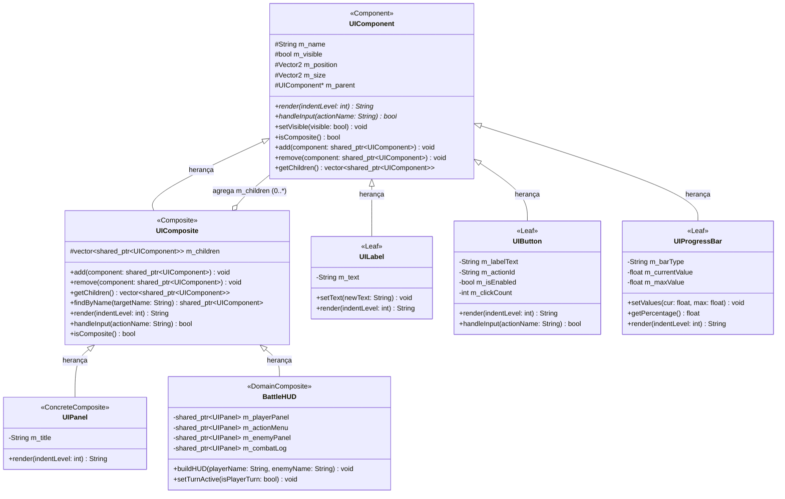

# SubEquipe_02 — Padrão GoF Composite (Interface de Usuário em C++)

## Descrição

Este artefato documenta a aplicação do padrão de projeto estrutural **Composite** ao **G4_ProjetoJogo**, sob responsabilidade de **João Victor da Silva Batista de Farias**. O documento apresenta o embasamento teórico na literatura, a modelagem na notação UML, os detalhes da implementação em **C++ (C++17)**, o roteiro de execução em vídeo e a rastreabilidade com os artefatos das entregas anteriores.

## Objetivo

Atender ao foco de padrões estruturais demonstrando como o padrão Composite resolve o problema de hierarquia visual e propagação de eventos na interface gráfica (HUD e menus) do jogo, permitindo tratar nós individuais e contêineres complexos de forma polimórfica e uniforme.

## Metodologia

O padrão foi selecionado e desenvolvido durante o alinhamento da SubEquipe 02, registrado na [Ata 01 do Subgrupo 02](/Atas/AtaSub02_01.md). A equipe padronizou a implementação de todos os padrões estruturais em **C++**, garantindo alto desempenho e compatibilidade nativa com o motor de jogo. A modelagem foi elaborada a partir das especificações de HUD de Batalha (Léxico L16) e do Diagrama de Estados do Combate da Entrega 02.

---

## Conteúdo

### 1. Padrão Escolhido e Fundamentação Teórica

| Item | Descrição |
|------|-----------|
| **Padrão** | **Composite** |
| **Categoria** | GoF Estrutural |
| **Autor Responsável** | João Victor da Silva Batista de Farias ([@beyondmagic](https://github.com/beyondmagic)) |
| **Linguagem** | C++ (padrão C++17) com Makefile |
| **Intenção do Padrão** | Compor objetos em estruturas de árvore para representar hierarquias do tipo parte-todo. O Composite permite que os clientes tratem objetos individuais e composições de objetos de maneira uniforme (GAMMA et al., 2000). |
| **Justificativa da Escolha** | No G4_ProjetoJogo, as interfaces de usuário (como o HUD de batalha e as bancadas de alquimia) são formadas por uma composição recursiva de painéis, barras de progresso, botões e rótulos. Sem o Composite, o cliente de combate ou alquimia precisaria tratar cada tipo de elemento visual e cada painel com lógica condicional (`if type == ...`), gerando forte acoplamento e rigidez ao adicionar novos menus dinâmicos. |

<p align="center">Tabela 1: Padrão GoF Composite na SubEquipe 02. Fonte: Autores, 2026.</p>

---

### 2. Contexto e Problema de Design

No desenvolvimento do **G4_ProjetoJogo**, a interface de combate necessita exibir simultaneamente:

- O estado de saúde, magia e turnos do jogador (HP, MP, ATB);
- O menu contextual de comandos de combate (Atacar, Misturar Elementos, Usar Item, Fugir);
- O status dos inimigos encontrados;
- O histórico textual (*combat log*);
- Janelas e popups contextuais abertos sob demanda, como a Bancada Rápida de Campo para sintetizar poções durante o turno.

Sem um padrão estrutural, a manipulação dessa interface sofreria de proliferação de condicionais e rigidez na adição de novos nós. Com o **Composite**, todos os elementos visuais herdam de `UIComponent`, formando uma árvore uniforme.

---

### 3. Modelagem na Notação UML

O diagrama de classes abaixo detalha a estrutura do padrão Composite implementada em C++:



<p align="center">Figura 1: Diagrama de Classes do padrão GoF Composite na notação UML. Fonte: Elaboração própria (FARIAS, João Victor, 2026).</p>

---

### 4. Implementação (Código & Vídeo do Padrão em Execução)

O código-fonte em C++ encontra-se em [`src/estrutural/composite/`](https://github.com/UnBArqDsw2026-2-Turma01/2026.2-T01-G4_ProjetoJogo_Entrega_03/tree/main/src/estrutural/composite/).

#### Destaques de Código em C++

1. **Delegação Recursiva no Composto (`ui_composite.hpp`):**

```cpp
std::string render(int indentLevel = 0) const override {
    if (!m_visible) return "";
    std::ostringstream ss;
    ss << getIndent(indentLevel) << "+-- [COMPOSTO: " << m_name << "] (pos: " 
       << m_position.toString() << ", size: " << m_size.toString() << ")\n";

    for (const auto& child : m_children) {
        ss << child->render(indentLevel + 1);
    }
    return ss.str();
}
```

2. **Propagação de Eventos Polimórfica (`ui_composite.hpp`):**

```cpp
bool handleInput(const std::string& actionName) override {
    if (!m_visible) return false;
    for (auto it = m_children.rbegin(); it != m_children.rend(); ++it) {
        if ((*it)->handleInput(actionName)) {
            return true;
        }
    }
    return false;
}
```

3. **Consumo de Evento na Folha (`ui_button.hpp`):**

```cpp
bool handleInput(const std::string& actionName) override {
    if (!m_visible || !m_isEnabled) return false;
    if (actionName == m_actionId || actionName == m_name) {
        m_clickCount++;
        std::cout << "   >> [EVENTO UI] Botão '" << m_name << "' acionado! (Cliques: " << m_clickCount << ")\n";
        return true;
    }
    return false;
}
```

#### Compilação e Execução

```bash
make -C src/estrutural/composite run
```

> 📹 **Vídeo de Demonstração em Execução:**
> *(Inserir link do vídeo no YouTube demonstrando a compilação via `make run` e a execução formatada no terminal)*
> ```markdown
> [Assistir à Demonstração do Padrão Composite no YouTube](https://youtu.be/SEU_LINK_AQUI)
> ```

---

### 5. Rastreabilidade com Artefatos Anteriores

| Artefato de Origem | Elo com o Padrão Composite |
|--------------------|----------------------------|
| **Léxico L16 (HUD de Batalha)** | O Léxico define a HUD como a interface visual que reúne HP, MP, barra de turnos e menu de ações, exatamente mapeada no `BattleHUD`. |
| **Modelagem Estática (Entrega 02)** | O componente `Menu de Status <<UI>>` e `Interação e Gatilhos` foram refinados para a estrutura em árvore de classes `UIComponent`. |
| **Diagrama de Estados do Combate (Entrega 02)** | A transição de estado onde o Menu de Comandos é ativado no turno do jogador e desativado no turno do inimigo é realizada via `hud->setTurnActive(isPlayerTurn)`. |
| **Ata Geral 04** | Alinhamento do escopo dos padrões de projeto e decisões de código da terceira entrega. |

---

## Referências

> GAMMA, Erich; HELM, Richard; JOHNSON, Ralph; VLISSIDES, John. **Padrões de Projeto**: soluções reutilizáveis de software orientado a objetos. Porto Alegre: Bookman, 2000.
> 
> STROUSTRUP, Bjarne. **The C++ Programming Language**. 4. ed. Boston: Addison-Wesley, 2013.
> 
> LARMAN, Craig. **Utilizando UML e Padrões**: uma introdução à análise e ao projeto orientados a objetos e ao desenvolvimento iterativo. 3. ed. Porto Alegre: Bookman, 2007.

## Histórico de Versão

| Versão | Data | Descrição | Autor(es) | Revisor |
|:------:|------|:----------|:----------|:--------|
| 1.0 | 16/10/2026 | Elaboração inicial da documentação do GoF Composite em C++, modelagem UML, código-fonte e rastreabilidade | [João Victor](https://github.com/beyondmagic) | [Marcelo](https://github.com/MatielloAL) |
