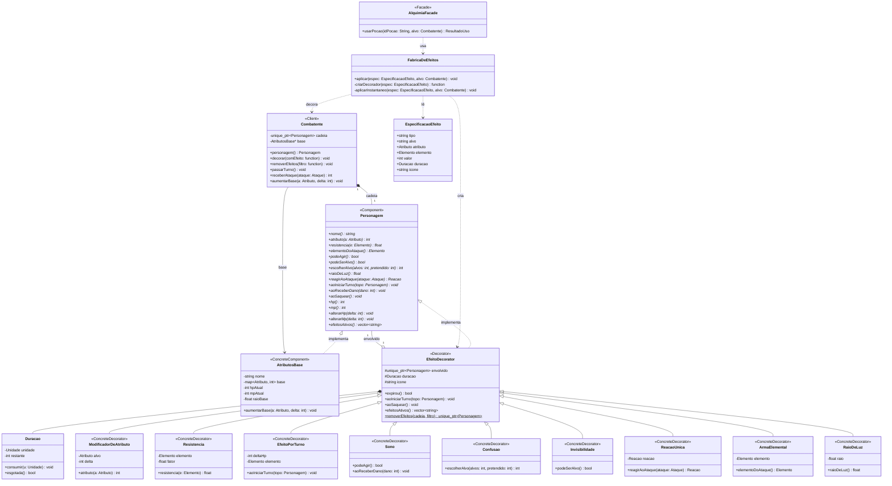
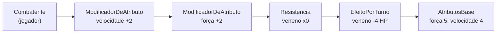

# SubEquipe_02 — GoF Decorator

## Descrição

Artefato do **FOCO_02: GoFs Estruturais & IA Generativa**, sob responsabilidade de **Marcos Vinícius Gündel da Silva**. Documenta a aplicação do padrão de projeto GoF Estrutural **Decorator** ao **G4_ProjetoJogo**, com o contexto do problema, a modelagem na notação UML, o código e o vídeo com o padrão em execução.

> **Página em elaboração.** A estrutura segue o [Artefato Padrão](/Guias/ArtefatoPadrao.md?id=artefatos-de-padrões-de-projeto) da disciplina. Preencha cada seção conforme o desenvolvimento do padrão.

## Objetivo

Atender à entrega do padrão estrutural: **um GoF Decorator com modelo, código e vídeo com o padrão em execução**, justificando a escolha com base na literatura e mantendo os elos com os artefatos das entregas anteriores.

## Metodologia

*A preencher pelo autor:* descreva como ocorreu a elaboração deste artefato, as reuniões realizadas ([Atas do Subgrupo 02](/Atas/SubEquipe_02.md)), ferramentas de modelagem e desenvolvimento utilizadas, e o processo de revisão.

---

## Conteúdo

### Padrão Escolhido

| Item | Descrição |
|------|-----------|
| **Padrão** | **Decorator** |
| **Categoria** | GoF Estrutural |
| **Autor Responsável** | Marcos Vinícius Gündel da Silva ([@MarcosViniciusG](https://github.com/MarcosViniciusG)) |
| **Intenção do Padrão** | *A preencher, com base na literatura (ex.: GAMMA et al., 2000).* |
| **Justificativa da Escolha** | *A preencher: por que este padrão, quais entidades ele estende dinamicamente e quais benefícios traz para o jogo.* |

Tabela 1: Padrão escolhido pela SubEquipe_02. Fonte: Autores, 2026.

### Contexto (Problema)

*A preencher pelo autor:* descreva o contexto do jogo e o problema a ser resolvido com o padrão Decorator. Indique o que ficaria rígido, duplicado ou limitado ao uso estático de subclasses sem a flexibilidade da decoração em tempo de execução.

### Modelagem (Notação UML)

O diagrama de classes da Figura 1 mostra como os efeitos das poções decoram um personagem em tempo de execução. Cada efeito ativo é um objeto que envolve o personagem e altera apenas o que lhe diz respeito, repassando todo o resto para o objeto envolvido.

Figura 1: Diagrama de classes do padrão Decorator aplicado aos efeitos das poções, na notação UML. Fonte: Marcos Vinícius Gündel da Silva, 2026.

`Atributo`, `Elemento`, `Reacao` e `Unidade` são enumerações, e `Ataque` é uma estrutura com o dano, o elemento e se o ataque é mágico. Eles foram omitidos da figura para manter a legibilidade. A Tabela 2 descreve o papel de cada classe no padrão.

| Papel no padrão | Classe | Responsabilidade |
|-----------------|--------|------------------|
| Component | `Personagem` | Interface comum a personagens com e sem efeitos: atributos, resistências, se pode agir ou ser alvo, reação a ataques e os ganchos de início de turno, de dano recebido e de saque. |
| ConcreteComponent | `AtributosBase` | Valores base do jogador e dos inimigos (atributos, HP, MP e raio de luz), sem nenhum efeito. |
| Decorator | `EfeitoDecorator` | Guarda o objeto envolvido, o ícone e a `Duracao` do efeito. Por padrão, repassa todas as chamadas ao envolvido e conta a duração a cada turno ou saque. |
| ConcreteDecorator | 9 classes (Tabela 3) | Cada uma sobrescreve apenas o comportamento que o efeito muda. |
| Client | `Combatente` | Dono da cadeia de decoradores: coloca novos efeitos por cima, remove os expirados ao passar o turno e remove os efeitos desfeitos por outras poções. |
| Complemento | `FabricaDeEfeitos` e `EspecificacaoEfeito` | Transformam a descrição dos efeitos de cada poção, lida de `data/alquimia.json`, em decoradores ou em ações instantâneas. |
| Complemento | `AlquimiaFacade` | Ganha a operação `usarPocao`, que tira a poção do inventário e pede à fábrica que aplique os efeitos. Assim, a interface continua conhecendo só a fachada. |

Tabela 2: Participantes do padrão Decorator. Fonte: Marcos Vinícius Gündel da Silva, 2026.

Das 36 poções do jogo, 25 mudam o comportamento de um personagem por um tempo e por isso são decoradores. Elas cabem em 9 decoradores concretos com parâmetros, em vez de uma subclasse por poção (Tabela 3). Salvo indicação, os efeitos duram 3 turnos.

| Decorador concreto | O que altera | Poções |
|--------------------|--------------|--------|
| `ModificadorDeAtributo` | Soma um valor a um atributo | Pele de Pedra (defesa +3), Pena Leve (velocidade +2), Vigor (força +3), Couraça de Cristal (defesa mágica +3), Olho de Corvo (precisão +15), Solução Condutora (dano mágico +5), Elixir da Quimera (força +2 e velocidade +2, com dois decoradores), Amuleto Líquido (sorte +25 nos próximos 3 saques), Ferrugem Líquida (defesa -3 no inimigo), Cinzas do Corvo (precisão -50 no inimigo, 2 turnos) e Luz Engarrafada (precisão -50 em todos os inimigos, 1 turno) |
| `Resistencia` | Multiplica o dano recebido de um elemento | Tônico Aquecido (frio x0,5), Vidro Fundido (fogo x0,5) e Antídoto Escamado (veneno x0, ou seja, imunidade) |
| `EfeitoPorTurno` | Altera o HP no início de cada turno | Poção de Regeneração (+5 HP), Veneno Roxo (-4 HP no inimigo) e Fumaça Tóxica (-3 HP em todos os inimigos) |
| `Sono` | Impede de agir e acaba ao receber dano | Elixir do Sono |
| `Confusao` | Sorteia o alvo das ações, 2 turnos | Poção Alucinógena |
| `Invisibilidade` | Impede de ser escolhido como alvo, 2 turnos | Poção Sombria |
| `ReacaoUnica` | Esquiva ou reflete o próximo ataque e se desfaz | Poção do Voo (esquiva) e Prisma Luminoso (reflete a próxima magia) |
| `ArmaElemental` | Troca o elemento dos ataques | Óleo de Salamandra (fogo) |
| `RaioDeLuz` | Aumenta o raio de visão na escuridão enquanto o jogador estiver na caverna | Chama Fátua e Elixir da Noite |

Tabela 3: Decoradores concretos e as poções que os utilizam. Fonte: Marcos Vinícius Gündel da Silva, 2026, a partir dos efeitos descritos em data/alquimia.json.

As outras 11 poções não decoram ninguém, porque agem uma vez e acabam. A `FabricaDeEfeitos` as executa diretamente:

- Cura Menor e Água Cristalina restauram HP e MP;
- Poção de Ferro e Poção de Foco aumentam o HP e o MP máximos de forma permanente, alterando o `AtributosBase`;
- Poção Flamejante, Sopro do Dragão, Faísca de Cobre e Poção Elétrica causam dano de fogo ou elétrico;
- Poção de Clarividência revela os segredos do mapa.

O Bálsamo de Cobre e a Poção do Esquecimento são um caso à parte: em vez de criar um decorador, eles **removem** decoradores da cadeia. O Bálsamo tira os efeitos de veneno do jogador, e o Esquecimento tira todos os efeitos de um inimigo.

A Figura 2 mostra a cadeia de um jogador que foi envenenado, bebeu um Antídoto Escamado e depois um Elixir da Quimera.

Figura 2: Exemplo de cadeia de decoradores em tempo de execução. Fonte: Marcos Vinícius Gündel da Silva, 2026.

Uma consulta como `atributo(VELOCIDADE)` entra pelo decorador mais externo e atravessa a cadeia até o `AtributosBase`, e cada decorador soma a sua parte: 4 da base mais 2 da Quimera. No início do turno, o veneno aplica o dano pedindo a resistência ao **topo** da cadeia, e não ao objeto que ele envolve. Por isso o Antídoto, bebido depois do veneno, ainda zera o dano. Sem o padrão, cada combinação precisaria de uma subclasse própria, como um "jogador envenenado com Quimera"; com ele, os efeitos se combinam em qualquer ordem e quantidade durante o jogo.

### Implementação (Código & Vídeo com Padrão em Execução)

O código deste foco fica em [`src/estrutural/decorator/`](https://github.com/UnBArqDsw2026-2-Turma01/2026.2-T01-G4_ProjetoJogo_Entrega_03/tree/main/src/estrutural/decorator/).

#### Código

*A preencher pelo autor:* explique a estrutura dos arquivos, as classes que compõem a cadeia de decoração e os métodos customizados, incluindo links para os arquivos correspondentes no repositório.

#### Vídeo

*A preencher pelo autor:* incorpore o vídeo que demonstra o código em execução, com legenda e link direto, conforme o [modelo de vídeo incorporado](/Guias/ArtefatoPadrao.md?id=modelo-de-vídeo-incorporado).

### Rastreabilidade

| Artefato Relacionado | Elo com este Padrão |
|----------------------|---------------------|
| [Modelagem da Entrega 02](https://unbarqdsw2026-2-turma01.github.io/2026.2-T01-G4_ProjetoJogo_Entrega_02/) | *A preencher: classes, atributos ou comportamentos reaproveitados.* |
| [Ata 01 da SubEquipe 02](/Atas/AtaSub02_01.md) | Decisão do subgrupo que atribuiu o padrão Decorator a Marcos Vinícius Gündel da Silva. |
| [Atas do Subgrupo 02](/Atas/SubEquipe_02.md) | *A preencher: atas de acompanhamento e reuniões internas.* |

Tabela 4: Elos com outros artefatos. Fonte: Autores, 2026.

---

## Referências

> GAMMA, Erich; HELM, Richard; JOHNSON, Ralph; VLISSIDES, John. **Padrões de Projeto**: soluções reutilizáveis de software orientado a objetos. Porto Alegre: Bookman, 2000.
> 
> SERRANO, Milene; SERRANO, Maurício. **Arquitetura e Desenho de Software**. Universidade de Brasília, 2026.

## Nível de Contribuição dos Integrantes

| Nome | % de Contribuição |
|------|:-----------------:|
| Marcos Vinícius Gündel da Silva | 100% |

Tabela 5: Contribuição dos integrantes.

## Histórico de Versão

| Versão | Data | Descrição | Autor(es) | Revisor |
|:------:|------|:----------|:----------|:--------|
| 1.0 | 16/10/2026 | Criação do template inicial do artefato GoF Decorator | [Marcos Vinícius](https://github.com/MarcosViniciusG) | [João Victor](https://github.com/beyondmagic) |
| 1.1 | 17/10/2026 | Modelagem UML do padrão Decorator: diagrama de classes, participantes, decoradores por poção e exemplo de cadeia | [Marcos Vinícius](https://github.com/MarcosViniciusG) | |
