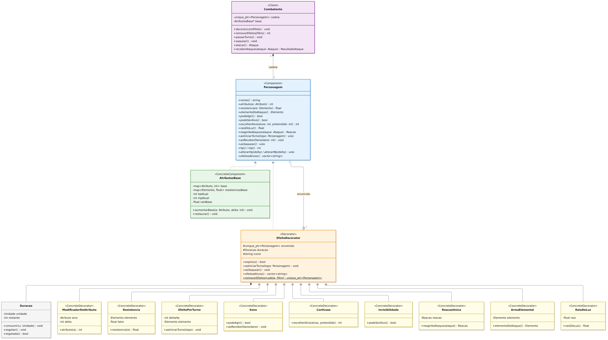
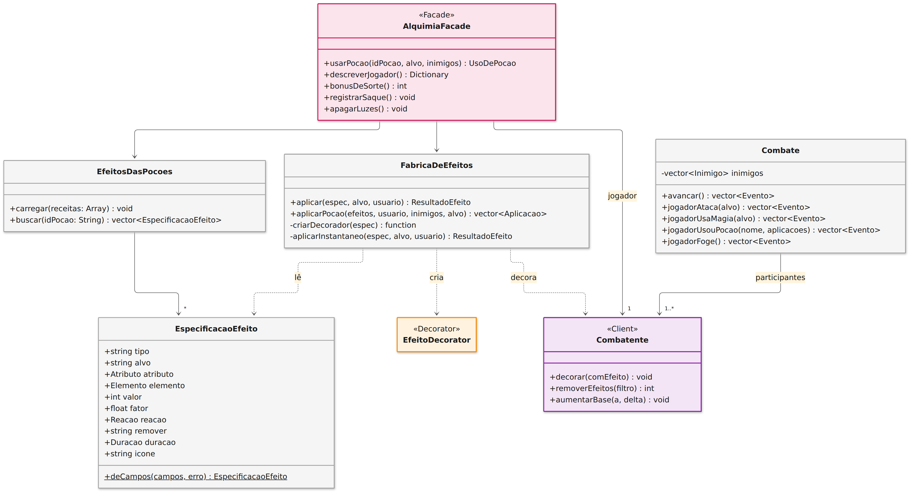
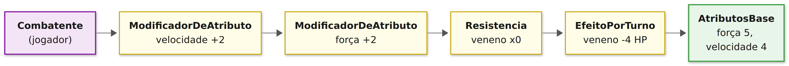

# SubEquipe_02: GoF Decorator

## Descrição

Artefato do **FOCO_02: GoFs Estruturais & IA Generativa**, sob responsabilidade de **Marcos Vinícius Gündel da Silva**. Documenta a aplicação do padrão de projeto GoF Estrutural **Decorator** ao **G4_ProjetoJogo**, com o contexto do problema, a modelagem na notação UML, o código e o vídeo com o padrão em execução.

## Objetivo

Atender à entrega do padrão estrutural: **um GoF Decorator com modelo, código e vídeo com o padrão em execução**, justificando a escolha com base na literatura e mantendo os elos com os artefatos das entregas anteriores.

## Metodologia

A divisão dos padrões estruturais foi decidida na primeira reunião da SubEquipe 02, em 16/10/2026, pelo WhatsApp ([Ata 01 do Subgrupo 02](/Atas/AtaSub02_01.md)). Propus que cada integrante escolhesse um dos sete padrões estruturais para aplicar em um módulo do jogo. Na lista de usos possíveis que o João Victor levantou, o Decorator aparecia para modificadores e power-ups, e fiquei com ele. A subequipe também decidiu usar C++17 em todos os padrões, para que o código rodasse tanto no terminal quanto dentro do Godot.

A elaboração seguiu estas etapas:

1. **Levantamento do problema:** partindo dos modelos da Entrega 02 (Tabela 5), em especial do Diagrama de Comunicação "Turno de Combate" que fiz na entrega anterior, listei as 36 poções do jogo, que até então tinham só um efeito descrito em texto, e separei as que mudam o comportamento de um personagem por um tempo (25, candidatas a decoradores) das que agem uma vez e acabam (11). Também levantei as mecânicas que faltavam para os efeitos fazerem sentido: atributos, combate por turnos, inimigos, uma caverna escura e segredos no mapa.
2. **Assets:** gerei as artes que faltavam com IA, o Gemini para inimigos e cenários e scripts em Python para ícones e efeitos visuais, como descrito no [relatório de IA Generativa](/Base/Relatórios/SubEquipe_02/IAGenerativa.md).
3. **Modelagem:** fiz os diagramas de classes em Mermaid, identificando os papéis do padrão, e os ajustei depois da implementação, para que refletissem o código final. Para ficarem legíveis e com zoom no site, separei o padrão da integração com o jogo e exportei as figuras como imagem com o mermaid-cli, usando o layout ELK, que evita cruzamento de setas.
4. **Implementação:** escrevi o núcleo do padrão em C++17 sem depender do Godot, no mesmo formato do Composite (headers, `Makefile` e demonstração no terminal). Depois, liguei o núcleo ao jogo pela fachada do Marcelo, que ganhou a operação `usarPocao`, e criei a tela de combate, a caverna e os segredos.
5. **Verificação:** testes automatizados do núcleo (172 verificações, incluindo as 36 poções), testes do jogo sem janela, capturas de tela do combate e da caverna e a versão para navegador testada antes de ser publicada.

Usei o VS Code com o Claude Code (Anthropic) e o Gemini (Google), o Godot 4.7.2 com godot-cpp e SCons, o g++ e o Emscripten 4.0.11 para a versão web. O uso da IA está detalhado no relatório de IA Generativa. A revisão é feita por outro integrante no pull request, como pede o [Guia de Contribuição](https://github.com/UnBArqDsw2026-2-Turma01/2026.2-T01-G4_ProjetoJogo_Entrega_03/blob/main/CONTRIBUTING.md).

---

## Conteúdo

### Padrão Escolhido

| Item | Descrição |
|------|-----------|
| **Padrão** | **Decorator** |
| **Categoria** | GoF Estrutural |
| **Autor Responsável** | Marcos Vinícius Gündel da Silva ([@MarcosViniciusG](https://github.com/MarcosViniciusG)) |
| **Intenção do Padrão** | Acrescentar responsabilidades a um objeto dinamicamente, em tempo de execução. Os decoradores são uma alternativa flexível ao uso de subclasses para estender funcionalidades (GAMMA et al., 2000). |
| **Justificativa da Escolha** | Na divisão da subequipe, o Decorator ficou com os modificadores e power-ups do jogo, que no projeto são os efeitos das poções: bônus, penalidades, resistências e condições como sono e veneno. Esses efeitos se acumulam no mesmo personagem, duram tempos diferentes e podem ser retirados no meio do combate. O Decorator permite empilhar e retirar efeitos em tempo de execução sem uma subclasse para cada combinação, e quem usa o personagem (combate, mundo e interface) não precisa saber quais efeitos estão ativos. |

<p align="center">Tabela 1: Padrão escolhido pela SubEquipe_02. Fonte: Marcos Vinícius Gündel da Silva, 2026.</p>

### Contexto (Problema)

Antes deste trabalho, as 36 poções do jogo podiam ser criadas na bancada de alquimia, mas não faziam nada. Cada uma tinha só um texto de efeito, como "+3 de defesa por 3 turnos" ou "Envenena um inimigo", e o jogo não tinha combate, atributos nem inimigos.

Implementar esses efeitos traz três exigências:

- **Combinação:** um personagem pode estar ao mesmo tempo sob o Elixir da Quimera e a Poção de Pele de Pedra e ainda envenenado, com os efeitos aplicados em qualquer ordem;
- **Duração e remoção:** cada efeito dura uma quantidade diferente de turnos ou de baús abertos, alguns acabam ao serem usados (Poção do Voo) e outros são retirados por outras poções (o Bálsamo de Cobre tira o veneno);
- **Transparência:** o combate, o mundo e a interface precisam consultar atributos, resistências e condições do personagem sem conhecer cada efeito.

Sem um padrão, as alternativas seriam ruins. Com herança, seria preciso uma subclasse para cada combinação, como um "jogador envenenado com Quimera", o que é inviável com 25 efeitos que se combinam livremente. Com indicadores e condicionais dentro do personagem (`if (envenenado)`, `if (comSorte)`), a classe cresceria a cada poção nova, e o combate também precisaria conhecer cada caso. No Decorator, cada efeito é um objeto que envolve o personagem e muda só o que lhe cabe.

### Modelagem (Notação UML)

O modelo está dividido em dois diagramas de classes. A Figura 1 mostra o padrão em si: como os efeitos das poções decoram um personagem em tempo de execução. Cada efeito ativo é um objeto que envolve o personagem e altera apenas o que lhe diz respeito, repassando todo o resto para o objeto envolvido. As cores indicam o papel de cada classe no padrão: Client em roxo, Component em azul, ConcreteComponent em verde, Decorator em laranja, ConcreteDecorators em amarelo e classes de apoio em cinza. Clique nas figuras para ampliá-las.



<p align="center">Figura 1: Diagrama de classes do padrão Decorator aplicado aos efeitos das poções, na notação UML. Fonte: Marcos Vinícius Gündel da Silva, 2026.</p>

A Figura 2 mostra como o padrão se liga ao resto do jogo: a fachada do sistema de alquimia (em rosa, padrão Facade) usa a `FabricaDeEfeitos` para decorar o `Combatente` do jogador, e o `Combate` conduz os turnos sobre os participantes.



<p align="center">Figura 2: Diagrama de classes da integração do padrão Decorator com o jogo, na notação UML. Fonte: Marcos Vinícius Gündel da Silva, 2026.</p>

Os diagramas foram escritos em Mermaid e exportados como imagem; os arquivos-fonte editáveis ([`decorator_classes_padrao.mmd`](https://github.com/UnBArqDsw2026-2-Turma01/2026.2-T01-G4_ProjetoJogo_Entrega_03/blob/main/docs/Base/Relatórios/SubEquipe_02/assets/decorator_classes_padrao.mmd) e [`decorator_classes_integracao.mmd`](https://github.com/UnBArqDsw2026-2-Turma01/2026.2-T01-G4_ProjetoJogo_Entrega_03/blob/main/docs/Base/Relatórios/SubEquipe_02/assets/decorator_classes_integracao.mmd)) ficam ao lado das imagens.

`Atributo`, `Elemento`, `Reacao` e `Unidade` são enumerações; `Ataque`, `ResultadoAtaque`, `ResultadoEfeito`, `Evento`, `Inimigo` e `UsoDePocao` são estruturas de dados simples. Eles foram omitidos da figura para manter a legibilidade. A Tabela 2 descreve o papel de cada classe no padrão.

| Papel no padrão | Classe | Responsabilidade |
|-----------------|--------|------------------|
| Component | `Personagem` | Interface comum a personagens com e sem efeitos: atributos, resistências, se pode agir ou ser alvo, reação a ataques e os ganchos de início de turno, de dano recebido e de saque. |
| ConcreteComponent | `AtributosBase` | Valores base do jogador e dos inimigos (atributos, HP, MP e raio de luz), sem nenhum efeito. |
| Decorator | `EfeitoDecorator` | Guarda o objeto envolvido, o ícone e a `Duracao` do efeito. Por padrão, repassa todas as chamadas ao envolvido e conta a duração a cada turno ou saque. |
| ConcreteDecorator | 9 classes (Tabela 3) | Cada uma sobrescreve apenas o comportamento que o efeito muda. |
| Client | `Combatente` | Dono da cadeia de decoradores: coloca novos efeitos por cima, remove os expirados ao passar o turno e remove os efeitos desfeitos por outras poções. |
| Complemento | `FabricaDeEfeitos` e `EspecificacaoEfeito` | Transformam a descrição dos efeitos de cada poção, lida de `data/alquimia.json`, em decoradores ou em ações instantâneas. |
| Complemento | `Combate` | Combate por turnos. Faz todas as contas pelo topo da cadeia de cada `Combatente` (velocidade, precisão, se pode agir, se pode ser alvo), sem conhecer nenhum decorador concreto, e devolve uma lista de eventos para a tela animar. |
| Complemento | `AlquimiaFacade` e `EfeitosDasPocoes` | A fachada ganha a operação `usarPocao`, que tira a poção do inventário e pede à fábrica que aplique os efeitos, e guarda a cadeia de efeitos do jogador. `EfeitosDasPocoes` é uma nova classe do subsistema escondido pela fachada. Assim, a interface continua conhecendo só a fachada. |

<p align="center">Tabela 2: Participantes do padrão Decorator. Fonte: Marcos Vinícius Gündel da Silva, 2026.</p>

Das 36 poções do jogo, 25 mudam o comportamento de um personagem por um tempo e por isso são decoradores. Elas cabem em 9 decoradores concretos com parâmetros, em vez de uma subclasse por poção (Tabela 3). Salvo indicação, os efeitos duram 3 turnos.

| Decorador concreto | O que altera | Poções |
|--------------------|--------------|--------|
| `ModificadorDeAtributo` | Soma um valor a um atributo | Pele de Pedra (defesa +3), Pena Leve (velocidade +2), Vigor (força +3), Couraça de Cristal (defesa mágica +3), Olho de Corvo (precisão +15), Solução Condutora (dano mágico +5), Elixir da Quimera (força +2 e velocidade +2, com dois decoradores), Amuleto Líquido (sorte +25 nos próximos 3 saques), Ferrugem Líquida (defesa -3 no inimigo), Cinzas do Corvo (precisão -50 no inimigo, 2 turnos) e Luz Engarrafada (precisão -50 em todos os inimigos, 1 turno) |
| `Resistencia` | Multiplica o dano recebido de um elemento | Tônico Aquecido (frio x0,5), Vidro Fundido (fogo x0,5) e Antídoto Escamado (veneno x0, ou seja, imunidade) |
| `EfeitoPorTurno` | Altera o HP no início de cada turno | Poção de Regeneração (+5 HP), Veneno Roxo (-4 HP no inimigo) e Fumaça Tóxica (-3 HP em todos os inimigos) |
| `Sono` | Impede de agir e acaba ao receber dano | Elixir do Sono |
| `Confusao` | Sorteia o alvo das ações, 2 turnos | Poção Alucinógena |
| `Invisibilidade` | Impede de ser escolhido como alvo, 2 turnos | Poção Sombria |
| `ReacaoUnica` | Esquiva ou reflete o próximo ataque e se desfaz | Poção do Voo (esquiva) e Prisma Luminoso (reflete a próxima magia) |
| `ArmaElemental` | Troca o elemento dos ataques | Óleo de Salamandra (fogo) |
| `RaioDeLuz` | Aumenta o raio de visão na escuridão enquanto o jogador estiver na caverna | Chama Fátua e Elixir da Noite |

<p align="center">Tabela 3: Decoradores concretos e as poções que os utilizam. Fonte: Marcos Vinícius Gündel da Silva, 2026, a partir dos efeitos descritos em data/alquimia.json.</p>

As outras 11 poções não decoram ninguém, porque agem uma vez e acabam. A `FabricaDeEfeitos` as executa diretamente:

- Cura Menor e Água Cristalina restauram HP e MP;
- Poção de Ferro e Poção de Foco aumentam o HP e o MP máximos de forma permanente, alterando o `AtributosBase`;
- Poção Flamejante, Sopro do Dragão, Faísca de Cobre e Poção Elétrica causam dano de fogo ou elétrico;
- Poção de Clarividência revela os segredos do mapa.

O Bálsamo de Cobre e a Poção do Esquecimento são um caso à parte: em vez de criar um decorador, eles **removem** decoradores da cadeia. O Bálsamo tira os efeitos de veneno do jogador, e o Esquecimento tira todos os efeitos de um inimigo.

A Figura 3 mostra a cadeia de um jogador que foi envenenado, bebeu um Antídoto Escamado e depois um Elixir da Quimera.



<p align="center">Figura 3: Exemplo de cadeia de decoradores em tempo de execução. Fonte: Marcos Vinícius Gündel da Silva, 2026.</p>

Uma consulta como `atributo(VELOCIDADE)` entra pelo decorador mais externo e atravessa a cadeia até o `AtributosBase`, e cada decorador soma a sua parte: 4 da base mais 2 da Quimera. No início do turno, o veneno aplica o dano pedindo a resistência ao **topo** da cadeia, e não ao objeto que ele envolve. Por isso o Antídoto, bebido depois do veneno, ainda zera o dano. Sem o padrão, cada combinação precisaria de uma subclasse própria, como um "jogador envenenado com Quimera"; com ele, os efeitos se combinam em qualquer ordem e quantidade durante o jogo.

### Implementação (Código e Vídeo com Padrão em Execução)

O código deste foco fica em [`src/estrutural/decorator/`](https://github.com/UnBArqDsw2026-2-Turma01/2026.2-T01-G4_ProjetoJogo_Entrega_03/tree/main/src/estrutural/decorator/).

#### Código

O núcleo do padrão é C++17 puro e é o mesmo código que roda na demonstração do terminal e dentro do jogo. A Tabela 4 mostra onde está cada participante; os demais arquivos apenas usam esses participantes.

| Papel no padrão | Classe | Arquivo |
|-----------------|--------|---------|
| Component | `Personagem` | [`personagem.hpp`](https://github.com/UnBArqDsw2026-2-Turma01/2026.2-T01-G4_ProjetoJogo_Entrega_03/blob/main/src/estrutural/decorator/personagem.hpp) |
| ConcreteComponent | `AtributosBase` | [`atributos_base.hpp`](https://github.com/UnBArqDsw2026-2-Turma01/2026.2-T01-G4_ProjetoJogo_Entrega_03/blob/main/src/estrutural/decorator/atributos_base.hpp) |
| Decorator | `EfeitoDecorator` | [`efeito_decorator.hpp`](https://github.com/UnBArqDsw2026-2-Turma01/2026.2-T01-G4_ProjetoJogo_Entrega_03/blob/main/src/estrutural/decorator/efeito_decorator.hpp) |
| ConcreteDecorator | 9 classes, como `ModificadorDeAtributo` e `Sono` | [`efeitos.hpp`](https://github.com/UnBArqDsw2026-2-Turma01/2026.2-T01-G4_ProjetoJogo_Entrega_03/blob/main/src/estrutural/decorator/efeitos.hpp) |
| Client | `Combatente` | [`combatente.hpp`](https://github.com/UnBArqDsw2026-2-Turma01/2026.2-T01-G4_ProjetoJogo_Entrega_03/blob/main/src/estrutural/decorator/combatente.hpp) |

<p align="center">Tabela 4: Onde está cada participante do padrão Decorator. Fonte: Marcos Vinícius Gündel da Silva, 2026.</p>

Três trechos mostram o padrão funcionando.

**1. O Decorator só repassa.** O `EfeitoDecorator` guarda o personagem que envolve e, por padrão, entrega cada chamada a ele. No início do turno, também conta a duração do efeito.

```cpp
EfeitoDecorator(std::unique_ptr<Personagem> p_envolvido, Duracao p_duracao, std::string p_icone) :
        envolvido(std::move(p_envolvido)), duracao(p_duracao), icone(std::move(p_icone)) {}

int atributo(Atributo a) const override { return envolvido->atributo(a); }

void aoIniciarTurno(Personagem &topo) override {
    duracao.consumir(Duracao::Unidade::TURNOS);
    envolvido->aoIniciarTurno(topo);
}
```

**2. Cada decorador concreto muda só uma coisa.** O `ModificadorDeAtributo` soma o seu valor quando a consulta é sobre o atributo dele e repassa as outras sem mexer. Com parâmetros diferentes, a mesma classe serve para 11 poções, como Vigor, Pele de Pedra e Ferrugem Líquida.

```cpp
int atributo(Atributo a) const override {
    const int valor = envolvido->atributo(a);
    return a == alvo ? valor + delta : valor;
}
```

**3. O Client empilha e consulta pelo topo.** O `Combatente` coloca cada efeito novo por cima da cadeia. No início do turno, entrega ao topo a própria cadeia como parâmetro, e a chamada desce por todos os efeitos. É por isso que o veneno (`EfeitoPorTurno`) calcula o dano com a resistência do topo, e não só da parte que ele envolve: um Antídoto bebido depois do veneno fica por cima dele e ainda assim zera o dano.

```cpp
void decorar(const ComEfeito &comEfeito) { cadeia = comEfeito(std::move(cadeia)); }

void passarTurno() {
    cadeia->aoIniciarTurno(*cadeia);
    removerExpirados();
}
```

Os demais arquivos complementam o padrão sem fazer parte dele: a `FabricaDeEfeitos` transforma os efeitos de cada poção, descritos em [`alquimia.json`](https://github.com/UnBArqDsw2026-2-Turma01/2026.2-T01-G4_ProjetoJogo_Entrega_03/blob/main/src/estrutural/data/alquimia.json), em decoradores; o `Combate` conduz os turnos; e, no jogo, a `AlquimiaFacade` ganhou a operação `usarPocao`, enquanto a tela de combate e o mundo mostram os efeitos ativos. A lista completa está no [README do projeto](https://github.com/UnBArqDsw2026-2-Turma01/2026.2-T01-G4_ProjetoJogo_Entrega_03/blob/main/src/estrutural/README.md).

##### Como executar

```bash
make -C src/estrutural/decorator run    # demonstração passo a passo no terminal
make -C src/estrutural/decorator test   # 172 verificações, incluindo as 36 poções
```

O jogo completo, com o combate, a caverna e as runas, está na [versão para navegador](/Base/Relatórios/SubEquipe_02/GoFEstrutural.md?id=jogo-no-navegador).

#### Vídeo

Apresentação do padrão Decorator: o problema dos efeitos das poções, o diagrama de classes, a implementação dos participantes, a demonstração no terminal e os efeitos no jogo, no combate e na caverna.

<div style="max-width:960px;margin:0 auto;">
  <video controls preload="metadata" style="width:100%;border-radius:6px;background:#000;" src="Base/Relatórios/SubEquipe_02/assets/efeito_decorator_video.mp4"></video>
</div>

<p align="center">Vídeo 1: Padrão Decorator aplicado aos efeitos das poções, em execução. Fonte: Marcos Vinícius Gündel da Silva, 2026. <a href="Base/Relatórios/SubEquipe_02/assets/efeito_decorator_video.mp4" target="_blank">Link direto para o vídeo</a>.</p>

### Rastreabilidade

| Artefato Relacionado | Elo com este Padrão |
|----------------------|---------------------|
| [Diagrama de Comunicação "Turno de Combate" (Entrega 02, SubEquipe 02)](https://unbarqdsw2026-2-turma01.github.io/2026.2-T01-G4_ProjetoJogo_Entrega_02/#/Base/Relatórios/SubEquipe_02/ModelagemDinamica?id=interação-1-turno-de-combate) | Modelei na Entrega 02 a mensagem `aplicaEfeitoNovaPocao()`, da mistura de elementos para o motor de batalha. Nesta entrega, ela foi implementada: o `usarPocao` da fachada entrega a poção à `FabricaDeEfeitos`, que decora o `Combatente`. O `sinalizaTurno()` corresponde ao início do turno, quando o `Combatente` avisa o topo da cadeia. |
| [Diagrama de Classes (Entrega 02, SubEquipe 03)](https://unbarqdsw2026-2-turma01.github.io/2026.2-T01-G4_ProjetoJogo_Entrega_02/#/Base/Relatórios/SubEquipe_03/ModelagemEstatica?id=personagens) | Reaproveitei os nomes `Personagem` e `Combatente` e os atributos de combate (vida, ataque e defesa). A fraqueza elemental do `Inimigo` ao `TipoEfeito` virou as resistências por elemento (o Gólem de Enxofre resiste a fogo e é fraco a eletricidade). A diferença: lá, `Combatente` era uma superclasse na herança; aqui, os efeitos não são subclasses do personagem, e sim decoradores que o envolvem. |
| [Diagrama de Componentes (Entrega 02, SubEquipe 02)](https://unbarqdsw2026-2-turma01.github.io/2026.2-T01-G4_ProjetoJogo_Entrega_02/#/Base/Relatórios/SubEquipe_02/ModelagemEstatica?id=diagrama-de-componentes) | A interface "Atributos" e o componente "Menu de Status" aparecem como a HUD, que mostra HP, MP e os ícones dos efeitos ativos lidos da cadeia; a saída "Output Nova Poção" da mistura é a poção que o jogador agora pode usar. |
| [Requisitos Funcionais do MVP (Entrega 02, SubEquipe 01)](https://unbarqdsw2026-2-turma01.github.io/2026.2-T01-G4_ProjetoJogo_Entrega_02/#/Base/Relatórios/SubEquipe_01/RequisitosFuncionais) | O RF10 pede validar tipo, quantidade e alvo antes de descontar o consumível, e preservar tudo em caso de recusa: é o que o `usarPocao` faz antes de gastar a poção. A regra de manter os PV entre zero e o máximo está no `AtributosBase`, e os RF08, RF09 e RF11 (início, turnos e fim do combate) estão no `Combate`. |
| [Ata 01 da SubEquipe 02](/Atas/AtaSub02_01.md) | Decisão do subgrupo que atribuiu o padrão Decorator a Marcos Vinícius Gündel da Silva. |
| [Atas do Subgrupo 02](/Atas/SubEquipe_02.md) | Índice das reuniões internas da subequipe; a Ata 01 registra a conversa em que o Decorator foi associado a modificadores e power-ups (Figura 1 da ata). |

<p align="center">Tabela 5: Elos com outros artefatos. Fonte: Marcos Vinícius Gündel da Silva, 2026.</p>

---

## Referências

> GAMMA, Erich; HELM, Richard; JOHNSON, Ralph; VLISSIDES, John. **Padrões de Projeto**: soluções reutilizáveis de software orientado a objetos. Porto Alegre: Bookman, 2000.
> 
> REFACTORING.GURU. **Decorator**. Disponível em: https://refactoring.guru/pt-br/design-patterns/decorator. Acesso em: 18 out. 2026.
>
> SERRANO, Milene; SERRANO, Maurício. **Arquitetura e Desenho de Software**. Universidade de Brasília, 2026.

## Nível de Contribuição dos Integrantes

| Nome | % de Contribuição |
|------|:-----------------:|
| Marcos Vinícius Gündel da Silva | 100% |

<p align="center">Tabela 6: Contribuição dos integrantes.</p>

## Histórico de Versão

| Versão | Data | Descrição | Autor(es) | Revisor |
|:------:|------|:----------|:----------|:--------|
| 1.0 | 16/10/2026 | Criação do template inicial do artefato GoF Decorator | [Marcos Vinícius](https://github.com/MarcosViniciusG) | [João Victor](https://github.com/beyondmagic) |
| 1.1 | 17/10/2026 | Modelagem UML do padrão Decorator: diagrama de classes, participantes, decoradores por poção e exemplo de cadeia | [Marcos Vinícius](https://github.com/MarcosViniciusG) | |
| 1.2 | 17/10/2026 | Ajuste do diagrama de classes e dos participantes ao código implementado (combate, fábrica e fachada) | [Marcos Vinícius](https://github.com/MarcosViniciusG) | |
| 1.3 | 17/10/2026 | Seção de código: arquivos do núcleo e da integração, destaques de código e instruções de execução | [Marcos Vinícius](https://github.com/MarcosViniciusG) | |
| 1.4 | 18/10/2026 | Metodologia, intenção, justificativa da escolha e contexto do problema | [Marcos Vinícius](https://github.com/MarcosViniciusG) | |
| 1.5 | 18/10/2026 | Diagramas exportados como imagens com zoom, sem cruzamento de setas: padrão (Figura 1) e integração com o jogo (Figura 2) | [Marcos Vinícius](https://github.com/MarcosViniciusG) | |
| 1.6 | 18/10/2026 | Seção de código reduzida: participantes do padrão e três trechos essenciais | [Marcos Vinícius](https://github.com/MarcosViniciusG) | |
| 1.7 | 18/10/2026 | Vídeo do padrão em execução, rastreabilidade com a Entrega 02 e remoção do aviso de página em elaboração | [Marcos Vinícius](https://github.com/MarcosViniciusG) | |
