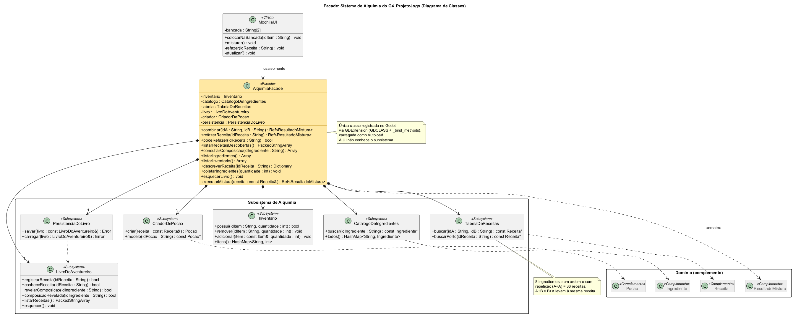

# SubEquipe_02 — GoF Facade

## Descrição

Artefato do **FOCO_02: GoFs Estruturais & IA Generativa**, sob responsabilidade de **Marcelo de Araújo Lopes**. Documenta a aplicação do padrão de projeto GoF Estrutural **Facade (Fachada)** ao **G4_ProjetoJogo**, com o contexto do problema, a modelagem na notação UML, o código e o vídeo com o padrão em execução.

Os padrões estruturais tratam de como classes e objetos são compostos para formar estruturas maiores (GAMMA et al., 2000). Pertencem a essa categoria os padrões Adapter, Bridge, Composite, Decorator, Facade, Flyweight e Proxy.

## Objetivo

Atender à entrega mínima do foco: **um GoF Estrutural (Facade), com modelo, código e vídeo com o padrão em execução**. Além disso, justificar a escolha do padrão com base na literatura e manter os elos com os artefatos das entregas anteriores.

## Metodologia

O desenvolvimento deste artefato seguiu as reuniões de alinhamento registradas nas [atas do Subgrupo 02](/Atas/SubEquipe_02.md), adotando o padrão Facade para simplificar a manipulação do subsistema de alquimia do jogo. A modelagem UML foi elaborada com diagrama de classes e o código foi desenvolvido em C++ utilizando a extensão nativa GDExtension para a Godot Engine 4.7.

## Conteúdo

### Padrão Escolhido

| Item | Descrição |
|------|-----------|
| Padrão | Facade (Fachada) |
| Categoria | GoF Estrutural |
| Autor Responsável | Marcelo de Araújo Lopes ([@MatielloAL](https://github.com/MatielloAL)) |
| Intenção do padrão | Fornecer uma interface unificada para um conjunto de interfaces de um subsistema. O Facade define uma interface de nível mais alto que torna o subsistema mais fácil de usar. |
| Justificativa da escolha | O sistema de alquimia envolve seis classes que precisam colaborar em uma ordem precisa a cada mistura. O problema não é de interfaces incompatíveis (Adapter), de hierarquia parte-todo (Composite), de responsabilidades acrescentadas em tempo de execução (Decorator), de controle de acesso (Proxy), de economia de memória com muitos objetos (Flyweight) nem de duas dimensões que variam de forma independente (Bridge). É um problema de **complexidade de uso**, exatamente o que o Facade resolve (REFACTORING.GURU, 2026). |

<p align="center">Tabela 1: Padrão escolhido pela SubEquipe_02. Fonte: Marcelo, 2026.</p>

### Contexto (Problema)

A mecânica distintiva do G4_ProjetoJogo é a alquimia. O jogador abre a mochila e combina dois ingredientes coletados no mundo (ervas, cogumelos, partes de criaturas e minérios) para criar uma poção. As regras definidas pelo grupo são:

- nesta versão existem **8 ingredientes**, e **toda dupla tem uma receita**, inclusive um ingrediente com ele mesmo (A+A). A ordem não importa (A+B = B+A), o que resulta em C(8+1, 2) = **36 receitas**;
- o resultado depende da **dupla de ingredientes**, e não dos elementos químicos que os compõem;
- a primeira vez que uma dupla é combinada, a receita é **descoberta** e registrada no **Livro do Aventureiro**, ficando salva para ser refeita a partir do livro sempre que o jogador quiser;
- cada ingrediente tem uma **composição química** (elementos da tabela periódica), que fica oculta até o ingrediente ser usado pela primeira vez em uma mistura;
- **poções não entram em misturas**, só os ingredientes base;
- misturar consome um de cada ingrediente (A+A consome dois), e refazer uma receita pelo livro exige ter os ingredientes na mochila.

Uma única mistura exige que o código consulte o catálogo de ingredientes, verifique e altere o inventário, busque a receita, crie a poção, atualize o Livro do Aventureiro, revele composições e persista o livro em `user://livro_aventureiro.sav`. Sem um ponto de entrada único, a interface da mochila precisaria conhecer e orquestrar essas seis classes, repetindo a mesma sequência em cada tela que mistura algo (arrastar ingredientes, refazer pelo livro). Qualquer mudança nas regras, como uma nova validação ou um novo formato de salvamento, se espalharia pela UI.

O `AlquimiaFacade` concentra essa orquestração. A UI chama apenas `combinar`, `refazerReceita`, `podeRefazer`, `listarReceitasDescobertas` e `consultarComposicao` e recebe um `ResultadoMistura`. No Godot, o Facade é também a **fronteira do sistema de alquimia com o motor**: do subsistema, só ele é registrado na GDExtension e carregado como *Autoload*. As classes do subsistema não são registradas e, portanto, não podem ser alcançadas pelos nós do jogo nem pelo editor.

### Modelagem (Notação UML)

A modelagem é estática, com um diagrama de classes centrado no Facade. As classes do subsistema exibem apenas os métodos que a fachada utiliza, e as classes de domínio aparecem somente como complemento, sem atributos, pois seu detalhamento não faz parte do padrão.

| Participante do padrão | Classe no modelo | Papel |
|------------------------|------------------|-------|
| Client | `MochilaUI` (C++, `godot::Control`) | Interface da mochila. Conhece somente a fachada e o `ResultadoMistura`. |
| Facade | `AlquimiaFacade` (C++, `godot::Node`) | Recebe os pedidos da UI e delega cada etapa da mistura ao subsistema, na ordem correta. |
| Classes do subsistema | `Inventario`, `CatalogoDeIngredientes`, `TabelaDeReceitas`, `LivroDoAventureiro`, `CriadorDePocao`, `PersistenciaDoLivro` | Executam o trabalho real e não sabem da existência da fachada. |

<p align="center">Tabela 2: Participantes do padrão Facade no sistema de alquimia. Fonte: Marcelo, 2026.</p>

#### Diagrama de Classes



<p align="center">Figura 1: Diagrama de classes do padrão Facade aplicado ao sistema de alquimia. Fonte: Marcelo, 2026.</p>

Pontos de destaque do modelo:

- a `MochilaUI` tem uma única associação, com a fachada. Uma chamada a `combinar` aciona, por trás, catálogo, inventário, tabela de receitas, criador de poção, livro e persistência;
- `combinar` e `refazerReceita` compartilham o método privado `executarMistura`, de modo que as duas entradas da UI usam uma única implementação das regras;
- `TabelaDeReceitas` trata A+B e B+A como a mesma dupla, e `LivroDoAventureiro` guarda separadamente as receitas descobertas e as composições reveladas;
- todas as classes do subsistema são **compostas** pela fachada. Nesta versão, o `Inventario` existe só para a alquimia. Quando o jogo tiver o jogador completo, o inventário passará a pertencer a ele e a relação vira agregação, sem mudar nada na UI;
- além das operações de mistura, a fachada oferece consultas de leitura (`listarInventario`, `descreverReceita`, `listarIngredientes`) para que a UI consiga desenhar a tela sem acessar o subsistema diretamente.

### Implementação (Código & Vídeo com Padrão em Execução)

O código deste foco fica em `src/estrutural/`, conforme a organização descrita no [README de `src/`](https://github.com/UnBArqDsw2026-2-Turma01/2026.2-T01-G4_ProjetoJogo_Entrega_03/blob/main/src/README.md).

#### Código

O padrão foi implementado na Godot Engine 4.7. Todo o código do jogo está em C++, compilado como GDExtension com a biblioteca godot-cpp: a fachada, o subsistema e os nós do jogo (mochila, mundo, jogador, baús). As cenas `.tscn` apenas instanciam esses tipos, sem scripts. As instruções de compilação estão no [README do projeto](https://github.com/UnBArqDsw2026-2-Turma01/2026.2-T01-G4_ProjetoJogo_Entrega_03/blob/main/src/estrutural/README.md).

| Participante | Código |
|--------------|--------|
| Client | [`native/src/jogo/mochila_ui.h`](https://github.com/UnBArqDsw2026-2-Turma01/2026.2-T01-G4_ProjetoJogo_Entrega_03/blob/main/src/estrutural/native/src/jogo/mochila_ui.h) e [`mochila_ui.cpp`](https://github.com/UnBArqDsw2026-2-Turma01/2026.2-T01-G4_ProjetoJogo_Entrega_03/blob/main/src/estrutural/native/src/jogo/mochila_ui.cpp) |
| Facade | [`native/src/alquimia_facade.h`](https://github.com/UnBArqDsw2026-2-Turma01/2026.2-T01-G4_ProjetoJogo_Entrega_03/blob/main/src/estrutural/native/src/alquimia_facade.h) e [`alquimia_facade.cpp`](https://github.com/UnBArqDsw2026-2-Turma01/2026.2-T01-G4_ProjetoJogo_Entrega_03/blob/main/src/estrutural/native/src/alquimia_facade.cpp) |
| Subsistema | [`native/src/subsistema.h`](https://github.com/UnBArqDsw2026-2-Turma01/2026.2-T01-G4_ProjetoJogo_Entrega_03/blob/main/src/estrutural/native/src/subsistema.h) e [`subsistema.cpp`](https://github.com/UnBArqDsw2026-2-Turma01/2026.2-T01-G4_ProjetoJogo_Entrega_03/blob/main/src/estrutural/native/src/subsistema.cpp) |
| Domínio (complemento) | [`native/src/dominio.h`](https://github.com/UnBArqDsw2026-2-Turma01/2026.2-T01-G4_ProjetoJogo_Entrega_03/blob/main/src/estrutural/native/src/dominio.h) e [`resultado_mistura.h`](https://github.com/UnBArqDsw2026-2-Turma01/2026.2-T01-G4_ProjetoJogo_Entrega_03/blob/main/src/estrutural/native/src/resultado_mistura.h) |
| Dados (8 ingredientes e 36 receitas) | [`data/alquimia.json`](https://github.com/UnBArqDsw2026-2-Turma01/2026.2-T01-G4_ProjetoJogo_Entrega_03/blob/main/src/estrutural/data/alquimia.json) |

<p align="center">Tabela 3: Arquivos de código de cada participante do padrão. Fonte: Marcelo, 2026.</p>

**Facade: a fronteira com o Godot.** Do sistema de alquimia, só a `AlquimiaFacade` e o `ResultadoMistura` que ela devolve são registrados no motor. As seis classes do subsistema não são registradas. Os nós do jogo são registrados como `RUNTIME_CLASS`, que não executa dentro do editor:

```cpp
void initialize_alquimia(ModuleInitializationLevel p_level) {
	if (p_level != MODULE_INITIALIZATION_LEVEL_SCENE) {
		return;
	}
	// Do sistema de alquimia, só a fachada (e o resultado que ela devolve) são
	// visíveis ao Godot. O subsistema não é registrado.
	GDREGISTER_CLASS(ResultadoMistura);
	GDREGISTER_CLASS(AlquimiaFacade);

	// Nós do jogo (Client da fachada). RUNTIME: não executam dentro do editor.
	GDREGISTER_RUNTIME_CLASS(MochilaUI);
	GDREGISTER_RUNTIME_CLASS(Mundo);
	// ... Jogador, Bau, IngredienteColetavel, Galinha
}
```

A fachada compõe o subsistema e expõe métodos de alto nível. Ela é carregada como *Autoload* com o nome `Alquimia`:

```cpp
class AlquimiaFacade : public Node {
	GDCLASS(AlquimiaFacade, Node)
public:
	Ref<ResultadoMistura> combinar(const String &idA, const String &idB);
	Ref<ResultadoMistura> refazerReceita(const String &idReceita);
	// ...
private:
	Ref<ResultadoMistura> executarMistura(const alquimia::Receita &receita);

	alquimia::Inventario inventario;
	alquimia::CatalogoDeIngredientes catalogo;
	alquimia::TabelaDeReceitas tabela;
	alquimia::LivroDoAventureiro livro;
	alquimia::CriadorDePocao criador;
	alquimia::PersistenciaDoLivro persistencia;
};
```

**Facade: a orquestração escondida.** `executarMistura` é o centro do padrão. Ele concentra a sequência que, sem a fachada, a UI teria de repetir em cada tela. `combinar` e `refazerReceita` apenas validam a entrada e delegam a ele:

```cpp
Ref<ResultadoMistura> AlquimiaFacade::executarMistura(const Receita &receita) {
	const String &a = receita.idIngredienteA;
	const String &b = receita.idIngredienteB;

	// 1. Inventário: há ingredientes suficientes? (A+A gasta dois)
	const bool temIngredientes = (a == b)
			? inventario.possui(a, 2)
			: inventario.possui(a, 1) && inventario.possui(b, 1);
	if (!temIngredientes) {
		return ResultadoMistura::falhou(ResultadoMistura::INGREDIENTE_INSUFICIENTE, "Faltam ingredientes na mochila.");
	}

	// 2. Inventário: consome os ingredientes.
	inventario.remover(a, 1);
	inventario.remover(b, 1);

	// 3. CriadorDePocao + Inventário: cria a poção e guarda na mochila.
	const Pocao pocao = criador.criar(receita);
	inventario.adicionar(pocao, 1);

	// 4. LivroDoAventureiro: registra a receita e revela composições.
	const bool receitaNova = livro.registrarReceita(receita.id);
	// ... revela a composição de cada ingrediente usado pela primeira vez

	// 5. PersistenciaDoLivro: só grava quando algo novo foi aprendido.
	if (receitaNova || !reveladas.is_empty()) {
		persistencia.salvar(livro);
	}
	return ResultadoMistura::sucedeu(receita.id, descreverPocao(pocao), receitaNova, reveladas);
}
```

**Subsistema: cada classe resolve uma parte.** As classes do subsistema não conhecem a fachada. Um exemplo é a regra de que a ordem não importa, que fica isolada na `TabelaDeReceitas`:

```cpp
String TabelaDeReceitas::chaveDaDupla(const String &idA, const String &idB) {
	// Ordena os ids para que A+B e B+A caiam na mesma receita.
	const String separador("+");
	return idA < idB ? idA + separador + idB : idB + separador + idA;
}
```

**Client: uma chamada por ação.** A mochila inclui apenas o cabeçalho da fachada e nunca cita uma classe do subsistema. Ela encontra a fachada pelo *Autoload* `Alquimia`, e cada ação do jogador é uma única chamada:

```cpp
// comum.h: o Client só conhece a fachada, que roda como Autoload "Alquimia".
inline AlquimiaFacade *fachada(const Node *no) {
	return no->get_node<AlquimiaFacade>(NodePath("/root/Alquimia"));
}

// mochila_ui.cpp
void MochilaUI::misturar() {
	if (bancada[0].is_empty() || bancada[1].is_empty()) {
		mostrarAviso(u("Coloque dois itens na bancada."));
		return;
	}
	const Ref<ResultadoMistura> r = fachada(this)->combinar(bancada[0], bancada[1]);
	mostrarResultado(r);
	if (r->isSucesso()) {
		bancada[0] = "";
		bancada[1] = "";
	}
	atualizar();
}
```

Os baús e os ingredientes do chão também são clientes da fachada: ambos entregam itens à mochila com `fachada(this)->coletarIngrediente(id, quantidade)`.

O teste [`tests/teste_facade.gd`](https://github.com/UnBArqDsw2026-2-Turma01/2026.2-T01-G4_ProjetoJogo_Entrega_03/blob/main/src/estrutural/tests/teste_facade.gd) exercita a fachada sem janela e passa em todos os cenários. Os cenários cobertos são:

- descoberta de receita e revelação de composição;
- repetição de uma receita já conhecida;
- A+B igual a B+A;
- recusa de poção na bancada;
- refazer receita pelo livro;
- falta de ingredientes;
- as 36 combinações;
- persistência do livro entre execuções.

#### Jogo no navegador

A versão web do projeto, compilada com a mesma extensão C++ em WebAssembly, roda direto nesta página. Clique em **Jogar** para iniciar e, depois, clique dentro do jogo antes de usar o teclado. Controles: WASD ou setas para andar, E para abrir baús, I ou Tab para abrir a mochila e Esc para fechá-la.

<div style="max-width:960px;margin:0 auto;">
  <div style="position:relative;width:100%;padding-top:56.25%;background:#3b2a2a url('jogo/capa.jpg') center/cover no-repeat;border-radius:6px;overflow:hidden;">
    <iframe data-src="jogo/index.html" style="display:none;position:absolute;top:0;left:0;width:100%;height:100%;border:0;margin:0;" title="Facade de alquimia em execução" allow="fullscreen; autoplay; gamepad" allowfullscreen></iframe>
    <button type="button" onclick="var p=this.parentNode,j=p.querySelector('iframe');p.style.background='#000';j.src=j.dataset.src;j.style.display='block';this.remove();" style="position:absolute;top:50%;left:50%;transform:translate(-50%,-50%);padding:16px 40px;font-size:22px;font-weight:bold;color:#3b2a2a;background:#f3e6cf;border:3px solid #3b2a2a;border-radius:8px;cursor:pointer;box-shadow:0 4px 0 #3b2a2a;">&#9654; Jogar</button>
  </div>
</div>

<p align="center">Jogo 1: Sistema de alquimia com o padrão Facade, em execução no navegador. Fonte: Marcelo, 2026. <a href="jogo/index.html" target="_blank">Abrir em tela cheia</a>.</p>

#### Vídeo

Apresentação do padrão Facade: o problema, a modelagem UML, o código dos participantes e o jogo em execução.

<div style="max-width:960px;margin:0 auto;">
  <video controls preload="metadata" style="width:100%;border-radius:6px;background:#000;" src="Base/Relatórios/SubEquipe_02/assets/facade_alquimia_video.mp4"></video>
</div>

<p align="center">Vídeo 1: Padrão Facade aplicado ao sistema de alquimia, em execução. Fonte: Marcelo, 2026. <a href="Base/Relatórios/SubEquipe_02/assets/facade_alquimia_video.mp4" target="_blank">Link direto para o vídeo</a>.</p>

### Rastreabilidade

| Artefato relacionado | Elo com este padrão |
|----------------------|---------------------|
| [Modelagem Estática da Entrega 02](https://unbarqdsw2026-2-turma01.github.io/2026.2-T01-G4_ProjetoJogo_Entrega_02/#/Base/Relatórios/SubEquipe_02/ModelagemEstatica) | O `modulo_mistura_quimica` (bancada de 2 slots e matriz de reações) e o arquivo `livro_aventureiro.sav` em `user://` foram detalhados no Facade como `TabelaDeReceitas`, `LivroDoAventureiro` e `PersistenciaDoLivro`. |
| [Ata Geral 04](/Atas/AtaGeral04.md) | Decisão do grupo que atribuiu o padrão estrutural ao Subgrupo 02. |
| [Ata 01 da SubEquipe 02](/Atas/AtaSub02_01.md) | Decisão do subgrupo que atribuiu o padrão Facade a Marcelo de Araújo Lopes. |

<p align="center">Tabela 4: Elos com outros artefatos. Fonte: Autores, 2026.</p>

## Referências

> GAMMA, Erich; HELM, Richard; JOHNSON, Ralph; VLISSIDES, John. **Padrões de Projeto**: soluções reutilizáveis de software orientado a objetos. Porto Alegre: Bookman, 2000.

> LARMAN, Craig. **Utilizando UML e Padrões**: uma introdução à análise e ao projeto orientados a objetos e ao desenvolvimento iterativo. 3. ed. Porto Alegre: Bookman, 2007.

> REFACTORING.GURU. **Facade**. Disponível em: https://refactoring.guru/pt-br/design-patterns/facade. Acesso em: 16 out. 2026.

> REFACTORING.GURU. **Padrões de projeto estruturais**. Disponível em: https://refactoring.guru/pt-br/design-patterns/structural-patterns. Acesso em: 16 out. 2026.

> SERRANO, Milene; SERRANO, Maurício. **Arquitetura e Desenho de Software**. Universidade de Brasília, 2026.

> UNB FCTE — ARQDSW. **GoFs Estruturais**. Módulo Padrão de Projeto. Disponível em: https://sites.google.com/view/unb-fcte-arqdsw/m%C3%B3dulos/m%C3%B3dulo-padr%C3%A3o-de-projeto/gofs-estruturais. Acesso em: 16 out. 2026.

## Nível de Contribuição dos Integrantes

| Nome | % de Contribuição |
|------|:-----------------:|
| Marcelo de Araújo Lopes | 100% |

<p align="center">Tabela 5: Contribuição dos integrantes no padrão Facade.</p>

## Histórico de Versão

| Versão | Data | Descrição | Autor(es) | Revisor |
|:------:|------|:----------|:----------|:--------|
| 1.0 | 11/10/2026 | Criação da estrutura do artefato | Marcos Vinícius Gündel da Silva | |
| 1.1 | 16/10/2026 | Escolha do padrão Facade, contexto do problema, modelagem UML (diagrama de classes), implementação em C++ (GDExtension) com explicação do código, rastreabilidade, versão web jogável e vídeo do padrão em execução | Marcelo de Araújo Lopes | |
| 1.2 | 16/10/2026 | Migração do conteúdo de Facade para arquivo dedicado (`Facade.md`) | João Victor da Silva Batista de Farias | Marcelo de Araújo Lopes |

<p align="center">Tabela 6: Histórico de versão.</p>
