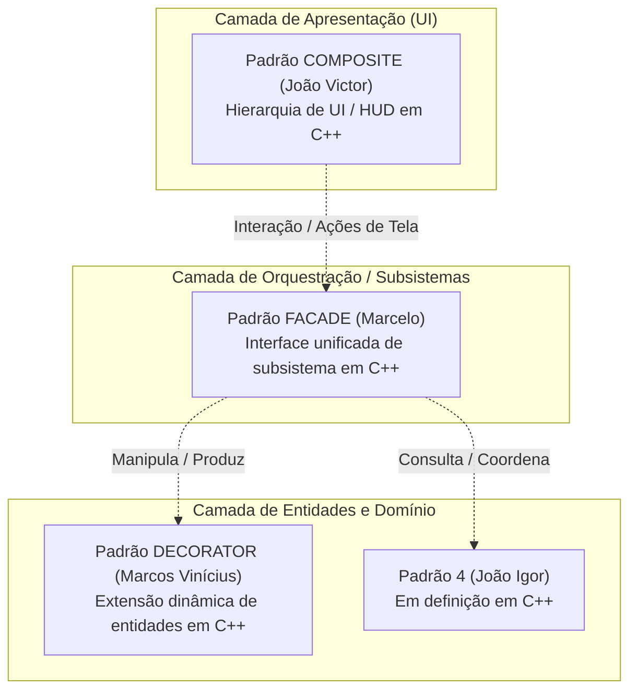

# SubEquipe_02 — GoF Estrutural (Visão Geral)

## Descrição

Artefato integrador do **FOCO_02: GoFs Estruturais & IA Generativa**, sob responsabilidade da **SubEquipe_02**. Apresenta a visão global e arquitetural dos padrões de projeto GoF Estruturais aplicados ao **G4_ProjetoJogo**, a distribuição dos padrões entre os 4 integrantes, a arquitetura modular de integração em C++ e a matriz de rastreabilidade com as entregas anteriores.

Os padrões estruturais tratam de como classes e objetos são compostos para formar estruturas maiores, mantendo essas estruturas flexíveis e eficientes (GAMMA et al., 2000). A SubEquipe 02 planejou a implementação de padrões estruturais em **C++ (C++17 e GDExtension para Godot 4.7)** cobrindo as camadas de Apresentação (UI), Orquestração de Subsistemas e Composição Dinâmica de Entidades.

---

## Objetivo

Atender e superar a entrega do foco estrutural fornecendo:
1. Uma **visão arquitetural integrada** conectando os padrões desenvolvidos pelos membros da subequipe;
2. Documentação individualizada e aprofundada para cada padrão (modelo UML, código C++, testes/demo e vídeo em execução);
3. Rastreabilidade bidirecional com os artefatos da Entrega 02 e as decisões registradas em ata.

---

## Metodologia e Divisão do Trabalho

A estratégia de trabalho da SubEquipe 02 foi alinhada na [Ata 01 (16/10/2026)](/Atas/AtaSub02_01.md), com reuniões e registros no repositório. Para assegurar autonomia criativa e foco técnico aprofundado, cada integrante assumiu a responsabilidade por um padrão GoF Estrutural independente, implementado em C++:

### Distribuição dos Padrões na SubEquipe 02

| Integrante | Padrão GoF | Linguagem / Plataforma | Módulo / Domínio no Jogo | Documentação | Código no Repositório |
|------------|:----------:|:----------------------:|--------------------------|:------------:|:---------------------:|
| **João Victor da Silva Batista de Farias** ([@beyondmagic](https://github.com/beyondmagic)) | **Composite** | C++17 / Godot | Interface de Batalha (BattleHUD), Menus e Painéis em Árvore | [1.1 GoF Composite](Base/Relatórios/SubEquipe_02/Composite.md) | [`src/estrutural/composite/`](https://github.com/UnBArqDsw2026-2-Turma01/2026.2-T01-G4_ProjetoJogo_Entrega_03/tree/main/src/estrutural/composite/) |
| **Marcos Vinícius Gündel da Silva** ([@MarcosViniciusG](https://github.com/MarcosViniciusG)) | **Decorator** | C++17 / Godot | Extensão Dinâmica de Entidades e Efeitos de Poções/Itens | [1.2 GoF Decorator](Base/Relatórios/SubEquipe_02/Decorator.md) | [`src/estrutural/decorator/`](https://github.com/UnBArqDsw2026-2-Turma01/2026.2-T01-G4_ProjetoJogo_Entrega_03/tree/main/src/estrutural/decorator/) |
| **Marcelo de Araújo Lopes** ([@MatielloAL](https://github.com/MatielloAL)) | **Facade** | C++ GDExtension / Godot 4.7 | Orquestração do Subsistema de Alquimia, Mochila e Mundo | [1.3 GoF Facade](Base/Relatórios/SubEquipe_02/Facade.md) | [`src/estrutural/native/`](https://github.com/UnBArqDsw2026-2-Turma01/2026.2-T01-G4_ProjetoJogo_Entrega_03/tree/main/src/estrutural/native/) |
| **João Igor Pereira da Costa** ([@JoaoPC10](https://github.com/JoaoPC10)) | *A definir* | C++17 / Godot | Domínio em definição pelo autor | *(Em definição)* | *(Em definição)* |

Tabela 1: Distribuição dos padrões estruturais entre os membros da SubEquipe 02. Fonte: Autores, 2026.

---

## Proposta de Integração Modular entre os Padrões em C++

A arquitetura do jogo conecta os padrões estruturais de forma modular, permitindo que a árvore de apresentação gráfica converse com o subsistema de regras e com as entidades dinâmicas sem acoplamento direto:

Figura 1: Proposta conceitual de integração dos padrões estruturais da SubEquipe 02. Fonte: Autores, 2026.

### Fluxo de Cooperação
1. **Apresentação Uniforme (Composite - João Victor):** O jogador interage com o HUD (`BattleHUD`, `UIPanel`, `UIButton`). Comandos disparados na interface (ex.: sintetizar poção ou ativar atalho) navegam pela árvore de componentes polimórficos de forma uniforme e desacoplada.
2. **Orquestração Desacoplada (Facade - Marcelo):** As solicitações complexas disparadas pela UI chegam ao `AlquimiaFacade`, que esconde toda a complexidade do catálogo de ingredientes, tabela de receitas, livro do aventureiro e persistência, entregando apenas um `ResultadoMistura`.
3. **Composição Dinâmica (Decorator - Marcos Vinícius):** As poções e itens manipulados pelo sistema podem receber modificadores e propriedades químicas acumuladas em tempo de execução sem gerar uma explosão de subclasses.
4. **Desacoplamento e Suporte (Padrão 4 - João Igor):** Expande os subsistemas de catálogo ou adaptação de interfaces periféricas.

---

## Navegação pelos Artefatos Individuais

Para conferir o detalhamento teórico, diagramas de classe UML, códigos-fonte e execuções práticas de cada padrão, acesse os artefatos dedicados:

- **[1.1 GoF Composite — João Victor da Silva Batista de Farias](Base/Relatórios/SubEquipe_02/Composite.md):** Modelagem e implementação de hierarquia de UI / HUD de Batalha com componentes folhas (`UILabel`, `UIButton`, `UIProgressBar`) e nós compostos (`UIPanel`, `BattleHUD`), com propagação recursiva de comandos e renderização unificada em C++17 e GDScript.
- **[1.2 GoF Decorator — Marcos Vinícius Gündel da Silva](Base/Relatórios/SubEquipe_02/Decorator.md):** Modelagem e implementação do padrão Decorator para enriquecimento dinâmico de entidades/itens alquímicos.
- **[1.3 GoF Facade — Marcelo de Araújo Lopes](Base/Relatórios/SubEquipe_02/Facade.md):** Fachada unificada em C++ com GDExtension para o subsistema de alquimia, catálogo de 8 ingredientes e 36 receitas, jogo jogável no navegador via WebAssembly e vídeo de demonstração.

---

## Matriz de Rastreabilidade Global

| Artefato da Entrega 02 | Mapeamento no Módulo de Padrões Estruturais |
|------------------------|---------------------------------------------|
| **Diagrama de Componentes** | As portas e interfaces dos pacotes `Core e Exploração`, `Motor de Combate` e `Sistemas de Inventário e Crafting` serviram de base para as fronteiras de cada padrão. |
| **Diagrama de Comunicação** | As 4 interações mapeadas (Combate, Mistura, Coliseu e Lojas) identificaram exatamente onde ocorria acoplamento excessivo que a Facade, o Decorator e o Composite eliminam. |
| **Diagrama de Implantação** | Mapeou a adoção do runtime nativo e bibliotecas GDExtension, justificando a escolha unificada de C++ de alto desempenho. |
| **Diagrama de Estados** | Mapeou a ativação/desativação de telas e estados de batalha tratados pelo Composite e pela Facade. |

Tabela 2: Rastreabilidade com os artefatos da Entrega 02. Fonte: Autores, 2026.

---

## Referências

> GAMMA, Erich; HELM, Richard; JOHNSON, Ralph; VLISSIDES, John. **Padrões de Projeto**: soluções reutilizáveis de software orientado a objetos. Porto Alegre: Bookman, 2000.

> LARMAN, Craig. **Utilizando UML e Padrões**: uma introdução à análise e ao projeto orientados a objetos e ao desenvolvimento iterativo. 3. ed. Porto Alegre: Bookman, 2007.

> REFACTORING.GURU. **Padrões de projeto estruturais**. Disponível em: https://refactoring.guru/pt-br/design-patterns/structural-patterns. Acesso em: 16 out. 2026.

> SERRANO, Milene; SERRANO, Maurício. **Arquitetura e Desenho de Software**. Universidade de Brasília, 2026.

> UNB FCTE — ARQDSW. **GoFs Estruturais**. Módulo Padrão de Projeto. Disponível em: https://sites.google.com/view/unb-fcte-arqdsw/m%C3%B3dulos/m%C3%B3dulo-padr%C3%A3o-de-projeto/gofs-estruturais. Acesso em: 16 out. 2026.

---

## Nível de Contribuição dos Integrantes

| Nome | % de Contribuição |
|------|:-----------------:|
| João Igor Pereira da Costa | 25% |
| João Victor da Silva Batista de Farias | 25% |
| Marcelo de Araújo Lopes | 25% |
| Marcos Vinícius Gündel da Silva | 25% |

Tabela 3: Contribuição estimada dos integrantes no foco estrutural.

---

## Histórico de Versão

| Versão | Data | Descrição | Autor(es) | Revisor |
|:------:|------|:----------|:----------|:--------|
| 1.0 | 16/10/2026 | Estruturação da visão geral integrada dos 4 padrões estruturais em C++, arquitetura de integração e matriz de rastreabilidade | João Victor da Silva Batista de Farias | Marcos Vinícius Gündel da Silva |
| 1.1 | 16/10/2026 | Separação do padrão Facade para artefato dedicado (`Facade.md`) e consolidação da visão geral integrada | João Victor da Silva Batista de Farias | Marcelo de Araújo Lopes |

Tabela 4: Histórico de versão.

