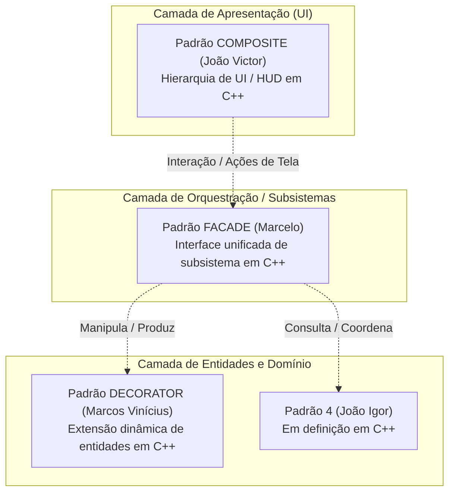
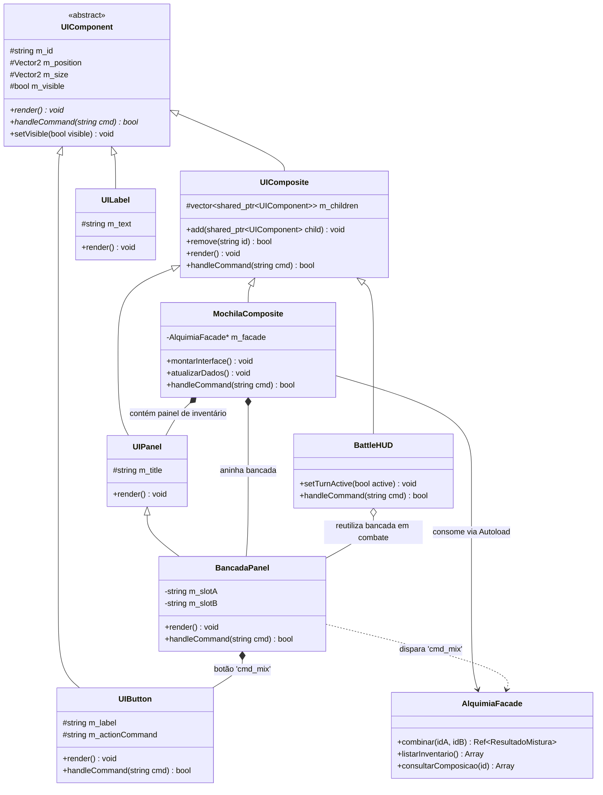

# SubEquipe_02 — GoF Estrutural (Visão Geral)

## Descrição

Artefato integrador do **FOCO_02: GoFs Estruturais & IA Generativa**, sob responsabilidade da **SubEquipe_02**. Apresenta a visão global e arquitetural dos padrões de projeto GoF Estruturais aplicados ao **G4_ProjetoJogo**, a distribuição dos padrões entre os 4 integrantes, a arquitetura modular de integração em C++ e a matriz de rastreabilidade com as entregas anteriores.

Os padrões estruturais tratam de como classes e objetos são compostos para formar estruturas maiores, mantendo essas estruturas flexíveis e eficientes (GAMMA et al., 2000). A SubEquipe 02 planejou a implementação de padrões estruturais em **C++ (C++17 e GDExtension para Godot 4.7)** cobrindo as camadas de Apresentação (UI), Orquestração de Subsistemas e Composição Dinâmica de Entidades.

---

## Objetivo

Atender e superar a entrega do foco estrutural fornecendo:
1. Uma **visão arquitetural integrada** conectando os padrões desenvolvidos pelos membros da subequipe;
2. Documentação individualizada e aprofundada para cada padrão (modelo UML, código C++, testes/demo e vídeo em execução);
3. Rastreabilidade bidirecional com os artefatos da Entrega 02 e as decisões registradas em ata.

---

## Metodologia e Divisão do Trabalho

A estratégia de trabalho da SubEquipe 02 foi alinhada na [Ata 01 (16/10/2026)](/Atas/AtaSub02_01.md), com reuniões e registros no repositório. Para assegurar autonomia criativa e foco técnico aprofundado, cada integrante assumiu a responsabilidade por um padrão GoF Estrutural independente, implementado em C++:

### Distribuição dos Padrões na SubEquipe 02

| Integrante | Padrão GoF | Linguagem / Plataforma | Módulo / Domínio no Jogo | Documentação | Código no Repositório |
|------------|:----------:|:----------------------:|--------------------------|:------------:|:---------------------:|
| **João Victor da Silva Batista de Farias** ([@beyondmagic](https://github.com/beyondmagic)) | **Composite** | C++17 / Godot | Interface de Batalha (BattleHUD), Menus e Painéis em Árvore | [1.1 GoF Composite](Base/Relatórios/SubEquipe_02/Composite.md) | [`src/estrutural/composite/`](https://github.com/UnBArqDsw2026-2-Turma01/2026.2-T01-G4_ProjetoJogo_Entrega_03/tree/main/src/estrutural/composite/) |
| **Marcos Vinícius Gündel da Silva** ([@MarcosViniciusG](https://github.com/MarcosViniciusG)) | **Decorator** | C++17 / Godot | Extensão Dinâmica de Entidades e Efeitos de Poções/Itens | [1.2 GoF Decorator](Base/Relatórios/SubEquipe_02/Decorator.md) | [`src/estrutural/decorator/`](https://github.com/UnBArqDsw2026-2-Turma01/2026.2-T01-G4_ProjetoJogo_Entrega_03/tree/main/src/estrutural/decorator/) |
| **Marcelo de Araújo Lopes** ([@MatielloAL](https://github.com/MatielloAL)) | **Facade** | C++ GDExtension / Godot 4.7 | Orquestração do Subsistema de Alquimia, Mochila e Mundo | [1.3 GoF Facade](Base/Relatórios/SubEquipe_02/Facade.md) | [`src/estrutural/native/`](https://github.com/UnBArqDsw2026-2-Turma01/2026.2-T01-G4_ProjetoJogo_Entrega_03/tree/main/src/estrutural/native/) |
| **João Igor Pereira da Costa** ([@JoaoPC10](https://github.com/JoaoPC10)) | *A definir* | C++17 / Godot | Domínio em definição pelo autor | *(Em definição)* | *(Em definição)* |

<p align="center">Tabela 1: Distribuição dos padrões estruturais entre os membros da SubEquipe 02. Fonte: Autores, 2026.</p>

---

## Proposta de Integração Modular entre os Padrões em C++

A arquitetura do jogo conecta os padrões estruturais de forma modular, permitindo que a árvore de apresentação gráfica converse com o subsistema de regras e com as entidades dinâmicas sem acoplamento direto:



<p align="center">Figura 1: Proposta conceitual de integração dos padrões estruturais da SubEquipe 02. Fonte: Autores, 2026.</p>

### Fluxo de Cooperação
1. **Apresentação Uniforme (Composite - João Victor):** O jogador interage com o HUD (`BattleHUD`, `UIPanel`, `UIButton`). Comandos disparados na interface (ex.: sintetizar poção ou ativar atalho) navegam pela árvore de componentes polimórficos de forma uniforme e desacoplada.
2. **Orquestração Desacoplada (Facade - Marcelo):** As solicitações complexas disparadas pela UI chegam ao `AlquimiaFacade`, que esconde toda a complexidade do catálogo de ingredientes, tabela de receitas, livro do aventureiro e persistência, entregando apenas um `ResultadoMistura`.
3. **Composição Dinâmica (Decorator - Marcos Vinícius):** As poções e itens manipulados pelo sistema podem receber modificadores e propriedades químicas acumuladas em tempo de execução sem gerar uma explosão de subclasses.
4. **Desacoplamento e Suporte (Padrão 4 - João Igor):** Expande os subsistemas de catálogo ou adaptação de interfaces periféricas.

---

## Análise Crítica e Refatoração: O Padrão Composite como Fundação de UI para a Facade e o Produto Final

### 1. Diagnóstico Arquitetural do Código Inicial

Na primeira versão entregue para demonstrar o padrão Facade em ambiente web jogável ([`Facade.md`](Base/Relatórios/SubEquipe_02/Facade.md)), a classe [`MochilaUI`](https://github.com/UnBArqDsw2026-2-Turma01/2026.2-T01-G4_ProjetoJogo_Entrega_03/blob/main/src/estrutural/native/src/jogo/mochila_ui.cpp) acumulou duas responsabilidades distintas:
1. **Atuar como Cliente da Fachada (Client do Facade):** Delegar operações de mistura, leitura de inventário e consulta de receitas exclusivamente para o nó `AlquimiaFacade`.
2. **Construção Imperativa e Gestão Visual de Controles (Apresentação):** Instanciar diretamente múltiplos nós concretos da Godot Engine (`memnew(TextureRect)`, `memnew(MarginContainer)`, `memnew(GridContainer)`, `memnew(VBoxContainer)`, `memnew(Button)`), controlando manualmente sua visibilidade, layout e callbacks.

Sob a ótica de Engenharia de Software e dos Padrões GoF, esse acoplamento gerou três limitações:
- **Violação do Princípio de Responsabilidade Única (SRP):** Mudanças na apresentação visual ou no tema da interface forçam alterações no mesmo arquivo que consome as regras da fachada.
- **Incapacidade de Reutilização da Bancada de Alquimia:** A lógica e os controles da bancada ficaram confinados à cena da mochila. Se o jogo necessitar acionar a síntese rápida de poções durante uma batalha em turnos (no `BattleHUD`), o código da interface precisaria ser duplicado.
- **Acoplamento Forte com a Engine:** Não é possível testar a hierarquia e o fluxo de eventos de tela de forma automatizada e isolada (modo *headless* sem carregar o runtime gráfico do Godot).

### 2. A Solução: Composite como Infraestrutura de Apresentação

A solução arquitetural definitiva da SubEquipe 02 estabelece que **toda a interface gráfica do jogo é construída como uma árvore de objetos do padrão Composite**, estruturada nas classes base [`UIComponent`](https://github.com/UnBArqDsw2026-2-Turma01/2026.2-T01-G4_ProjetoJogo_Entrega_03/blob/main/src/estrutural/composite/ui_component.hpp) e [`UIComposite`](https://github.com/UnBArqDsw2026-2-Turma01/2026.2-T01-G4_ProjetoJogo_Entrega_03/blob/main/src/estrutural/composite/ui_composite.hpp) sob responsabilidade de **João Victor**:



<p align="center">Figura 2: Arquitetura refatorada integrando o Composite como base de UI para a Facade e HUD. Fonte: Autores, 2026.</p>

### 3. Decomposição Hierárquica da Mochila Refatorada

Com a adoção do Composite, a tela da mochila passa a ser declarada e manipulada recursivamente como uma árvore uniforme:

```
MochilaComposite (UIComposite - Raiz da Tela)
├── FundoPanel (UIPanel)
├── InventarioPanel (UIPanel)
│   ├── TituloMochila (UILabel - Folha)
│   ├── GradeSlotsComposite (UIComposite)
│   │   ├── SlotItem1 (UIButton - Folha, cmd: 'select_item_1')
│   │   ├── SlotItem2 (UIButton - Folha, cmd: 'select_item_2')
│   │   └── ...
│   └── BtnFechar (UIButton - Folha, cmd: 'cmd_close')
└── BancadaELivroComposite (UIComposite)
    ├── BancadaPanel (UIPanel - Reutilizável no BattleHUD)
    │   ├── SlotA (UIButton - Folha)
    │   ├── OperadorLabel (UILabel - Folha, "+")
    │   ├── SlotB (UIButton - Folha)
    │   └── BtnMisturar (UIButton - Folha, cmd: 'cmd_mix')
    └── LivroPanel (UIPanel)
        ├── ContadorLabel (UILabel - Folha)
        └── ListaReceitasComposite (UIComposite)
```

### 4. Ganhos de Engenharia para o Produto Final

| Dimensão de Qualidade | Antes (UI Monolítica em `mochila_ui.cpp`) | Depois (UI Estruturada com GoF Composite) |
|-----------------------|-------------------------------------------|--------------------------------------------|
| **Reuso Inter-sistemas** | A bancada só existia dentro da mochila. Impossível usá-la no combate. | `BancadaPanel` é um `UIComponent` independente. Pode ser plugado no `BattleHUD` via `hud->add(bancadaPanel)` durante batalhas contra chefes. |
| **Despacho de Eventos** | *Callbacks* imperativos amarrados diretamente aos botões concretos do Godot. | Comandos polimórficos (`handleCommand("cmd_mix")`) propagados recursivamente pela árvore até o destinatário. |
| **Testabilidade** | Depende de inicialização gráfica completa do Godot e cenas `.tscn`. | Testável de forma 100% nativa e automatizada via console/CI (`make -C src/estrutural/composite run`). |
| **Manutenibilidade** | Adicionar um novo painel exige dezenas de linhas de manipulação manual de containers. | Novos painéis e controles são adicionados dinamicamente via `container->add(novoComponente)`. |

### 5. Exemplo de Código da Integração em C++

O trecho conceitual a seguir ilustra como a `MochilaComposite` monta sua hierarquia e despacha o comando de mistura diretamente para a `AlquimiaFacade`:

```cpp
// mochila_composite.hpp — Camada de Apresentação baseada no Composite
#include "ui_composite.hpp"
#include "ui_panel.hpp"
#include "ui_button.hpp"
#include "ui_label.hpp"

class MochilaComposite : public UIComposite {
private:
    AlquimiaFacade* m_facade; // Ponte com a camada de orquestração (GoF Facade)
    std::shared_ptr<UIPanel> m_bancadaPanel;

public:
    MochilaComposite(AlquimiaFacade* facade) 
        : UIComposite("MochilaComposite", {0, 0}, {1920, 1080}), m_facade(facade) {
        montarEstrutura();
    }

    void montarEstrutura() {
        // 1. Painel de Inventário
        auto invPanel = std::make_shared<UIPanel>("InventarioPanel", "Mochila do Jogador", Vector2{40, 40}, Vector2{600, 800});
        // Popula slots a partir de m_facade->listarInventario()...
        add(invPanel);

        // 2. Painel da Bancada (Componente reusável também no BattleHUD)
        m_bancadaPanel = std::make_shared<UIPanel>("BancadaPanel", "Bancada de Alquimia", Vector2{680, 40}, Vector2{800, 400});
        m_bancadaPanel->add(std::make_shared<UILabel>("LblSlotA", "Slot 1: [Vazio]", Vector2{700, 100}));
        m_bancadaPanel->add(std::make_shared<UILabel>("LblPlus", "+", Vector2{850, 100}));
        m_bancadaPanel->add(std::make_shared<UILabel>("LblSlotB", "Slot 2: [Vazio]", Vector2{900, 100}));
        m_bancadaPanel->add(std::make_shared<UIButton>("BtnMisturar", "Misturar Ingredientes", "cmd_mix", Vector2{700, 200}));
        add(m_bancadaPanel);
    }

    bool handleCommand(const std::string& command) override {
        if (command == "cmd_mix") {
            // A árvore Composite consome o comando e delega a orquestração à Facade
            std::cout << "[Composite -> Facade] Comando 'cmd_mix' interceptado! Acionando AlquimiaFacade...\n";
            // auto resultado = m_facade->combinar(slotA, slotB);
            return true;
        }
        // Propaga recursivamente para os demais filhos
        return UIComposite::handleCommand(command);
    }
};
```

---

## Jogo no Navegador

A versão web do projeto, compilada com a extensão C++ em WebAssembly, roda direto nesta página. Ela demonstra a integração prática dos padrões estruturais: o subsistema de regras e combinações de alquimia (Facade) e a apresentação visual com navegação desacoplada (Composite). Clique em **Jogar** para iniciar e clique dentro do jogo antes de usar o teclado. Controles: WASD ou setas para andar, E para abrir baús, I ou Tab para abrir a mochila e Esc para fechá-la.

<div style="max-width:960px;margin:0 auto;">
  <div style="position:relative;width:100%;padding-top:56.25%;background:#3b2a2a url('jogo/capa.jpg') center/cover no-repeat;border-radius:6px;overflow:hidden;">
    <iframe data-src="jogo/index.html?v=4.7.2" style="display:none;position:absolute;top:0;left:0;width:100%;height:100%;border:0;margin:0;" title="GoF Estrutural em execução" allow="fullscreen; autoplay; gamepad" allowfullscreen></iframe>
    <button type="button" onclick="var p=this.parentNode,j=p.querySelector('iframe');p.style.background='#000';j.src=j.dataset.src;j.style.display='block';this.remove();" style="position:absolute;top:50%;left:50%;transform:translate(-50%,-50%);padding:16px 40px;font-size:22px;font-weight:bold;color:#3b2a2a;background:#f3e6cf;border:3px solid #3b2a2a;border-radius:8px;cursor:pointer;box-shadow:0 4px 0 #3b2a2a;">&#9654; Jogar</button>
  </div>
</div>

<p align="center">Jogo 1: Demonstração dos padrões GoF Estruturais, em execução no navegador. Fonte: Autores, 2026. <a href="jogo/index.html?v=4.7.2" target="_blank">Abrir em tela cheia</a>.</p>

---

## Navegação pelos Artefatos Individuais

Para conferir o detalhamento teórico, diagramas de classe UML, códigos-fonte e execuções práticas de cada padrão, acesse os artefatos dedicados:

- **[1.1 GoF Composite — João Victor da Silva Batista de Farias](Base/Relatórios/SubEquipe_02/Composite.md):** Modelagem e implementação de hierarquia de UI / HUD de Batalha com componentes folhas (`UILabel`, `UIButton`, `UIProgressBar`) e nós compostos (`UIPanel`, `BattleHUD`), com propagação recursiva de comandos e renderização unificada em C++17 e GDScript.
- **[1.2 GoF Decorator — Marcos Vinícius Gündel da Silva](Base/Relatórios/SubEquipe_02/Decorator.md):** Modelagem e implementação do padrão Decorator para enriquecimento dinâmico de entidades/itens alquímicos.
- **[1.3 GoF Facade — Marcelo de Araújo Lopes](Base/Relatórios/SubEquipe_02/Facade.md):** Fachada unificada em C++ com GDExtension para o subsistema de alquimia, catálogo de 8 ingredientes e 36 receitas, testes de cobertura e vídeo de demonstração.

---

## Matriz de Rastreabilidade Global

| Artefato da Entrega 02 | Mapeamento no Módulo de Padrões Estruturais |
|------------------------|---------------------------------------------|
| **Diagrama de Componentes** | As portas e interfaces dos pacotes `Core e Exploração`, `Motor de Combate` e `Sistemas de Inventário e Crafting` serviram de base para as fronteiras de cada padrão. |
| **Diagrama de Comunicação** | As 4 interações mapeadas (Combate, Mistura, Coliseu e Lojas) identificaram exatamente onde ocorria acoplamento excessivo que a Facade, o Decorator e o Composite eliminam. |
| **Diagrama de Implantação** | Mapeou a adoção do runtime nativo e bibliotecas GDExtension, justificando a escolha unificada de C++ de alto desempenho. |
| **Diagrama de Estados** | Mapeou a ativação/desativação de telas e estados de batalha tratados pelo Composite e pela Facade. |

<p align="center">Tabela 2: Rastreabilidade com os artefatos da Entrega 02. Fonte: Autores, 2026.</p>

---

## Referências

> GAMMA, Erich; HELM, Richard; JOHNSON, Ralph; VLISSIDES, John. **Padrões de Projeto**: soluções reutilizáveis de software orientado a objetos. Porto Alegre: Bookman, 2000.

> LARMAN, Craig. **Utilizando UML e Padrões**: uma introdução à análise e ao projeto orientados a objetos e ao desenvolvimento iterativo. 3. ed. Porto Alegre: Bookman, 2007.

> REFACTORING.GURU. **Padrões de projeto estruturais**. Disponível em: https://refactoring.guru/pt-br/design-patterns/structural-patterns. Acesso em: 16 out. 2026.

> SERRANO, Milene; SERRANO, Maurício. **Arquitetura e Desenho de Software**. Universidade de Brasília, 2026.

> UNB FCTE — ARQDSW. **GoFs Estruturais**. Módulo Padrão de Projeto. Disponível em: https://sites.google.com/view/unb-fcte-arqdsw/m%C3%B3dulos/m%C3%B3dulo-padr%C3%A3o-de-projeto/gofs-estruturais. Acesso em: 16 out. 2026.

---

## Nível de Contribuição dos Integrantes

| Nome | % de Contribuição |
|------|:-----------------:|
| João Igor Pereira da Costa | 25% |
| João Victor da Silva Batista de Farias | 25% |
| Marcelo de Araújo Lopes | 25% |
| Marcos Vinícius Gündel da Silva | 25% |

<p align="center">Tabela 3: Contribuição estimada dos integrantes no foco estrutural.</p>

---

## Histórico de Versão

| Versão | Data | Descrição | Autor(es) | Revisor |
|:------:|------|:----------|:----------|:--------|
| 1.0 | 16/10/2026 | Estruturação da visão geral integrada dos 4 padrões estruturais em C++, arquitetura de integração e matriz de rastreabilidade | João Victor da Silva Batista de Farias | Marcos Vinícius Gündel da Silva |
| 1.1 | 16/10/2026 | Separação do padrão Facade para artefato dedicado (`Facade.md`) e consolidação da visão geral integrada | João Victor da Silva Batista de Farias | Marcelo de Araújo Lopes |
| 1.2 | 16/10/2026 | Adição da análise crítica de arquitetura e proposta de refatoração integrando o Composite como fundação de UI para a Facade e o produto final | João Victor da Silva Batista de Farias | Marcos Vinícius Gündel da Silva |
| 1.3 | 16/10/2026 | Inclusão da demonstração jogável em WebAssembly (Godot 4 e C++) integrando os padrões estruturais | João Victor da Silva Batista de Farias | Marcelo de Araújo Lopes |

<p align="center">Tabela 4: Histórico de versão.</p>
