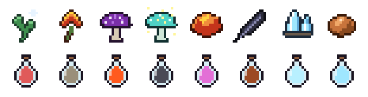
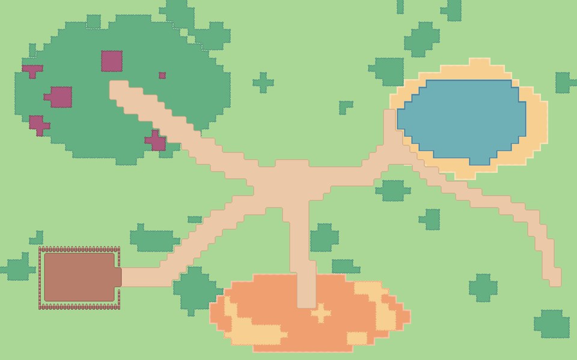
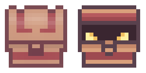
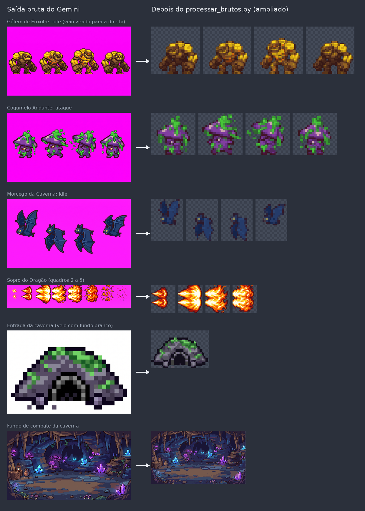
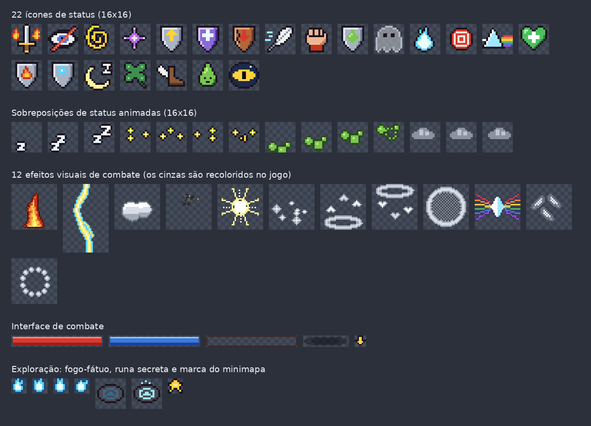

# SubEquipe 02: IA Generativa

## Descrição

Registro dos **participantes no FOCO_02: GoFs Estruturais & IA Generativa**. Reúne os pontos de vista de cada integrante da SubEquipe_02 sobre as lições aprendidas e o uso de IA Generativa na entrega.

## Objetivo

Registrar, com senso crítico, o que cada membro aprendeu sobre padrões de projeto GoF Estruturais e como utilizou IA Generativa no trabalho. **TODOS DEVEM PARTICIPAR.**

## Metodologia

Cada integrante registra, em uma subseção própria, as lições aprendidas e uma análise crítica do uso da IA Generativa, acompanhada de evidências, como os históricos das conversas ou os resultados gerados pela ferramenta. As saídas da IA devem ser conferidas na literatura antes de qualquer uso, e a ferramenta não deve aparecer como autora nos históricos de versão.

## Conteúdo

### Participantes no Foco_02

| Nome do Membro | Lições Aprendidas | Uso da IA Generativa (senso crítico) |
|----------------|-------------------|--------------------------------------|
| João Igor Pereira da Costa | Aprendi a aplicar o padrão Bridge em C++17, separando o controlador de movimento da fonte de entrada, além de compreender sua integração com o Decorator e a importância de testes independentes. | Utilizei o ChatGPT (GPT-6) para analisar compatibilidades, sugerir correções e criar testes; apesar da agilidade, foi necessário considerar suas limitações pela ausência dos arquivos completos do Godot e validar a integração manualmente. |
| João Victor da Silva Batista de Farias | Separação entre árvore de apresentação (Composite) e regras de domínio (Facade); reuso de painéis de UI entre combate e mochila | Uso do Antigravity (Gemini) com a skill `grill-me` para sabatinar o design arquitetural; apoio na compilação nativa (Linux .so) e scripts de automação; correção crítica de erros de exportação web e carregamento de assets |
| Marcelo de Araújo Lopes | Facade como interface única de um subsistema; fronteira C++/Godot com GDExtension; layout de diagramas UML legíveis | Claude e Gemini para entender o Facade, gerar assets, apoiar o C++, depurar e organizar a documentação; falhas no diagrama e na versão web corrigidas após testes |
| Marcos Vinícius Gündel da Silva | Decorator como um efeito que é e tem um personagem; consulta pelo topo da cadeia; nem todo efeito deve virar decorador; cooperação com a Facade | Claude para analisar o encaixe das poções no Decorator, modelar, implementar, documentar e gerar assets por script; Gemini para inimigos, cenários e efeitos; saídas conferidas no jogo e corrigidas |

Tabela 1: Síntese dos pontos de vista dos participantes no Foco_02. Fonte: Autores, 2026.

### João Igor Pereira da Costa

#### Lições Aprendidas

Durante o desenvolvimento do padrão GoF Bridge, aprendi a importância de separar responsabilidades que variam de forma independente, desacoplando o controlador de movimento da fonte de entrada. Essa abordagem permite que diferentes dispositivos, como teclado e controle, ou fontes de intenção, como uma inteligência artificial, sejam utilizados sem exigir alterações na lógica principal de movimentação.

Também aprofundei meus conhecimentos sobre composição, abstração e implementação em C++17, compreendendo como o padrão Bridge pode reduzir a quantidade de classes necessárias quando existem diferentes combinações entre personagens e fontes de entrada. Além disso, explorei a integração entre padrões de projeto, especialmente a relação com o Decorator, que permite utilizar atributos modificados por efeitos para definir a velocidade do personagem.

Por fim, compreendi a importância de realizar testes independentes da engine para verificar a lógica central do padrão, além de identificar que a integração com o Godot exige validações adicionais para garantir a compatibilidade com as classes e interfaces existentes no projeto.

#### Uso da IA Generativa (senso crítico)

Foi utilizada a ferramenta **ChatGPT, da OpenAI, modelo GPT-6**, como apoio ao desenvolvimento e à revisão do padrão Bridge. A ferramenta foi empregada para analisar a compatibilidade entre os códigos do padrão Decorator e a proposta de implementação do Bridge, identificar possíveis incompatibilidades, auxiliar na organização dos arquivos e desenvolver testes para verificar o funcionamento do núcleo do padrão em C++17.

Entre as vantagens observadas, destacam-se a agilidade na identificação de dependências, a sugestão de melhorias na estrutura do código e o apoio à elaboração de testes para situações como deslocamento, normalização do movimento diagonal, troca da fonte de entrada e desativação do controlador. Os testes do núcleo implementado foram executados com sucesso, conforme registrado na conversa com a ferramenta.

Entretanto, a utilização da IA também apresentou limitações. A ferramenta não tinha acesso aos arquivos específicos de integração com o Godot, como as implementações completas de `Jogador` e `Mundo`. Por isso, não foi possível confirmar integralmente a compatibilidade da solução com o projeto original, apenas pelos prompts enviados.

Os resultados gerados foram tratados como apoio ao desenvolvimento, sendo necessário distinguir os testes efetivamente executados das funcionalidades que ainda dependem de integração e validação no ambiente Godot.

### João Victor da Silva Batista de Farias

#### Lições Aprendidas

Antes de aplicar o Composite, a interface da mochila misturava construção visual de botões diretamente com as chamadas de mistura química da bancada. A principal lição prática foi separar o que é apresentação visual do que é orquestração de regras de negócio.

Quando estruturei a tela em uma árvore de componentes (`UIComponent`), ficou nítido que a `AlquimiaFacade` só precisa receber o comando final (`cmd_mix`) e devolver o resultado da mistura. A árvore de UI cuida de propagar cliques, calcular recuos visuais e decidir o que exibir ou esconder sem poluir o subsistema de poções. Essa separação também permitiu reaproveitar o mesmo painel da bancada dentro do menu de combate (`BattleHUD`) sem duplicar controles visuais.

#### Uso da IA Generativa (senso crítico)

Usei o assistente Antigravity com o modelo Gemini. Para conduzir as decisões de arquitetura antes de tocar no código, ativei a skill `grill-me`. Essa skill coloca a IA no papel de entrevistadora crítica: em vez de gerar código por antecipação, ela faz perguntas duras sobre o design proposto, apontando ambiguidades, suposições frágeis e casos de borda.

As perguntas da ferramenta me ajudaram a alinhar como a árvore trataria a propagação de eventos polimórficos de trás para frente, como isolar a lógica de interface do motor de jogo para rodar testes no terminal e como dividir as fronteiras entre o Composite e a Facade do Marcelo.

A IA também serviu para acelerar tarefas mecânicas e de infraestrutura: gerou scripts em Python para converter e importar o pacote de texturas TinyPixel, configurou o Makefile com testes de console e auxiliou nos comandos de compilação da biblioteca compartilhada (`.so`) para Linux via SCons e godot-cpp.

Por outro lado, o uso exigiu intervenção manual e senso crítico em pontos importantes onde a ferramenta falhou:

1. **Compilação e suporte a plataformas:** a IA assumiu inicialmente arquivos voltados apenas para Windows e Web, deixando o arquivo de configuração `.gdextension` sem a referência da biblioteca Linux (`.so`), o que gerava falha de carregamento no motor.
2. **Conflito de versões de exportação web:** ao gerar o pacote `.pck` para a versão do navegador, houve incompatibilidade de cabeçalho entre o Godot 4.8 e o 4.7, além de retenção de arquivos antigos pelo cache do navegador. Foi preciso depurar os cabeçalhos HTTP via terminal e configurar `cache: 'no-store'` no carregador JavaScript.
3. **Erros de importação de texturas:** a ferramenta tentou referenciar caminhos inexistentes de sprites sem tratamento de erro, gerando avisos no log da engine até que criássemos um gerador de placeholders e importador automático em Python.

A experiência mostrou que a IA funciona bem como debatedora de arquitetura e geradora de scripts de apoio, mas confiar cegamente no código ou na configuração sugerida sem testar cada etapa no terminal rapidamente quebra a compilação do projeto.

### Marcelo de Araújo Lopes

#### Lições Aprendidas

A principal lição foi entender o Facade como uma decisão sobre **quem pode enxergar o quê**. No sistema de alquimia, uma única mistura passa por seis classes, e a interface da mochila não precisa conhecer nenhuma delas. Ao implementar em C++ com GDExtension, isso ficou concreto: só a `AlquimiaFacade` é registrada no Godot, e o subsistema simplesmente não existe para o resto do jogo. O padrão deixou de ser um desenho no slide e virou uma fronteira imposta pela própria ferramenta.

#### Uso da IA Generativa (senso crítico)

Usei duas ferramentas: o **Claude** (Anthropic), pelo Claude Code integrado ao VS Code, e o **Gemini** (Google). Os usos foram:

- **entender o padrão Facade**, discutindo como a mistura de ingredientes se encaixaria nos papéis de Client, Facade e Subsistema antes de modelar;
- **gerar os assets que faltavam no jogo**: o pacote TinyPixel não tinha ícones de ingredientes e poções nem baús. Os ícones (Figura 1) e o mapa (Figura 2) foram gerados por scripts escritos com o Claude, e o baú foi desenhado com o Gemini (Figura 3);
- **apoiar a implementação do código C++** com GDExtension, seguindo as decisões que eu tomei sobre as regras do jogo e a estrutura das classes;
- **depurar erros** de compilação, de exportação para a web e de exibição na página;
- **organizar a entrega e a documentação no GitHub Pages**: a estrutura dos arquivos `.md` no Docsify, as seções exigidas pelo modelo da disciplina, as tabelas, as legendas, o histórico de versão, a página de participações e a publicação do jogo e do vídeo na página do artefato.

Figura 1: Os 8 ingredientes (linha de cima) e algumas das 36 poções (linha de baixo), em pixel art 16x16. Fonte: Claude (Anthropic), por meio de script gerado a pedido de Marcelo, 2026.

Figura 2: Mapa do mundo de teste, com vila, trilhas, floresta, lago, pedreira e acampamento, montado a partir dos autotiles do TinyPixel. Fonte: Claude (Anthropic), por meio de script gerado a pedido de Marcelo, 2026.

Figura 3: Baú fechado e aberto usados no jogo. Fonte: Gemini (Google), a partir de referência visual do pacote TinyPixel indicada por Marcelo, 2026.

### Marcos Vinícius Gündel da Silva

#### Lições Aprendidas

A principal lição foi entender o Decorator como duas relações ao mesmo tempo: o efeito **é** um personagem e **tem** um personagem. O padrão é uma solução elegante para evitar subclasses e ramifações excessivas.

Também aprendi que os detalhes da cadeia importam. O dano do veneno precisa ser calculado com a resistência do topo da cadeia, e não só com a do objeto envolvido; caso contrário, um Antídoto bebido depois do veneno não funcionaria. E nem tudo deve virar decorador: das 36 poções, só as 25 que mudam o comportamento do personagem por um tempo usam o padrão, enquanto curas e danos diretos agem uma vez e acabam. Por fim, ligar o Decorator ao jogo pela Facade do Marcelo mostrou como dois padrões estruturais funcionam em conjunto.

#### Uso da IA Generativa (senso crítico)

Usei duas ferramentas: o **Claude** (Anthropic, modelo Claude Opus 5.5), pelo Claude Code integrado ao VS Code, e o **Gemini** (Google, Gemini Pro 3.1 Max com o gerador de imagens Nano Banana Pro). Os usos foram:

- **analisar onde o Decorator se encaixa no jogo**: pedi ao Claude o levantamento das 36 poções existentes no código e discutimos quais efeitos são de fato decorações (bônus e penalidades com duração, que se acumulam no personagem e podem ser removidos) e quais são ações instantâneas, como curar ou causar dano, que não deveriam ser forçadas no padrão. Também levantamos as mecânicas que o jogo ainda não tinha para os efeitos fazerem sentido, como atributos, combate por turnos, inimigos e uso de itens;
- **planejar os assets necessários**: a partir dessas mecânicas, o Claude listou cada asset com tamanho, quantidade de quadros e caminho no repositório, e escreveu os prompts para a geração das imagens;
- **gerar a arte que exigia desenho**: no Gemini, gerei em 17/10/2026 os três inimigos com suas animações, os dois fundos de combate, o mapa e a entrada da caverna e o efeito do Sopro do Dragão, anexando sprites do próprio jogo como referência de estilo (Figura 4);
- **processar e completar os assets**: o Claude escreveu o script `processar_brutos.py`, que recorta o fundo das imagens do Gemini, separa e espelha os quadros, padroniza a escala de cada inimigo e reduz tudo ao tamanho final, e o `gerar_assets_efeitos.py`, que desenha por código os 22 ícones de status, as animações de status, os 12 efeitos visuais de combate, a interface de combate e os elementos de exploração (Figura 5). Ao todo, foram 178 arquivos de imagem;
- **implementar partes do jogo não relacionadas com o padrão**: o Claude escreveu o núcleo em C++17 o combate por turnos, da caverna, das runas, dos testes automatizados e da nova versão para navegador.

Figura 4: Imagens geradas pelo Gemini (esquerda) e o resultado depois do processamento por script (direita), ampliado para visualização. Fonte: Gemini (Google), a partir de prompts e referências indicados por Marcos, com processamento por script gerado pelo Claude (Anthropic), 2026.

Figura 5: Ícones de status, animações de status, efeitos visuais de combate, interface de combate e elementos de exploração desenhados por código, ampliados para visualização. Fonte: Claude (Anthropic), por meio de script gerado a pedido de Marcos, 2026.

O uso exigiu conferência constante, porque nenhuma das duas ferramentas acertou tudo de primeira:

1. **O Gemini não entrega pixel art pronta para o jogo.** As imagens vieram em JPEG com fundo magenta em vez de transparência, com cada "pixel" do desenho ocupando dezenas de pixels reais, quadros fora de uma grade regular e escalas diferentes entre folhas do mesmo inimigo (o Gólem da animação de dano veio com quase o dobro do tamanho). Algumas instruções também foram ignoradas: duas folhas do Gólem vieram viradas para a direita, a entrada da caverna veio com fundo branco, a animação de dano do Cogumelo veio com quatro quadros em vez de dois e a de derrota não mostra o cogumelo derretendo, como pedido. Descartei duas tentativas do Cogumelo e uma do Morcego antes de chegar às versões usadas.
2. **O script do Claude também errou e precisou de correção.** Na primeira versão, a separação dos quadros juntou dois quadros da derrota do Gólem e cortou as chamas do Sopro do Dragão, e a redução de cores apagou cores pouco frequentes, como os cristais roxos do mapa e o brilho laranja do Gólem. Só percebi esses problemas conferindo prévias ampliadas de cada imagem.
3. **Uma decisão da IA não combinava com o jogo.** O Claude desenhou as animações de combate do jogador a partir do personagem substituto do projeto, e não do personagem do pacote TinyPixel usado na versão publicada, porque a licença do pacote impede versionar artes derivadas dele. Ao comparar, percebi que eram personagens completamente diferentes. Descartamos essas animações e decidimos que o combate usa os mesmos quadros da exploração, com as ações animadas no código.

A IA acelerou muito a parte artística, que não é o foco da disciplina, e a implementação de partes auxiliares ao padrão, que eu não teria como fazer neste tamanho dentro do prazo. Em compensação, cada saída precisou ser verificada: confiar no resultado sem olhar teria levado para o jogo inimigos cortados, cores erradas, um jogo que travava ao abrir e um combate impossível de vencer. As decisões de projeto foram discutidas com a IA, mas a escolha final , revisão de cada resultado e a modelagem seguindo o padrão de projeto ficaram comigo.

## Referências

> GAMMA, Erich; HELM, Richard; JOHNSON, Ralph; VLISSIDES, John. **Padrões de Projeto**: soluções reutilizáveis de software orientado a objetos. Porto Alegre: Bookman, 2000.

> REFACTORING.GURU. **Facade**. Disponível em: https://refactoring.guru/pt-br/design-patterns/facade. Acesso em: 16 out. 2026.

## Nível de Contribuição dos Integrantes

| Nome | % de Contribuição |
|------|-------------------|
| João Igor Pereira da Costa | 25% |
| João Victor da Silva Batista de Farias | 25% |
| Marcelo de Araújo Lopes | 25% |
| Marcos Vinícius Gündel da Silva | 25% |

Tabela 2: Contribuição dos integrantes.

## Histórico de Versão

| Versão | Data | Descrição | Autor(es) | Revisor |
|:------:|------|:----------|:----------|:--------|
| 1.0 | | | | |
| 1.1 | 16/10/2026 | Adição das lições aprendidas e do uso de IA Generativa de Marcelo de Araújo Lopes | [Marcelo de Araújo Lopes](https://github.com/MatielloAL) | |
| 1.2 | 16/10/2026 | Adição das lições aprendidas e do uso de IA Generativa de João Victor da Silva Batista de Farias | [João Victor da Silva Batista de Farias](https://github.com/beyondmagic) | |
| 1.3 | 17/10/2026 | Humanização e detalhamento crítico das lições aprendidas e do uso de IA Generativa de João Victor da Silva Batista de Farias | [João Victor da Silva Batista de Farias](https://github.com/beyondmagic) | [Marcelo de Araújo Lopes](https://github.com/MatielloAL) |
| 1.4 | 17/10/2026 | Adição do uso de IA Generativa de Marcos Vinícius Gündel da Silva, com as figuras dos assets gerados | [Marcos Vinícius Gündel da Silva](https://github.com/MarcosViniciusG) | |
| 1.5 | 18/10/2026 | Lições aprendidas de Marcos Vinícius Gündel da Silva e uso de IA Generativa | [Marcos Vinícius Gündel da Silva](https://github.com/MarcosViniciusG) | |

Tabela 3: Histórico de versão.

