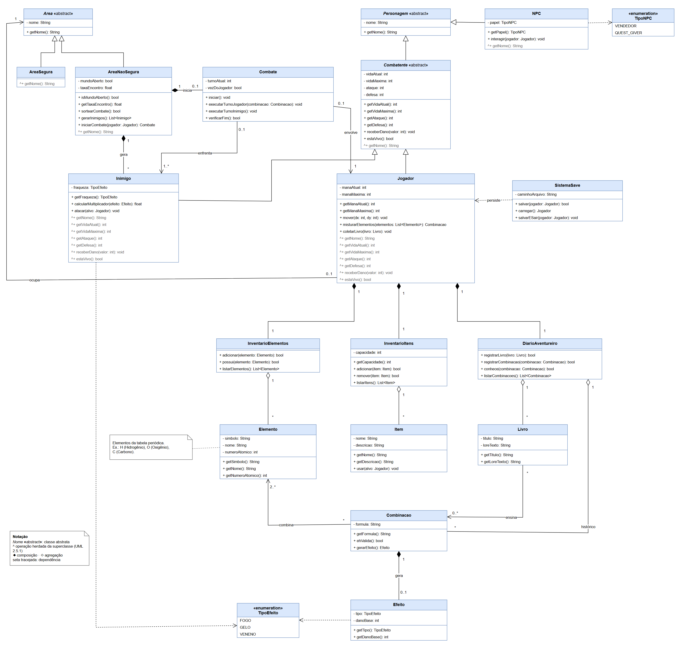
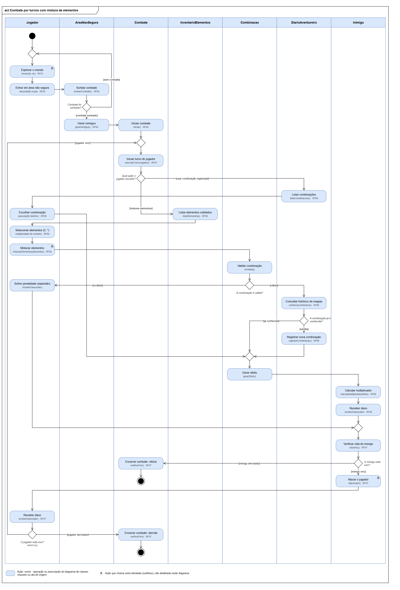
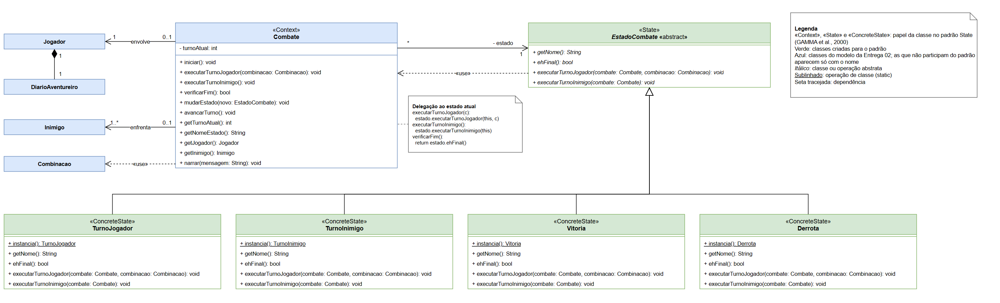
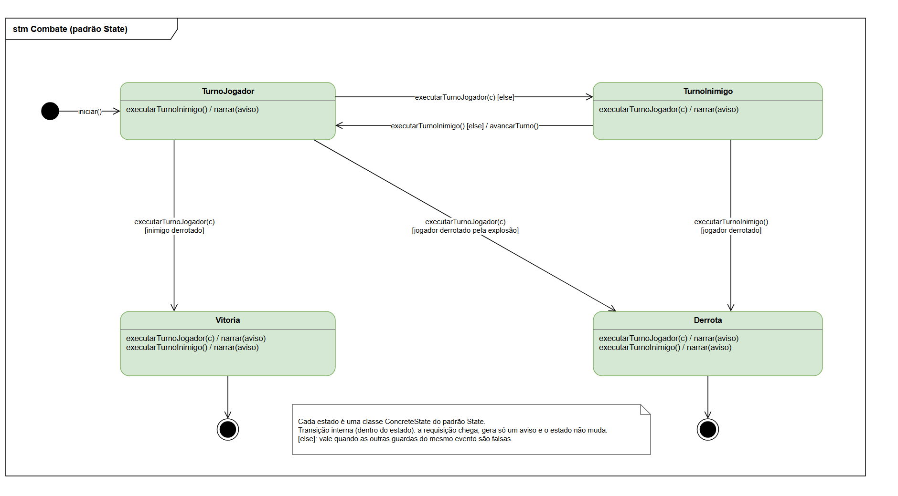

# SubEquipe_03 — GoF Comportamental

## Descrição

Artefato do **FOCO_03: GoFs Comportamentais & IA Generativa**, sob responsabilidade da SubEquipe_03. Documenta a aplicação do padrão de projeto GoF Comportamental **State** ao combate por turnos do **G4_ProjetoJogo**, com o contexto do problema, a modelagem na notação UML, o código e o vídeo com o padrão em execução.

Os padrões comportamentais tratam de algoritmos e da atribuição de responsabilidades entre objetos, descrevendo também os padrões de comunicação entre eles (GAMMA et al., 2000). Pertencem a essa categoria os padrões Chain of Responsibility, Command, Interpreter, Iterator, Mediator, Memento, Observer, State, Strategy, Template Method e Visitor.

## Objetivo

- Atender à entrega mínima do foco: um GoF Comportamental, com modelo, código e vídeo com o padrão em execução.
- Justificar a escolha do padrão com base na literatura e manter os elos com os artefatos das entregas anteriores.

## Metodologia

A subequipe trabalhou em duas reuniões pelo Google Meet, com os três integrantes, ambas gravadas e transcritas: em 17/10/2026, das 20h33 às 23h26 ([Ata 01](/Atas/AtaSub03_01.md)), e em 18/10/2026, das 19h41 às 20h51 ([Ata 02](/Atas/AtaSub03_02.md)). Pedro Teixeira Moriel Sanchez registrou as atas a partir das gravações e das transcrições. Depois da segunda reunião, a equipe seguiu com a implementação, os testes, a documentação e a gravação do vídeo.

1. **Escolha do padrão (17/10).** A equipe comparou o State com o Strategy, o Command e o Memento e escolheu o State, para organizar o combate sem acumular condicionais sobre o turno.
2. **Revisão do modelo (17/10).** Os diagramas de classes e de atividades da Entrega 02 foram revisados a partir do feedback da professora, para servirem de base ao padrão.
3. **Modelagem do padrão (18/10).** A equipe revisou o diagrama de classes do padrão e a máquina de estados do combate e decidiu que cada combinação exige a quantidade exata de cada elemento, como dois de hidrogênio e um de oxigênio para formar H2O.
4. **Implementação e testes (18/10).** Programa de terminal em C++17, com um arquivo para cada participante do padrão e testes automáticos.
5. **Vídeo (18/10).** Gravação do padrão em execução.

**Ferramentas.** Os diagramas foram editados em conjunto no Draw.io, pelo Google Drive. Problemas de sincronização do arquivo atrasaram a revisão, mas foram resolvidos durante a chamada. O código foi escrito em C++17 e compilado com g++ e make. A equipe usou IA generativa em várias etapas, e esse uso está descrito no artefato [IA Generativa](IAGenerativa.md).
## Conteúdo

### Padrão Escolhido

| Item | Descrição |
|------|-----------|
| Padrão | State |
| Categoria | GoF Comportamental |
| Intenção do padrão | Permitir que um objeto altere seu comportamento quando o seu estado interno muda, de modo que o objeto pareça ter mudado de classe (GAMMA et al., 2000). |
| Justificativa da escolha | O combate por turnos tem momentos bem definidos (vez do jogador, vez do inimigo, vitória e derrota), e o mesmo pedido precisa ter efeitos diferentes em cada um deles. Gamma et al. (2000) indicam o State quando o comportamento de um objeto depende do seu estado e as operações acumulam condicionais sobre ele. A Modelagem Dinâmica da Entrega 02 já apontava a alternância de turnos como candidata a um padrão comportamental. |

<p align="center">Tabela 1: Padrão escolhido pela SubEquipe_03. Fonte: SOUZA, Carlos; SANCHEZ, Pedro; REIS, Renan (2026).</p>

Na reunião de 17/10, a equipe também considerou outros três padrões da mesma categoria e os descartou pelos seguintes motivos:

- **Strategy.** Serviria para o cálculo do dano elemental, mas resolveria um ponto muito específico do jogo, e não o fluxo do combate.
- **Command.** Seria útil para guardar o histórico das ações, o que pesa mais num combate em tempo real do que num combate por turnos simples como o do jogo.
- **Memento.** Atenderia ao salvamento do jogo, mas criar um padrão inteiro para uma única funcionalidade foi considerado exagero.

### Contexto (Problema)

O combate por turnos é a mecânica central do jogo. A cada turno, o jogador mistura elementos químicos ou usa uma combinação já registrada no Diário do Aventureiro. Depois, o inimigo ataca, e o laço se repete até a vitória ou a derrota.

No modelo da Entrega 02, a classe Combate controlava esse fluxo com os atributos turnoAtual e vezDoJogador e com as operações executarTurnoJogador, executarTurnoInimigo e verificarFim. Sem um padrão, cada operação precisaria testar de quem é a vez e se a luta já acabou antes de agir:

```cpp
// Sem o padrão: cada operação repete os mesmos testes.
void Combate::executarTurnoJogador(const Combinacao &combinacao) {
    if (combateEncerrado) { narrar("O combate já terminou."); return; }
    if (!vezDoJogador) { narrar("É a vez do inimigo."); return; }
    // ... mistura, dano e verificação de vitória
    vezDoJogador = false;
}

void Combate::executarTurnoInimigo() {
    if (combateEncerrado) { narrar("O combate já terminou."); return; }
    if (vezDoJogador) { narrar("Ainda é a vez do jogador."); return; }
    // ... ataque e verificação de derrota
    vezDoJogador = true;
}
```

Esse desenho traz três problemas:

- **Condicionais repetidas.** Os mesmos testes se espalham por todas as operações, e esquecer um deles gera um erro difícil de encontrar.
- **Rigidez.** Um estado novo, como um jogador atordoado que perde a vez ou a fuga do combate, exigiria alterar todas as operações.
- **Regras dispersas.** O que acontece em cada momento da luta fica espalhado por vários métodos, em vez de reunido em um só lugar.

### Modelagem (Notação UML)

O modelo do padrão parte dos diagramas de classes e de atividades da Entrega 02, que a equipe revisou nesta entrega a partir do feedback da professora (versão 1.3).

<details>
<summary>Ver os diagramas da Entrega 02 revisados (versão 1.3)</summary>



<p align="center">Figura 1: Diagrama de classes do G4_ProjetoJogo (versão 1.3), na notação UML. Fonte: SOUZA, Carlos; SANCHEZ, Pedro; REIS, Renan (2026), com apoio de IA generativa.</p>



<p align="center">Figura 2: Diagrama de atividades "Combate por turnos com mistura de elementos" (versão 1.3), na notação UML. Fonte: SOUZA, Carlos; SANCHEZ, Pedro; REIS, Renan (2026), com apoio de IA generativa.</p>

</details>

#### Diagrama de classes do padrão

A Figura 3 mostra o padrão State aplicado ao combate. As classes em verde foram criadas para o padrão, e as azuis já existiam no modelo; as que não participam do padrão aparecem só com o nome. Acima do nome de cada classe aparece o seu papel no padrão. Clique nas figuras para ampliá-las.



<p align="center">Figura 3: Diagrama de classes do padrão State aplicado ao combate por turnos, na notação UML. Fonte: SOUZA, Carlos; SANCHEZ, Pedro; REIS, Renan (2026), com apoio de IA generativa.</p>

| Participante | Classe | Papel no combate |
|--------------|--------|------------------|
| Context | Combate | Guarda o estado atual e repassa a ele cada pedido. Mantém as operações públicas da Entrega 02, mas não testa mais de quem é a vez. |
| State | EstadoCombate | Classe abstrata que declara o que todo estado sabe fazer: informar o nome, dizer se é final e tratar os dois pedidos do turno. |
| ConcreteState | TurnoJogador | Aplica a combinação escolhida e passa a vez ao inimigo, ou leva à vitória ou à derrota. |
| ConcreteState | TurnoInimigo | Faz o inimigo atacar e devolve a vez ao jogador, ou leva à derrota. |
| ConcreteState | Vitoria e Derrota | Estados finais: respondem a qualquer pedido só com um aviso. |
| Client | MenuTerminal | Lê as escolhas do jogador e faz os pedidos ao combate, sem perguntar de quem é a vez. |

<p align="center">Tabela 2: Participantes do padrão State no combate por turnos. Fonte: SOUZA, Carlos; SANCHEZ, Pedro; REIS, Renan (2026), com base em GAMMA et al. (2000).</p>

As principais decisões de projeto foram:

- **O combate passa a si mesmo para o estado.** Gamma et al. (2000) descrevem que o contexto pode se passar como argumento ao estado, que assim acessa os dados de que precisa. Por isso, as operações do estado recebem o combate, o que aparece como a dependência «use» na Figura 3.
- **Os estados decidem o próximo estado.** As transições ficam nos estados concretos, que chamam mudarEstado. Assim, o Combate não precisa conhecer as regras de cada momento da luta.
- **Uma instância por estado.** Como os estados não guardam dados, cada estado concreto tem um único objeto, obtido pela operação de classe instancia(), sublinhada no diagrama. Gamma et al. (2000) discutem criar os estados antecipadamente e nunca destruí-los, e observam que objetos State costumam ser Singletons.
- **A interface do Combate foi mantida.** Os pedidos da Entrega 02 (iniciar, executarTurnoJogador, executarTurnoInimigo e verificarFim) continuam os mesmos. Só o comportamento interno passou para os estados, e o atributo vezDoJogador deixou de existir.
- **Operações explícitas nas subclasses.** Na revisão dos diagramas, Carlos Henrique Brasil de Souza e Pedro Teixeira Moriel Sanchez propuseram que as subclasses mostrassem as operações das superclasses. Seguindo essa regra, cada estado concreto mostra todas as operações que redefine.

#### Máquina de estados do combate

Fowler (2005) apresenta o padrão State como uma das formas de implementar um diagrama de máquina de estados, ao lado de condicionais aninhadas e de tabelas de estados. A Figura 4 mostra a máquina de estados do combate. Cada estado nela corresponde a um estado concreto da Figura 3.



<p align="center">Figura 4: Diagrama de máquina de estados do combate por turnos, na notação UML. Fonte: SOUZA, Carlos; SANCHEZ, Pedro; REIS, Renan (2026), com apoio de IA generativa.</p>

- Cada transição segue a notação "evento [guarda] / efeito" da UML (OBJECT MANAGEMENT GROUP, 2017). Por exemplo, o turno do inimigo com o jogador ainda vivo avança o contador de turnos e devolve a vez ao jogador.
- As transições internas, escritas dentro de cada estado, mostram os pedidos que chegam fora de hora: o pedido é recebido, gera só um aviso, e o estado não muda.
- A morte do jogador pela explosão de uma mistura inválida encerra o combate na hora. No diagrama de atividades da Entrega 02, a vida do jogador só era verificada depois do ataque do inimigo, simplificação que a própria subequipe havia registrado.

### Implementação (Código & Vídeo com Padrão em Execução)

O código está em [src/comportamental/state](https://github.com/UnBArqDsw2026-2-Turma01/2026.2-T01-G4_ProjetoJogo_Entrega_03/tree/main/src/comportamental/state). É um programa de terminal em C++17, sem dependências externas, com um arquivo para cada participante do padrão. O [README da pasta](https://github.com/UnBArqDsw2026-2-Turma01/2026.2-T01-G4_ProjetoJogo_Entrega_03/blob/main/src/comportamental/state/README.md) traz as regras do combate. Para compilar e rodar:

```bash
cd src/comportamental/state
make run    # partida interativa no terminal
make demo   # demonstração com roteiro fixo, que passa por todos os estados
make test   # testes automáticos
```

| Participante | Arquivos |
|--------------|----------|
| Context | [combate.h](https://github.com/UnBArqDsw2026-2-Turma01/2026.2-T01-G4_ProjetoJogo_Entrega_03/blob/main/src/comportamental/state/src/combate.h) e [combate.cpp](https://github.com/UnBArqDsw2026-2-Turma01/2026.2-T01-G4_ProjetoJogo_Entrega_03/blob/main/src/comportamental/state/src/combate.cpp) |
| State | [estado_combate.h](https://github.com/UnBArqDsw2026-2-Turma01/2026.2-T01-G4_ProjetoJogo_Entrega_03/blob/main/src/comportamental/state/src/estado_combate.h) |
| ConcreteState | [turno_jogador.cpp](https://github.com/UnBArqDsw2026-2-Turma01/2026.2-T01-G4_ProjetoJogo_Entrega_03/blob/main/src/comportamental/state/src/turno_jogador.cpp), [turno_inimigo.cpp](https://github.com/UnBArqDsw2026-2-Turma01/2026.2-T01-G4_ProjetoJogo_Entrega_03/blob/main/src/comportamental/state/src/turno_inimigo.cpp), [vitoria.cpp](https://github.com/UnBArqDsw2026-2-Turma01/2026.2-T01-G4_ProjetoJogo_Entrega_03/blob/main/src/comportamental/state/src/vitoria.cpp) e [derrota.cpp](https://github.com/UnBArqDsw2026-2-Turma01/2026.2-T01-G4_ProjetoJogo_Entrega_03/blob/main/src/comportamental/state/src/derrota.cpp), com os cabeçalhos correspondentes |
| Client | [menu_terminal.cpp](https://github.com/UnBArqDsw2026-2-Turma01/2026.2-T01-G4_ProjetoJogo_Entrega_03/blob/main/src/comportamental/state/src/menu_terminal.cpp) |
| Domínio | [dominio.h](https://github.com/UnBArqDsw2026-2-Turma01/2026.2-T01-G4_ProjetoJogo_Entrega_03/blob/main/src/comportamental/state/src/dominio.h) e [dominio.cpp](https://github.com/UnBArqDsw2026-2-Turma01/2026.2-T01-G4_ProjetoJogo_Entrega_03/blob/main/src/comportamental/state/src/dominio.cpp) |
| Testes | [testes.cpp](https://github.com/UnBArqDsw2026-2-Turma01/2026.2-T01-G4_ProjetoJogo_Entrega_03/blob/main/src/comportamental/state/tests/testes.cpp) |

<p align="center">Tabela 3: Arquivos de cada participante do padrão. Fonte: SOUZA, Carlos; SANCHEZ, Pedro; REIS, Renan (2026).</p>

#### Código

**State (EstadoCombate).** Declara os pedidos que todo estado trata. As operações são constantes porque os estados não guardam dados, e a cópia é proibida porque cada estado concreto tem uma única instância.

```cpp
class EstadoCombate {
public:
    virtual ~EstadoCombate() = default;
    EstadoCombate(const EstadoCombate &) = delete;
    EstadoCombate &operator=(const EstadoCombate &) = delete;

    virtual std::string getNome() const = 0;
    virtual bool ehFinal() const = 0;
    virtual void executarTurnoJogador(Combate &combate, const Combinacao &combinacao) const = 0;
    virtual void executarTurnoInimigo(Combate &combate) const = 0;

protected:
    EstadoCombate() = default;
};
```

**Context (Combate).** Cada pedido só repassa ao estado atual, sem nenhum teste sobre de quem é a vez. A troca de estado fica registrada na saída, o que torna o padrão visível durante a execução.

```cpp
void Combate::executarTurnoJogador(const Combinacao &combinacao) {
    estado->executarTurnoJogador(*this, combinacao);
}

void Combate::executarTurnoInimigo() {
    estado->executarTurnoInimigo(*this);
}

bool Combate::verificarFim() const {
    return estado->ehFinal();
}

void Combate::mudarEstado(const EstadoCombate &novo) {
    narrar("[estado] " + estado->getNome() + " -> " + novo.getNome());
    estado = &novo;
}
```

**ConcreteState (TurnoInimigo).** Na vez do inimigo, uma ação do jogador vira só um aviso. Já o turno do inimigo executa o ataque e escolhe o próximo estado.

```cpp
void TurnoInimigo::executarTurnoJogador(Combate &combate, const Combinacao &) const {
    combate.narrar("Aviso (" + getNome() + "): é a vez do inimigo; aguarde.");
}

void TurnoInimigo::executarTurnoInimigo(Combate &combate) const {
    Jogador &jogador = combate.getJogador();
    Inimigo &inimigo = combate.getInimigo();
    const int vidaAntes = jogador.getVidaAtual();
    inimigo.atacar(jogador);
    combate.narrar(inimigo.getNome() + " ataca! " + jogador.getNome() + " sofre "
            + std::to_string(vidaAntes - jogador.getVidaAtual()) + " de dano. Vida: " + textoDeVida(jogador) + ".");

    if (jogador.estaVivo()) {
        combate.avancarTurno();
        combate.mudarEstado(TurnoJogador::instancia());
    } else {
        combate.mudarEstado(Derrota::instancia());
    }
}
```

**ConcreteState (TurnoJogador).** A operação instancia() devolve sempre o mesmo objeto. Na ação do jogador, uma combinação que já está no diário é usada direto (RF08), uma nova é validada e registrada, e uma inválida explode. O trecho abaixo mostra a explosão, que leva à derrota na hora se o jogador morrer.

```cpp
const TurnoJogador &TurnoJogador::instancia() {
    static const TurnoJogador unico{};
    return unico;
}

// Trecho de executarTurnoJogador: a combinação não está no diário e é inválida.
jogador.receberDano(PENALIDADE_EXPLOSAO);
// ... mensagem da explosão
if (jogador.estaVivo()) {
    combate.mudarEstado(TurnoInimigo::instancia());
} else {
    combate.mudarEstado(Derrota::instancia());
}
```

**ConcreteState final (Vitoria).** Os estados finais não executam mais nada: qualquer pedido vira um aviso, e ehFinal() encerra o laço do cliente.

```cpp
bool Vitoria::ehFinal() const { return true; }

void Vitoria::executarTurnoInimigo(Combate &combate) const {
    combate.narrar("Aviso (" + getNome() + "): o inimigo foi derrotado e não age mais.");
}
```

**Client (MenuTerminal).** A cada rodada, o menu pede o turno do jogador e o do inimigo, e o estado atual decide o que cada pedido faz. Se o jogador vence na própria ação, o pedido seguinte cai no estado Vitoria e vira só um aviso.

```cpp
void MenuTerminal::jogar(Combate &combate) {
    combate.iniciar();
    while (!combate.verificarFim()) {
        mostrarSituacao(combate);
        const std::optional<Combinacao> escolha = escolherCombinacao(combate.getJogador());
        if (!escolha) {
            saida << "\nEntrada encerrada. Até a próxima!\n";
            return;
        }
        combate.executarTurnoJogador(*escolha);
        combate.executarTurnoInimigo();
    }
    saida << "\nFim do combate: " << combate.getNomeEstado() << ".\n";
}
```

**Testes.** Os testes cobrem as fórmulas das combinações, as regras do combate, cada transição da Figura 4, os pedidos feitos fora de hora e uma partida completa pelo menu. A execução termina com:

```text
RESULTADO: 37 verificações, 0 falha(s)
```

#### Vídeo

O vídeo mostra o padrão State em execução no combate por turnos.

<div style="max-width:960px;margin:0 auto;">
  <video controls preload="metadata" style="width:100%;border-radius:6px;background:#000;" src="Base/Relatórios/SubEquipe_03/assets/state_combate_video.mp4"></video>
</div>

<p align="center">Vídeo 1: Padrão State aplicado ao combate por turnos, em execução. Fonte: SOUZA, Carlos; SANCHEZ, Pedro; REIS, Renan (2026). <a href="Base/Relatórios/SubEquipe_03/assets/state_combate_video.mp4" target="_blank">Link direto para o vídeo</a>.</p>

### Rastreabilidade

| Artefato relacionado | Elo com este padrão |
|----------------------|---------------------|
| [Modelagem Estática da Entrega 02](https://unbarqdsw2026-2-turma01.github.io/2026.2-T01-G4_ProjetoJogo_Entrega_02/#/Base/Relatórios/SubEquipe_03/ModelagemEstatica) | A classe Combate e suas operações de turno viraram o Context do padrão. Jogador, Inimigo, Combinacao e DiarioAventureiro foram reaproveitados no código. |
| [Modelagem Dinâmica da Entrega 02](https://unbarqdsw2026-2-turma01.github.io/2026.2-T01-G4_ProjetoJogo_Entrega_02/#/Base/Relatórios/SubEquipe_03/ModelagemDinamica) | O laço de turnos com saídas para vitória e derrota é o fluxo que o State organiza. A análise crítica desse artefato já apontava a alternância de turnos como candidata a padrão comportamental. |
| [Requisitos funcionais (Entregas 01 e 02)](https://unbarqdsw2026-2-turma01.github.io/2026.2-T01-G4_ProjetoJogo_Entrega_02/#/Base/Relatórios/SubEquipe_03/ModelagemEstatica?id=requisitos-funcionais-de-referência) | O código implementa as regras do combate: mistura de elementos (RF05), fraqueza elemental (RF06), alternância de turnos (RF07), uso direto das combinações do diário (RF08) e restrição aos elementos do inventário (RF09). |
| [Ata Geral 04](/Atas/AtaGeral04.md) | Atribuição do padrão comportamental ao Subgrupo 03. |
| [Ata 01 do Subgrupo 03](/Atas/AtaSub03_01.md) | Escolha do State entre os padrões comportamentais e revisão dos diagramas da Entrega 02. |
| [Ata 02 do Subgrupo 03](/Atas/AtaSub03_02.md) | Revisão dos diagramas do padrão, regra das quantidades exatas nas combinações e decisão de seguir com o modelo próprio da subequipe. |
| [IA Generativa](IAGenerativa.md) | Uso da IA generativa nesta entrega e pontos de vista dos integrantes. |

<p align="center">Tabela 4: Elos com outros artefatos. Fonte: SOUZA, Carlos; SANCHEZ, Pedro; REIS, Renan (2026).</p>

### Pontos de Vista dos Integrantes

| Integrante | Ponto de vista |
|------------|----------------|
| Carlos Henrique Brasil de Souza | Para mim, o State é o padrão mais natural para um jogo: assim que existem inimigos e turnos, aparece uma máquina de estados, e sem ela o combate viraria uma sequência de if-else. Na revisão do modelo, percebi que tínhamos deixado as superclasses concretas por achar que as setas de herança bastavam, e trouxe o exemplo da professora com aspas francesas para marcar as classes abstratas. Ainda tive dúvida sobre a notação das operações herdadas, mas a legenda do diagrama deixa claro o que ela significa. |
| Pedro Teixeira Moriel Sanchez | Comparei os padrões comportamentais com o que já tínhamos modelado. O Strategy serviria para o dano elemental, mas é específico demais; o Command faria mais sentido em combate em tempo real; e criar um Memento só para o salvamento seria exagero. O State se encaixa porque o jogo já é uma máquina de estados, e sem ele teríamos um switch gigante. Na revisão, aprendi que as setas da UML têm significado: tínhamos ligado as enumerações por herança sem querer, por costume de diagramas visuais sem semântica. Também preferimos fazer um padrão bem feito a vários, e achei que a máquina de estados ficou boa depois da revisão. |
| Renan Pereira Reis | Propus partir do modelo da Entrega 02, corrigido a partir do feedback da professora, em vez de começar do zero, e transformei esse feedback em correções concretas: as enumerações soltas, que tínhamos ligado por herança e passaram a usar dependência, e a pergunta sobre quem cria o combate, que levou às novas operações da área não segura. Sugeri aplicar as correções combinadas com apoio de IA generativa, para sobrar tempo para o padrão, e manter o diagrama de atividades como uma evolução do anterior. Na segunda reunião, levantei as duas dúvidas que definiram o código: se cada combinação exige a quantidade exata de cada elemento, o que virou regra, e se o nosso modelo precisava seguir o dos outros subgrupos, o que descartamos, porque cada subequipe partiu das próprias ideias. Desde o início, também cuidei para que a documentação e a rastreabilidade acompanhassem o trabalho. |

<p align="center">Tabela 5: Pontos de vista dos integrantes sobre o padrão e o trabalho em equipe. Fonte: SOUZA, Carlos; SANCHEZ, Pedro; REIS, Renan (2026), a partir das transcrições da Ata 01 e da Ata 02.</p>

### Análise Crítica

**Ganhos.** O Combate deixou de ter condicionais sobre de quem é a vez: cada pedido virou uma linha de delegação. As regras de cada momento da luta ficaram reunidas em uma classe só, o que facilitou testar cada transição isoladamente. Um estado novo, como o jogador atordoado ou a fuga, entra como uma classe nova, sem alterar o Combate nem o menu.

**Custos.** O padrão troca uma classe por cinco (a interface e os quatro estados) para um fluxo pequeno. As transições ficam espalhadas pelos estados, e para ver o fluxo inteiro é preciso consultar a máquina de estados, motivo pelo qual a Figura 4 foi incluída. Além disso, os estados concretos se conhecem, porque cada um cria as transições para os outros. Gamma et al. (2000) apontam essa dependência entre as subclasses como o preço de deixar as transições com os próprios estados.

**Instância única.** O uso de uma instância por estado só é seguro porque os estados não guardam dados. Se um estado passar a guardar informação de uma luta, como o número de rodadas em que o jogador fica atordoado, essa informação vazaria para os outros combates, e a decisão precisaria ser revista.

**Simplificações.** O código trata um único inimigo por combate, como o diagrama de atividades, embora o diagrama de classes admita vários. Mana, livros, itens e fuga ficaram de fora, e as combinações e os valores de dano são exemplos para a demonstração.

## Referências

> FOWLER, Martin. **UML essencial**: um breve guia para a linguagem-padrão de modelagem de objetos. 3. ed. Porto Alegre: Bookman, 2005.

> G4_PROJETOJOGO. **SubEquipe_03 — Modelagem Dinâmica na Notação UML**. Entrega 02, Arquitetura e Desenho de Software, Universidade de Brasília, 2026. Disponível em: <https://unbarqdsw2026-2-turma01.github.io/2026.2-T01-G4_ProjetoJogo_Entrega_02/#/Base/Relatórios/SubEquipe_03/ModelagemDinamica>. Acesso em: 18 out. 2026.

> G4_PROJETOJOGO. **SubEquipe_03 — Modelagem Estática na Notação UML**. Entrega 02, Arquitetura e Desenho de Software, Universidade de Brasília, 2026. Disponível em: <https://unbarqdsw2026-2-turma01.github.io/2026.2-T01-G4_ProjetoJogo_Entrega_02/#/Base/Relatórios/SubEquipe_03/ModelagemEstatica>. Acesso em: 18 out. 2026.

> GAMMA, Erich; HELM, Richard; JOHNSON, Ralph; VLISSIDES, John. **Padrões de Projeto**: soluções reutilizáveis de software orientado a objetos. Porto Alegre: Bookman, 2000.

> OBJECT MANAGEMENT GROUP. **OMG Unified Modeling Language (OMG UML), Version 2.5.1**. 2017. Disponível em: <https://www.omg.org/spec/UML/2.5.1/PDF>. Acesso em: 18 out. 2026.

> SERRANO, Milene; SERRANO, Maurício. **Arquitetura e Desenho de Software**. Universidade de Brasília, 2026.

## Nível de Contribuição dos Integrantes

| Nome | % de Contribuição |
|------|-------------------|
| Carlos Henrique Brasil de Souza | 33% |
| Pedro Teixeira Moriel Sanchez | 33% |
| Renan Pereira Reis | 33% |

<p align="center">Tabela 6: Contribuição dos integrantes.</p>

## Histórico de Versão

| Versão | Data | Descrição | Autor(es) | Revisor |
|:------:|------|:----------|:----------|:--------|
| 1.0 | 18/10/2026 | Escolha e modelagem do padrão State, implementação em C++17 com testes e redação do artefato | Carlos Henrique Brasil de Souza, Pedro Teixeira Moriel Sanchez, Renan Pereira Reis | |

<p align="center">Tabela 7: Histórico de versão.</p>

Ver também: [IA Generativa](IAGenerativa.md)
