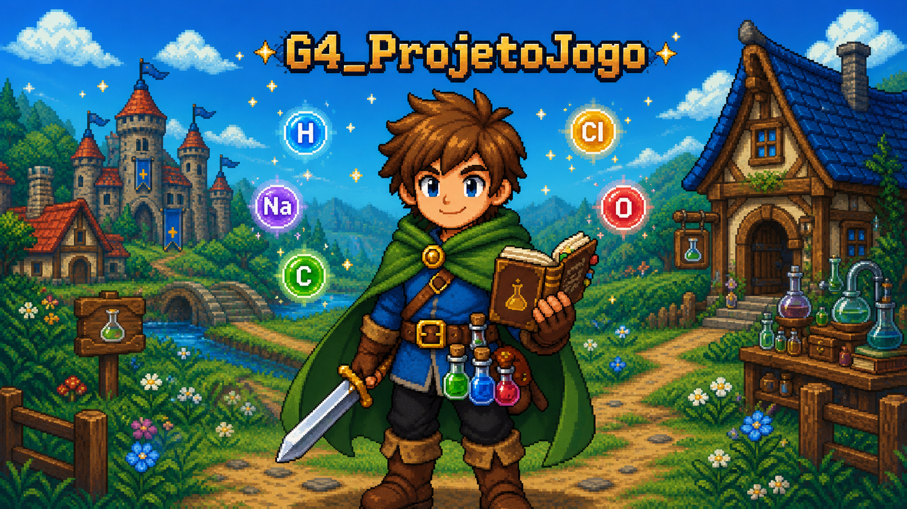

# G4_ProjetoJogo

<p align="center">
  
</p>

<p align="center">Figura 1: Identidade visual do G4_ProjetoJogo. Fonte: imagem gerada pelo GPT-5.6 Sol Alto (IA), 2026.</p>

**Código da Disciplina:** FGA0208: Arquitetura e Desenho de Software<br>
**Turma:** 01 · **Período:** 2026.2<br>
**Número do Grupo:** 04<br>
**Entrega:** 03 (Módulo Padrões de Projeto)

## Sobre

O **G4_ProjetoJogo** é um **RPG medieval 2D de mundo semiaberto**, com história linear e combate por turnos (referências: Final Fantasy clássicos e Undertale). Sua mecânica distintiva é a **mistura de elementos químicos** da tabela periódica: fora do combate, o jogador combina elementos coletados no mundo para criar itens, registrando as receitas descobertas no Livro do Aventureiro.

A identidade visual combina a estética de um RPG em pixel art com o aventureiro, o Livro do Aventureiro, os frascos e os símbolos de elementos químicos, representando a relação entre exploração, alquimia, criação de itens e combate.

Como convenção visual da documentação, a SubEquipe 01 é identificada por H, a SubEquipe 02 por C e a SubEquipe 03 por O. Os símbolos funcionam apenas como temas gráficos e não representam a divisão técnica das responsabilidades. Nas páginas gerais, Fe representa a ambientação medieval e a presença dos elementos químicos no jogo.

Detalhes completos em [Projeto](/Projeto/Projeto.md).

## Equipe

O grupo é formado por 10 integrantes, organizados em 3 subgrupos. A divisão foi feita por livre escolha dos integrantes.

| Matrícula | Aluno | Subgrupo |
|-----------|-------|:--------:|
| 23/2014404 | Carlos Henrique Brasil de Souza | 03 |
| 23/1026680 | Cibelly Lourenço Ferreira | 01 |
| 23/2013980 | Gabriel Andrade Magioli | 01 |
| 23/1027201 | João Igor Pereira da Costa | 02 |
| 22/1022604 | João Victor da Silva Batista de Farias | 02 |
| 21/1062179 | Marcelo de Araújo Lopes | 02 |
| 23/2014100 | Marcos Vinícius Gündel da Silva | 02 |
| 23/2014146 | Pedro Teixeira Moriel Sanchez | 03 |
| 22/2037764 | Renan Pereira Reis | 03 |
| 23/2014576 | Yogi Nam de Souza Barbosa | 01 |

<p align="center">Tabela 1: Integrantes do Grupo 04.</p>

## Subgrupos

Cada subgrupo é responsável por seu próprio relatório e por um foco da entrega. A entrega mínima de cada um é um padrão de projeto GoF da categoria do seu foco, com modelo na notação UML, código e vídeo com o padrão em execução, além dos pontos de vista dos membros sobre o uso de IA Generativa.

### Subgrupo 01

| Aluno | Matrícula |
|-------|-----------|
| Cibelly Lourenço Ferreira | 23/1026680 |
| Gabriel Andrade Magioli | 23/2013980 |
| Yogi Nam de Souza Barbosa | 23/2014576 |

<p align="center">Tabela 2: Integrantes do Subgrupo 01.</p>

Foco: **GoFs Criacionais & IA Generativa**.

Artefatos: [GoF Criacional](/Base/Relatórios/SubEquipe_01/GoFCriacional.md) · [IA Generativa](/Base/Relatórios/SubEquipe_01/IAGenerativa.md) · [Atas](/Atas/SubEquipe_01.md)

### Subgrupo 02

| Aluno | Matrícula |
|-------|-----------|
| João Igor Pereira da Costa | 23/1027201 |
| João Victor da Silva Batista de Farias | 22/1022604 |
| Marcelo de Araújo Lopes | 21/1062179 |
| Marcos Vinícius Gündel da Silva | 23/2014100 |

<p align="center">Tabela 3: Integrantes do Subgrupo 02.</p>

Foco: **GoFs Estruturais & IA Generativa**.

Artefatos: [GoF Estrutural](/Base/Relatórios/SubEquipe_02/GoFEstrutural.md) · [IA Generativa](/Base/Relatórios/SubEquipe_02/IAGenerativa.md) · [Atas](/Atas/SubEquipe_02.md)

### Subgrupo 03

| Aluno | Matrícula |
|-------|-----------|
| Carlos Henrique Brasil de Souza | 23/2014404 |
| Pedro Teixeira Moriel Sanchez | 23/2014146 |
| Renan Pereira Reis | 22/2037764 |

<p align="center">Tabela 4: Integrantes do Subgrupo 03.</p>

Foco: **GoFs Comportamentais & IA Generativa**.

Artefatos: [GoF Comportamental](/Base/Relatórios/SubEquipe_03/GoFComportamental.md) · [IA Generativa](/Base/Relatórios/SubEquipe_03/IAGenerativa.md) · [Atas](/Atas/SubEquipe_03.md)

## Navegação

| Seção | Conteúdo |
|-------|----------|
| [Projeto](/Projeto/Projeto.md) | Visão geral do jogo, ênfases e contexto da disciplina. |
| [Padrões de Projeto](/Base/1.PadroesDeProjeto.md) | Módulo Desenho de Software: focos da entrega, entrega mínima e relatórios das subequipes. |
| [Atas de Reunião](/Atas/Gerais.md) | Registro oficial das reuniões, separado em gerais e por subgrupo. |
| [Guias](/Guias/ArtefatoPadrao.md) | Modelos padrão de artefato e de ata adotados pelo grupo. |
| [Participações](/Base/1.2.ParticipacoesPadroesDeProjeto.md) | Quadro geral de participação com links de commits por integrante. |
| [Iniciativas Extras](/Base/1.3.IniciativasExtras.md) | Realizações da equipe além da entrega mínima, como padrões emergentes. |

<p align="center">Tabela 5: Navegação da documentação.</p>

A barra lateral oferece pesquisa textual em todas as páginas da documentação.

O rodapé **Ver também** acompanha a organização da barra lateral. Clique nas imagens para ampliá-las na própria página; use os botões de zoom, a roda do mouse ou a pinça no celular e arraste para mover a imagem.

## Screenshots da Terceira Entrega

*A preencher: adicione duas ou mais capturas dos artefatos realizados na entrega, como a modelagem UML de um padrão e o padrão em execução, com legenda e fonte.*

## Há algo a ser executado?

(X) SIM

( ) NÃO

A entrega inclui o código dos padrões de projeto, que deve ser demonstrado em execução. O código fica na pasta `src/` do repositório, e o manual de execução de cada padrão está descrito no [README de `src/`](https://github.com/UnBArqDsw2026-2-Turma01/2026.2-T01-G4_ProjetoJogo_Entrega_03/blob/main/src/README.md).

Para executar a documentação localmente, use o [Docsify](https://docsify.js.org/) a partir da pasta `docs/`:

```bash
npx docsify-cli serve docs
```

O site fica disponível em `http://localhost:3000`.

## Vídeos da Entrega

*A preencher: incorpore aqui o vídeo da apresentação e os vídeos dos padrões em execução, ou crie os links para as seções de vídeo de cada artefato.*

| Foco | Vídeo do padrão em execução |
|------|-----------------------------|
| GoF Criacional | [Seção de implementação da SubEquipe 01](/Base/Relatórios/SubEquipe_01/GoFCriacional.md?id=implementação-código-amp-vídeo-com-padrão-em-execução) |
| GoF Estrutural | [Seção de implementação da SubEquipe 02](/Base/Relatórios/SubEquipe_02/GoFEstrutural.md?id=implementação-código-amp-vídeo-com-padrão-em-execução) |
| GoF Comportamental | [Seção de implementação da SubEquipe 03](/Base/Relatórios/SubEquipe_03/GoFComportamental.md?id=implementação-código-amp-vídeo-com-padrão-em-execução) |

<p align="center">Tabela 6: Vídeos dos padrões em execução.</p>

## Informações Complementares

As entregas anteriores do grupo estão publicadas em repositórios próprios. A [documentação da Entrega 02](https://unbarqdsw2026-2-turma01.github.io/2026.2-T01-G4_ProjetoJogo_Entrega_02/) reúne as modelagens estática e dinâmica na notação UML que servem de base para os padrões aplicados nesta entrega.
